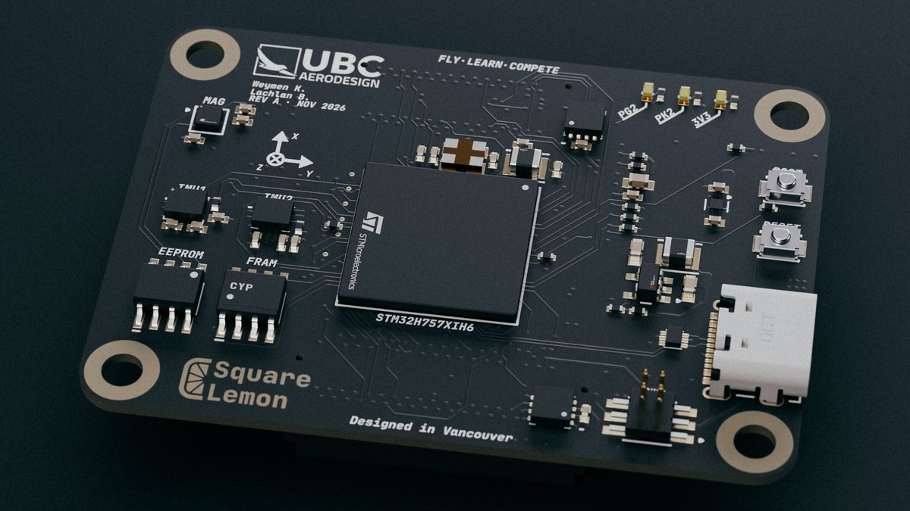
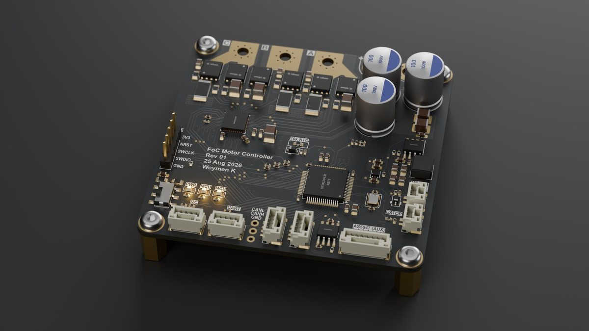
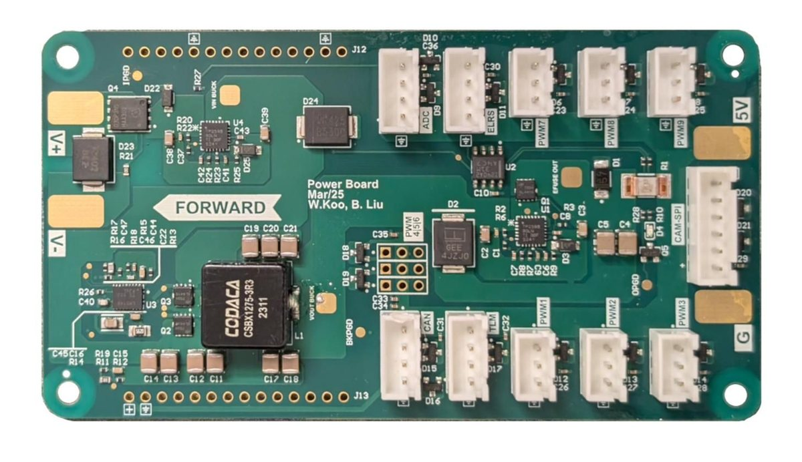
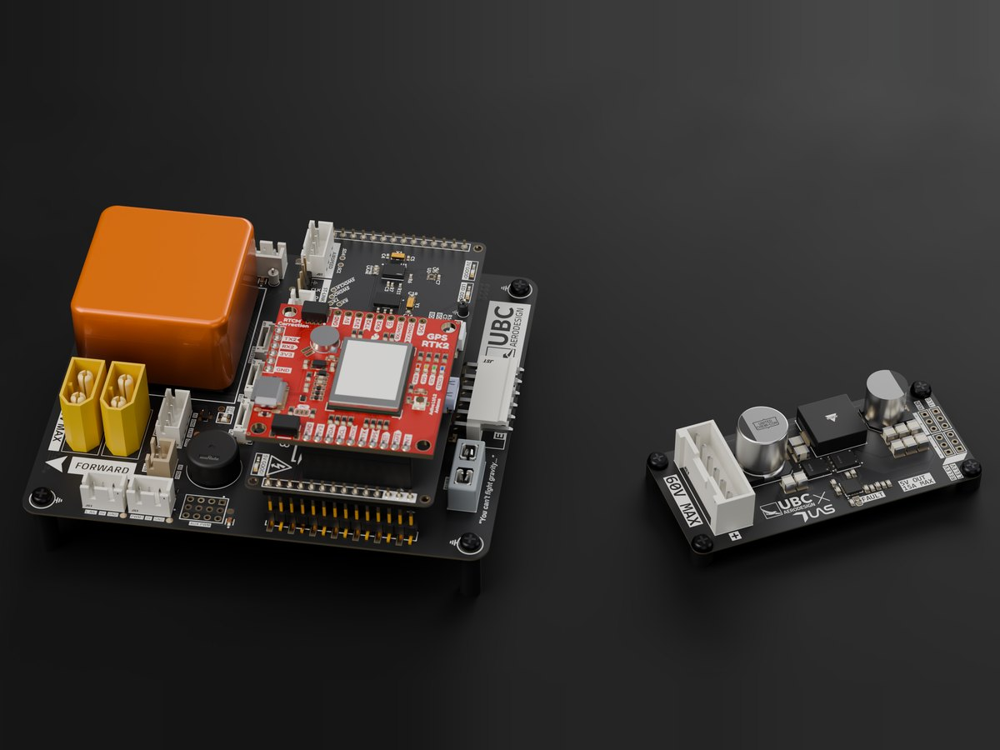
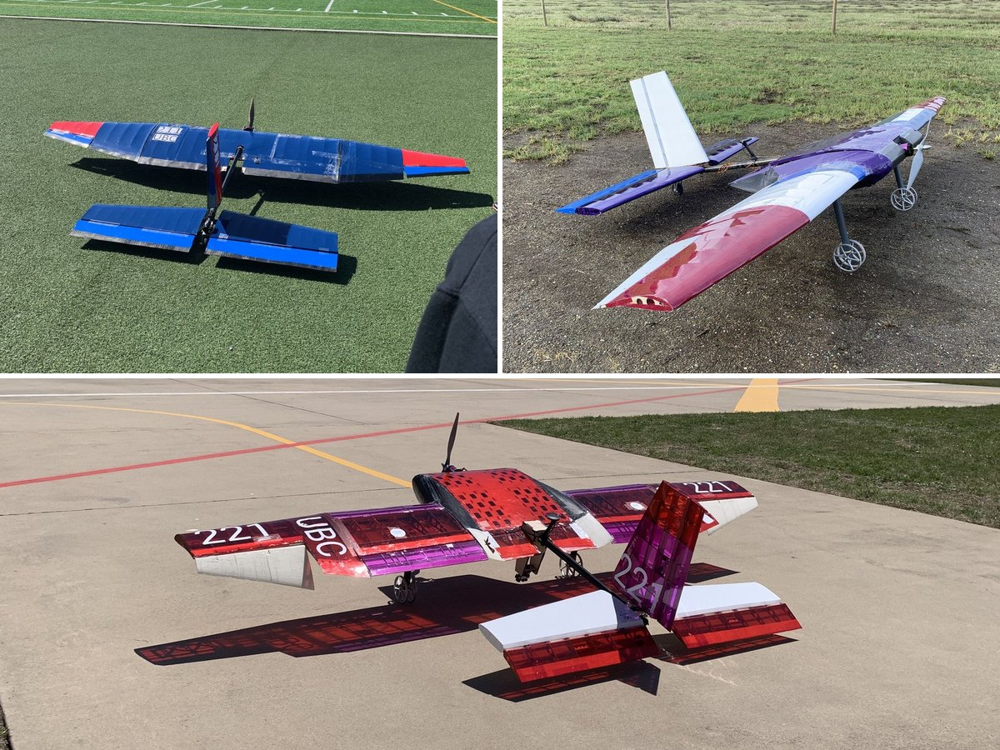

# Weymen Koo — personal site

Circuit boards, film photographs, and records: a day, from golden hour to night.

**Live:** https://weymenkoo.github.io/Personal-Site/

```
dusk/        the site itself: this folder is what gets published
tests/       Playwright tests (npm test)
tools/       scroll-profile.js, a frame-time profiler (npm run profile)
.github/     test + deploy workflow for GitHub Pages
```

<!-- tldr:start (generated by npm run tldr, do not edit by hand) -->

## Projects

The short version. Each title links to the full write-up on the site. Printable: **[portfolio.pdf](portfolio.pdf)**.

### [Flight controller SoM](https://weymenkoo.github.io/Personal-Site/content/projects/fc-som/index.html)



**Design complete** · 2026 · STM32H757 · 55 × 40 mm · 8 layers · ArduPilot

A flight-controller system-on-module for UBC AeroDesign. The STM32H757, two IMUs, two barometers, a magnetometer, FRAM and microSD sit on one module that plugs into a carrier board through two Hirose DF17 connectors. Rev A is design-complete and not yet fabricated.

### [FOC motor controller](https://weymenkoo.github.io/Personal-Site/content/projects/foc-controller/index.html)



**Bring-up** · 2026 · 12S bus · 10 A RMS · STM32G431 + DRV8323S · CAN-FD

A single-axis, sensored field-oriented-control motor controller for one joint of a cat-scale bipedal robot: 70 × 70 mm, 6 layers. Rev 1 is fabricated and partly bench-validated on a 12 V supply, with a motor identified and spun open-loop up to 1000 rpm.

### [AeroDesign power board](https://weymenkoo.github.io/Personal-Site/content/projects/power-board/index.html)



**Flown 2025** · 2025 · 2S–4S in · 5 V 15 A · LM5146 · 2 × TPS25983 · 6 layers

The power board for UBC AeroDesign's 2025 Advanced Class aircraft. It takes the flight battery and gives every servo, radio and sensor a protected 5 V rail, with eFuses on the input and the servo output, servo current sensing, and the flight controller plugged in on top.

### [Shadow: power distribution](https://weymenkoo.github.io/Personal-Site/content/projects/avionics-2024/index.html)



**Flown 2024** · 2024 · Wiring hub · 2 power modules · 5 V 15 A · ISL8117A · dual battery

The power distribution system for Shadow, UBC AeroDesign's 2023–24 Advanced Class aircraft: a wiring hub that carries the Cube Orange flight controller, and two custom 5 V, 15 A power modules with hot-swappable dual batteries and voltage and current sensing. Flown at SAE Aero Design West 2024 in Van Nuys, California.

### [Kyogre and Spirit](https://weymenkoo.github.io/Personal-Site/content/projects/kyogre-spirit/index.html)



**Flown once** · 2023 · 2 airframes · 120 in span · S1223 wing · NACA 0012 tail · balsa, ply and carbon fibre

Two seasons as mechanical lead for lifting surfaces and aerodynamics on UBC AeroDesign's Advanced Class team: Kyogre in 2021–22, then Spirit, a blended wing body built twice in 2022–23. The analysis behind Kyogre, then mostly photos: a crash, Spirit's one flight and two shipments lost by UPS.

<!-- tldr:end -->

## Editing

Each project is a folder under `dusk/content/projects/` with its images
and one Markdown file, `article.md`, which is the write-up. Edit that file
to change the article. The Projects section above and `portfolio.pdf` come
from each project's `entry.json`: after changing one, run `npm run tldr`.

Adding projects, photo rolls and records, writing an article, running it
locally, and deploying: see **[dusk/README.md](dusk/README.md)**.
