As the team's power and propulsion lead that season, I was mainly responsible for developing the power modules and the wiring hub: the backbone of the aircraft. *Shadow* flew in the Advanced Class of SAE Aero Design West 2024, at the Apollo XI RC Field in Van Nuys, California.

, carrying the Cube Orange, the sensor board and a SparkFun GPS-RTK2, and the tail power module (right). Rendered in Blender from the Altium STEP models and Gerbers.")

The goal was simple to state: custom power modules and a carrier board that power *Shadow*. It took three versions.


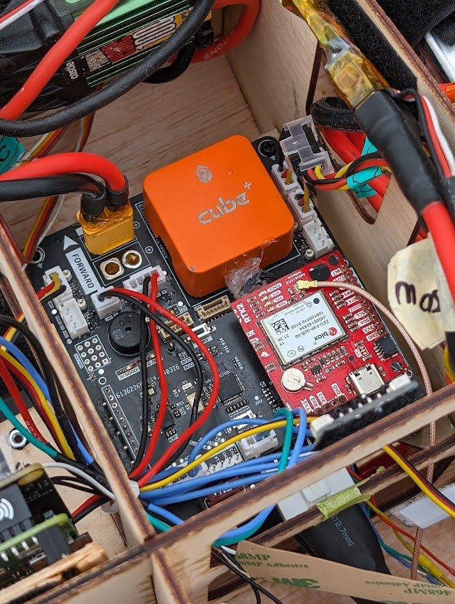

| | |
|---|---|
| Aircraft | *Shadow*, SAE Aero Design West 2024, Advanced Class, 7th of 14 |
| Boards | Wiring hub (4 layers) · main power module (castellated, soldered to the hub) · tail power module (2 layers) |
| Flight controller | CubePilot Cube Orange, on the wiring hub |
| Input | 2 × 4S LiPo (16.8 V), 7.4–20 V design range, hot-swappable |
| Output | 5 V, 15 A per power module |
| Buck | Renesas ISL8117A controller, Infineon BSC0702LS FETs, 3.3 µH, 600 kHz |
| Protection | Reverse-polarity P-FETs · ideal-diode OR · TVS and 0.1 µF on every connector · 2-second fuse |
| Sensing | Battery voltage and current, to the flight controller for telemetry |
| Tools | Altium Designer, fabricated and assembled by JLCPCB |


## The challenge

The SAE 2024 ruleset requires the aircraft to be powered by an unmodified propulsion circuit (motor battery, arming plug, power limiter, speed controller and motor) and a separate avionics circuit, powered by its own battery.

To make things more challenging, we decided to move away from off-the-shelf parts and design our own. The brief, from the avionics director:

<div class="ar-chat">
<span class="who">Avionics Director</span>
<span aria-hidden="true" class="typing"><i></i><i></i><i></i></span>
<div class="msg">Custom Electronics,<br>Hand Assembly,<br>Money is no issue,<br>Figure it out</div>
<span class="seen">Seen <b>✓✓</b><br>02:10 AM</span>
</div>

## Planning | Pulling the puzzle apart


Designing a whole system from scratch is undoubtedly a complex task. To manage it, I broke the problem down into subcategories, then further into primitive building blocks, so I could tackle them one at a time. The smaller solutions can then be combined into a larger system.


While the propulsion circuit's design was driven and constrained by the ruleset, the avionics power distribution system is more open-ended. That flexibility comes from the sensor and communication team's freedom to use various hardware to achieve the competition's goals. I identified five key items to address:

1. Power requirements
2. The hierarchy of connected devices
3. Connectivity and interfaces
4. Safety, redundancy and risks
5. Telemetry and monitoring

The overall avionics system can be summarized as a black box with its inputs and outputs: an on/off kill switch, two 16.8 V batteries and a 2.4 GHz ELRS receiver going in; ESC PWM, 900 MHz telemetry, a cellular video stream and MAVLink coming out. My job was to design a solution that connects these components and powers them effectively.

## Power budget | Worst case


The maximum battery discharge is 130 A, based on the battery's capacity and discharge rate. Each power module supplies 4 servos, usually with only 2 active at a time. Each servo can draw 2.5 A at stall, but that is unlikely, so typical consumption is lower. The Sankey diagram shows the current flows: where power is used most, and where there is room to optimize.

| Load | Current | Module |
|---|---|---|
| Cube Orange flight controller | `3.050 A` | Main |
| Cellular communication system | `4.000 A` | Main |
| Optical system | `0.660 A` | Main |
| Sensor system | `0.434 A` | Main |
| Left and right aileron servos | `2.500 A` each | Main |
| Left and right elevator servos | `2.500 A` each | Tail |
| **Total** | **`18.144 A`** of `30 A`, leaving `11.856 A` margin | |

## The power architecture of Shadow


The power system is built around a wiring hub with an integrated DC-DC controller, which supplies the devices near it: mainly the avionics inside the fuselage.

For the tail avionics, a second DC-DC controller is daisy-chained from the wiring hub to extend the power distribution.

Only the PWM signal and DC common connect to the power limiter in the propulsion circuit. This way the PWM duty cycle is throttled at 750 W, keeping the propulsion system within its power limit.

## Detailed design | The wiring hub


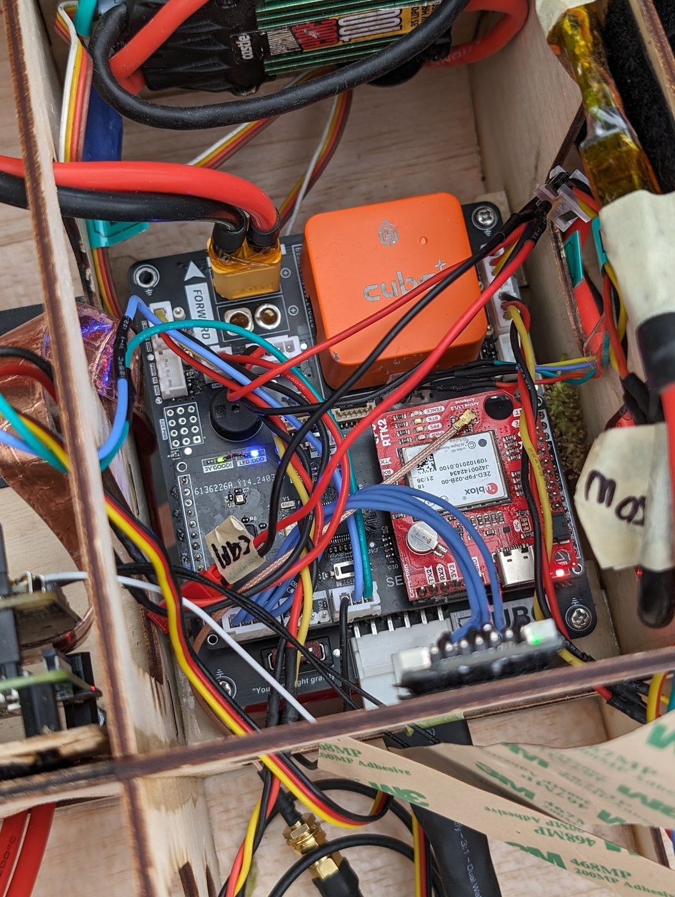

The main design considerations for the wiring hub were:

- Every connector must stay easy to reach, even with the hub installed in the aircraft.
- It houses the main sensor board and the flight controller, and distributes power from the DC-DC controller.
- The DC-DC controller is soldered to the bottom of the hub.

These kept the system compact, efficient and easy to maintain.

 and the tail power module (right), joined by the six-wire tail harness.")

On the hub: the flight controller module interface, B2B headers for the sensor board, the LiPo battery input through a 2-second fuse, the servo connections, 4 PWM signals and power for the tail power module, and an LED and buzzer for flight controller status.


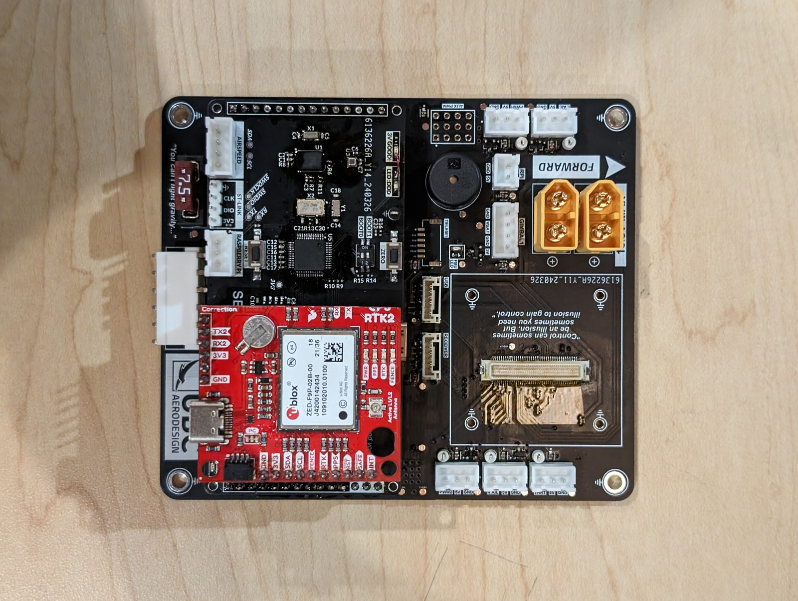

### The Cube Orange module


I studied the Cube Orange documentation carefully, identified the relevant I/O pins and broke them out. From that, I implemented these functions for the flight control system:

| Interface | Priority |
|---|---|
| 14 PWM channels · ELRS radio receiver | Mission critical |
| USB for configuration and monitoring · 900 MHz radio for wireless configuration and monitoring | Required, but won't cause a failure |
| Status LED and buzzer · battery monitoring | Good to have |

### I/O protection


To improve reliability, I put 0.1 µF filtering capacitors on every connector's supply. These low-ESL capacitors were added to mitigate EMI, although I couldn't validate their impact, which I suspect was minimal.

TVS diodes were added across every connector to protect against ESD, which was especially likely during winter. Both the filtering capacitors and the TVS diodes match the parts on the manufacturer's own carrier board.

### Fuse

I chose the Littelfuse 0297005, with the trip time set, somewhat arbitrarily, to under 2 seconds. I did account for temperature derating:

- Texas weather
- The airframe's low albedo
- Extra heat from the other onboard electronics

In hindsight, using a fuse was a design flaw: it is a single point of failure in the power system. A more robust protection method, such as redundant circuitry or self-resetting devices, would have been a better choice.

### PCB layout

The hub is a 4-layer board, built to JLCPCB's design rules. The top and bottom layers carry the digital signals and the power traces; the middle two layers are dedicated ground planes.

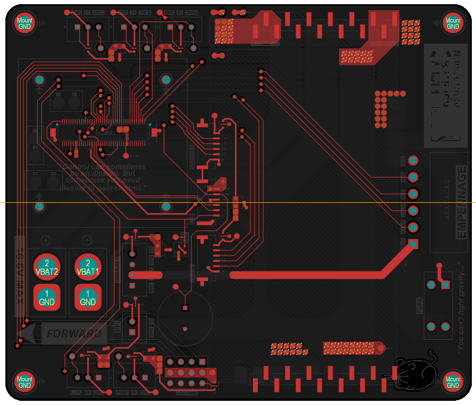
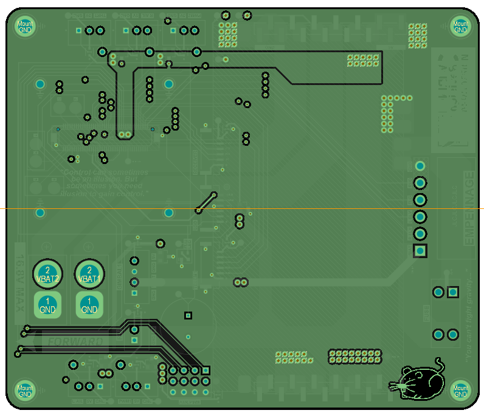

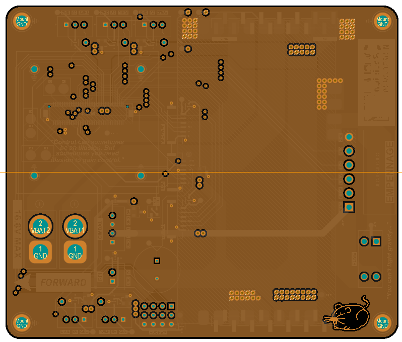
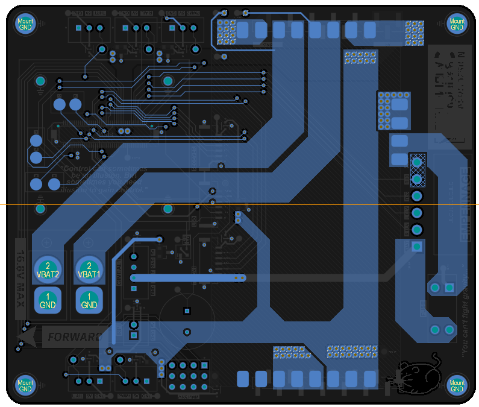

## Detailed design | The power modules


The power module has a castellated board edge, so it solders directly onto the wiring hub. The main module has the DC-DC buck controller, the input protection circuitry and dual redundant batteries for longer on-time. It also has current and voltage sensing for telemetry.

The same design was used for a second module that powers the servos at the tail. This takes load off the main module, and puts the converter closer to its load. PWM signals and power reach the tail module through a wire harness.

Each module has:

1. **Dual battery input:** reverse-polarity protection and an ideal-diode OR.
2. **Battery pass-through**, so units can be daisy-chained.
3. **Voltage and current sensing.**
4. **DC/DC controller:** 5 V out, 15 A maximum.

## Buck converter | ISL8117A, 5 V, 15 A

The detailed design of the buck converter closely follows the ISL8117A datasheet and Texas Instruments' design guides. I chose the IC mainly for its price (`$0.96` per unit at JLCPCB): at the time I didn't have the experience to make a more informed choice, and picked the first option that stood out.

I then defined the key parameters that govern the design of the power stage:

| Design input | Value |
|---|---|
| Input voltage, minimum | `7.4 V` (2S LiPo) |
| Input voltage, maximum | `20 V` (4S LiPo, with margin) |
| Output voltage | `5 V` |
| Output current, maximum | `15 A`, from the power budget |

### Inductor

The inductor value follows the datasheet's recommendation: `3.3 µH`, the same as the ISL8117A evaluation board. The resulting ripple current, `1.9326 A`, is within the typical range of 30–70 % of the output.

```
ΔI_L = V_OUT × (V_IN(max) − V_OUT) / (V_IN(max) × f_S × L)
```

A higher inductance gives a higher maximum output current, because the ripple current is smaller. A lower inductance gives a smaller solution.

### Maximum switch current

The output current is set by the switching frequency, the IC's maximum output current and its duty cycle, which together keep the system within its limits.

| | Value |
|---|---|
| Switching frequency | `600 kHz` (`RT` tied to `VCC5V`) |
| Maximum duty cycle | `0.2551` |
| Maximum output current of the selected IC | `24.0337 A` |
| Peak switch current | `15.9663 A`: what the inductor, the switches and the external diode have to withstand |

If the IC's maximum output current had come out below the required output current, the switching frequency would have had to go up.

### Output capacitor

The output capacitor was sized mainly for the load transient response. Most values were estimates, based on assumptions. I chose `330 µF` (aluminium electrolytic, EEE-FK1V331P), within the datasheet's recommended 100–680 µF, and back-calculated the expected voltage deviation to make sure it stayed in an acceptable range:

| | |
|---|---|
| Load step, I<sub>TRAN</sub> | `5 A`: two servos stalling |
| Output deviation, ΔV<sub>OUT</sub> | `±10.5932 mV` |

Compared against the datasheet's typical characteristics and our scope captures, it looked reasonable. It could be validated further with a dynamic electronic load, which we didn't have.

### MOSFETs

The MOSFETs were chosen by the datasheet's guidelines. The main criteria for the high-side and low-side FETs were rated voltage, continuous current, low R<sub>DS(on)</sub>, price and availability. Both are Infineon BSC0702LS:

| Parameter | Value |
|---|---|
| R<sub>DS(on)</sub> at V<sub>GS</sub> = 4.5 V, 25 °C | `2.7 mΩ` |
| Gate threshold voltage | `1.7 V` |
| Q<sub>gtotal</sub> at V<sub>GS</sub> = 4.5 V | `30 nC` |
| Q<sub>gd</sub> at V<sub>GS</sub> = 4.5 V | `11 nC` |
| Gate resistance | `1.95 Ω` |
| Input / output / reverse-transfer capacitance | `4400` / `890` / `58 pF` |
| Thermal resistance, junction to ambient | `1.5 °C/W` |
| Price | `$0.546` each |

### Power loss

These parameters went into the buck controller's design calculator to estimate the losses:

```
P_UPPER = I_O² × r_DS(on) × V_OUT / V_IN  +  I_O × V_IN × t_SW × f_SW / 2
P_LOWER = I_O² × r_DS(on) × (V_IN − V_OUT) / V_IN
```


The high-side FET sees mostly switching losses; the low-side FET mostly conduction losses. In the worst case, at maximum load, the losses looked acceptable. Realistically, our system is unlikely to see conditions that extreme.

### Other features

The datasheet's other features are summarized below. To optimize the design further, each of these could be analysed in more detail for its effect on the power module's performance.

| Feature | Setting |
|---|---|
| Adaptive dead time | `16 ns`, no resistor between `UGATE` and `LGATE` |
| Internal bootstrap diode | C<sub>BOOT</sub> = `220 nF` |
| Undervoltage lockout | `3.9 V` rising, `3.5 V` falling |
| Overcurrent protection | `190 %` of nominal current |
| Overvoltage protection | `121 %` of nominal output |
| Power-good indicator | Used |
| Enable and soft-start | Unused |

Reference: [ISL8117A datasheet](https://www.renesas.com/en/document/dst/isl8117a-datasheet?r=1395776).

### The final schematic


## Monitoring | Sensing and input protection

### Voltage sensing

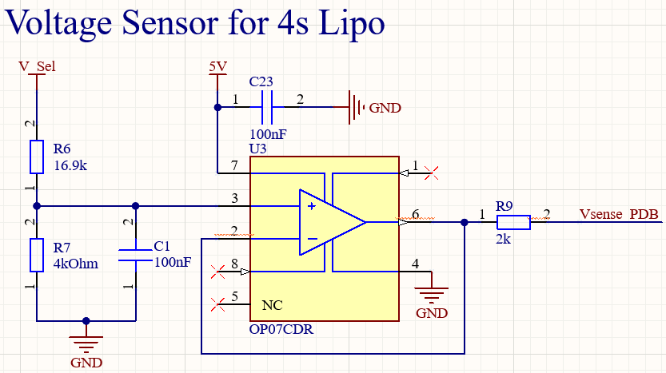

The voltage sensor uses a divider to scale down the input voltage. A buffer sits between the divider and the ADC to prevent an impedance mismatch: without it, the ADC could load the divider and give inaccurate readings.

The buffer has a high input impedance and a low output impedance, so the divider isn't affected by the ADC's input characteristics. When sizing the divider, the impedance should be high enough to keep the current draw low, but low enough to drive the ADC input reliably: usually a few kΩ.

| | |
|---|---|
| R1 / R2 | `16.9 kΩ` / `4 kΩ` (`20.9 kΩ` total) |
| Fully charged 4S, `16.8 V` | `3.2153 V` out |
| Discharged 4S, `12.8 V` | `2.4498 V` out |

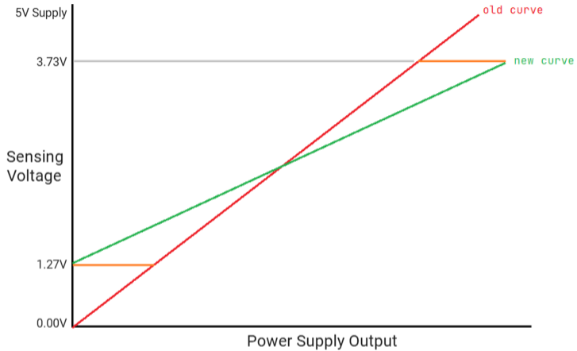

The OP07's output only swings reliably to within ±2 V of its supply, and the measured minimum was `1.27 V`, which limits the range. The possible fixes:

- [ ] Replace the buffer with a rail-to-rail MCP6001
- [ ] Change the divider ratio to use more of the ADC range
- [x] Leave it as is: it's good enough for practical use

With the 12-bit ADC and its 3.6 V reference, the resolution is `0.879 mV` per bit, giving `871` counts to track the battery from fully charged to dead. That's enough granularity for our application.

### Current sensing


I chose the MAX4080 as the current-sense amplifier, with a 3 mΩ shunt. The calculations confirmed that even at maximum load, the design stays within the datasheet's ratings.

| | |
|---|---|
| Current-sense amplifier | MAX4080SAUA+, gain `60 V/V`, `4.5–75 V` |
| Shunt | `3 mΩ`, `3 W` |
| Maximum load | `15 A` |
| Sense voltage at 15 A | `45 mV` (the amplifier's full scale is 100 mV) |
| Output at 15 A | `2.7 V` |
| Shunt dissipation at 15 A | `0.675 W` |

### Input protection

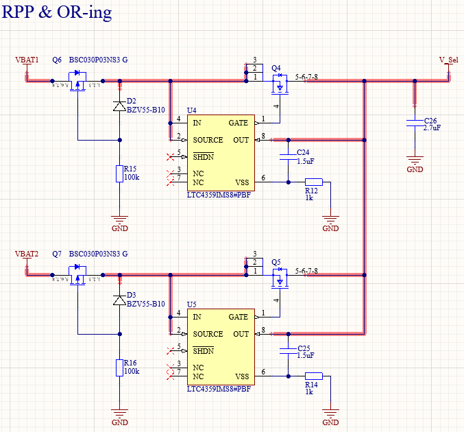

The reverse-polarity and diode-OR circuit was added at the software team's request, to keep the system running while idle. It makes the batteries hot-swappable: one battery can charge while the other powers the avionics.

- Q6 and Q7 are P-channel FETs, for reverse polarity.
- Q4 and Q5 are the same FETs as the DC/DC controller's high and low side.
- The circuit follows the LTC4359 application examples.

The circuit worked as intended, but it had limits. The expensive IC was underused: many of its built-in protection features weren't used. In hindsight, I would redesign it to protect both the input and the output of the power module, for better cost and reliability. The list I made afterwards:

- Choose a cheaper OR controller.
- Replace D2 and D3 with Zener diodes.
- Use the built-in reverse-polarity protection, though reverse polarity is unlikely.
- Add overvoltage and overcurrent protection.
- Or redesign the protection circuits completely.

## PCB layout | The power module

, the switch node kept small, analog circuits kept away from it, and the PGND vias close to the low-side FET.")

The buck controller's layout follows the datasheet's guidelines, plus Texas Instruments' reference designs and application notes (SNVA803, SNVSBV0A).

The pulsating current paths don't just radiate magnetic fields; they also cause high-voltage ringing and spikes across the PCB traces and the MOSFETs. To minimize the PCB inductance, this pulsating current loop, the *hot loop*, should be laid out with the shortest, widest traces, to keep its circumference small. Other considerations:

- The input power copper could have been wider.
- The controller is placed close to the power stage.
- The switch-node copper area is kept small.
- The PGND vias sit close to the source of the low-side FET.
- The analog circuits are kept away from the switch node.
- On this 2-layer board, the return path is `0.32 mm` away, through the dielectric. For tight coupling and low power-loop impedance it should be `0.15 mm`, which needs a multilayer stackup.

The final design is a 2-layer board, with no special stackup requirement, following JLCPCB's capabilities.

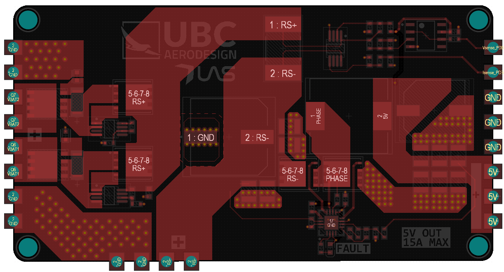
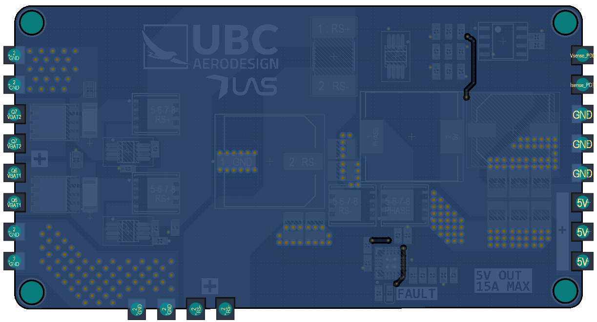

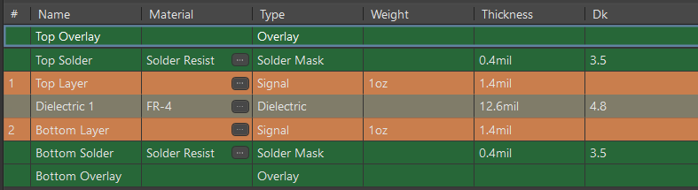

## Nobody said it was easy

### December 2023: a short

We assembled the first boards ourselves. One of them had a short on it, and the cause was a 0 Ω resistor we forgot to leave off.

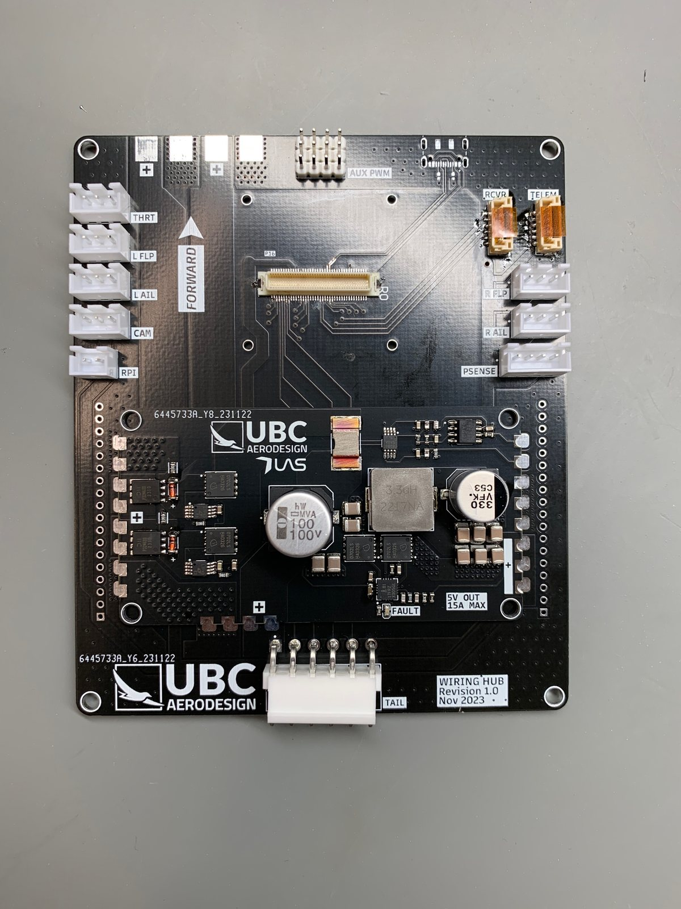
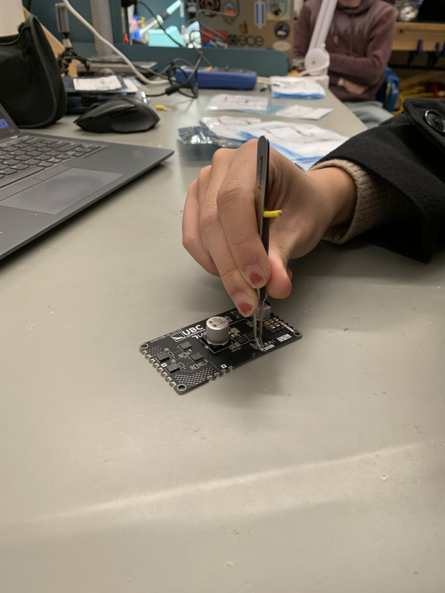
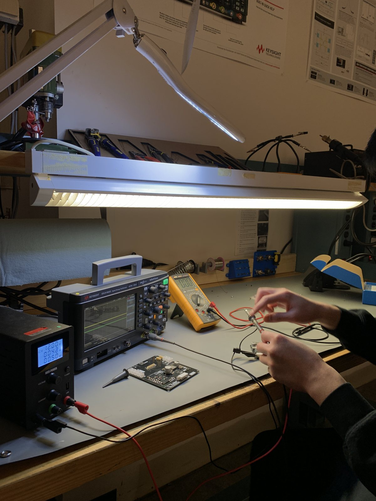


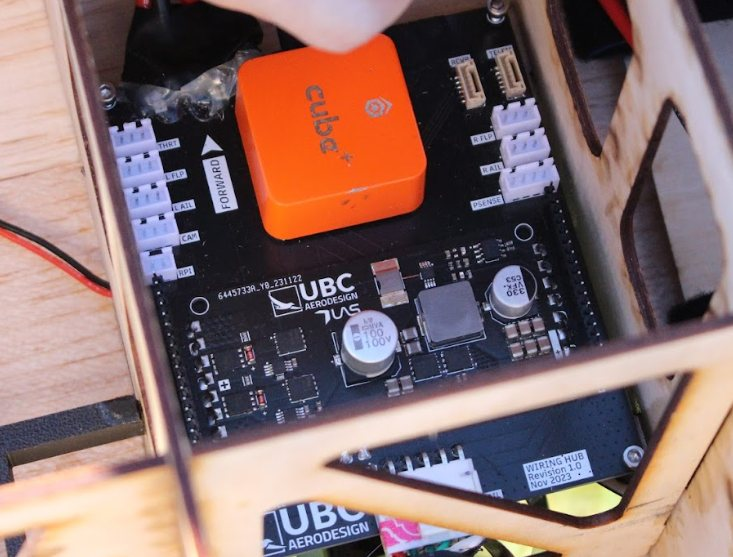

During test flights and the competition, several design flaws became apparent. The most critical were:

- **Poor connector choices**, which caused reliability problems.
- **A suspected shoot-through event** that irreparably damaged the tail servos. The root cause was never conclusively identified.

Other issues:

- The buck controller IC was running low on stock.
- No output protection.
- The ICs' built-in features were underused.
- No datalog for troubleshooting, and no test points.
- Better test equipment was needed to validate the design.

These failures, and the other limits, became the lessons that shaped the redesign of the power distribution system for the following year.

## Things worked | SAE Aero Design West 2024


Official overall results, SAE Aero Design West 2024, Advanced Class:

| | |
|---|---|
| Place | 7th of 14 ranked teams |
| Design report | `37.3505` |
| Presentation | `37.8500` |
| Mission | `0.0000` |
| Total | `75.2005` |

Source: [SAE Aero Design West 2024, Overall Results, Advanced Class (PDF)](https://www.saeaerodesign.com/content/2024_AeroDesignWest_Overall_Advanced.pdf), generated 14 April 2024.

## Future plans | Going back to the start


The plan for the next power distribution system focuses on reliability, fault detection and protection.

Designing a buck converter has become a more routine process: many manufacturers offer comprehensive design tools and calculators. So the emphasis can shift to I/O protection. That means hot-swap controllers to guard against overcurrent, overvoltage and dead shorts, and ideal diodes to block reverse current and reverse voltage spikes, especially near inductive loads.

At the input, the LM5050 is a widely used IC for OR-ing, and its datasheet has detailed guidelines for adding more protective features.

Finally, a low-power buck converter can power the systems with lower, steadier demand, and a load switch can shut it down to save battery.

### System test plan


This flowchart is a high-level test plan for the revised power distribution system. It should have been done for this system too, to fully characterize its performance and have quantitative metrics as a benchmark.

The tests run from input to output, module by module, from least to most destructive. Then a full system load test validates the initial design parameters. The plan is not comprehensive, but drawing it out helped: I realized the low-power DC/DC converter probably needs overcurrent protection, if it isn't built in. Test 11 can use temperature feedback to prove the system won't blow up under stress.

## Evaluation | Did I address the challenge?

Whether this was an appropriate solution depends on how you look at the problem.

From a purely competitive standpoint, it wasn't effective: we should have used off-the-shelf parts for maximum reliability and less overhead.

From an engineering standpoint, it isn't the best design, given my limited know-how at the time and the lack of equipment to verify it.

But from a student's perspective, we did a pretty good job. We were probably the only team that made custom electronics, we made the challenge harder for ourselves, and things worked.

<div class="ar-gbu">
<div class="good"><b>The good</b><ul><li>Student competition, not a business</li><li>Only team that pursued custom electronics</li><li>Challenged, and things worked technically</li></ul></div>
<div class="bad"><b>The bad</b><ul><li>Placed 7th overall</li><li>Expensive; cost optimization</li><li>High risk</li><li>Unpopular amongst other subteams</li></ul></div>
<div class="ugly"><b>The ugly</b><ul><li>Risk mitigation</li><li>FMEA</li><li>Comprehensive system test plan</li><li>Hardware design</li><li>Mechanical integration</li><li>Validate and verify</li></ul></div>
</div>

The next season's power system started from these lessons: [the 2025 power board](../power-board/index.html).
