*Shadow* was UBC AeroDesign's entry in the Advanced Class of SAE Aero Design West 2024, flown at the Apollo XI RC Field in Van Nuys, California. Its power distribution system is two kinds of board: a **wiring hub** that carries the flight controller and every connection in the plane, and **power modules** that turn the flight batteries into a 5 V, 15 A rail for the servos and electronics.

, with the Cube Orange, the sensor board and a SparkFun GPS-RTK2 stacked on it, and the tail power module (right). Rendered in Blender from the Altium STEP models and Gerbers.")

**Result:** *Shadow* placed **7th of 14** ranked teams in the Advanced Class, with `75.20` points. By the team's own review, it was the only team that pursued custom electronics.

| | |
|---|---|
| Aircraft | *Shadow*, SAE Aero Design West 2024, Advanced Class, 7th of 14 |
| Boards | Wiring hub (4 layers) · main power module (soldered to the hub) · tail power module (2 layers) |
| Flight controller | CubePilot Cube Orange, on the wiring hub |
| Input | 2 × 4S LiPo (16.8 V), 7.4–20 V design range |
| Output | 5 V, 15 A per power module |
| Buck | Renesas ISL8117A controller, BSC0702LS FETs, 3.3 µH, 600 kHz |
| Protection | Reverse-polarity P-FETs · ideal-diode OR between the batteries · TVS and 0.1 µF on every connector · 2-second fuse |
| Sensing | Battery voltage (divider + buffer) and current (3 mΩ shunt, MAX4080) to the flight controller |
| Tools | Altium Designer, fabricated and assembled by JLCPCB |

Custom power modules and carrier board, in three versions:

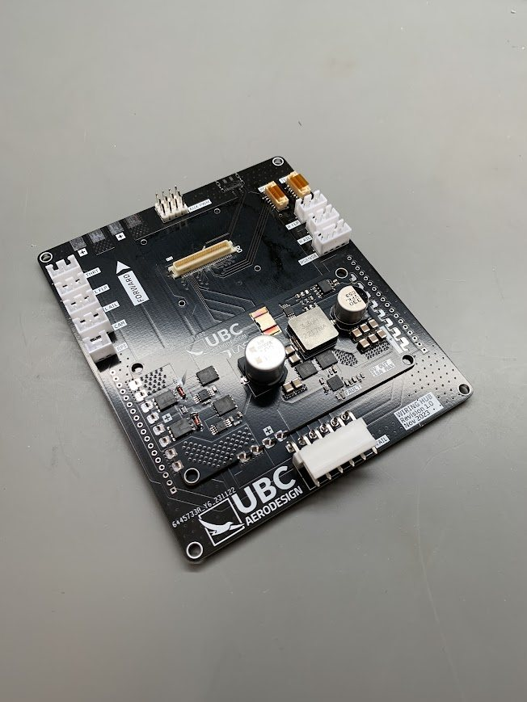

## The challenge

The SAE Aero Design 2024 rules define part of the electrical system: the receiver and motor batteries, the arming plug, the power limiter and the speed controller. The rest, the avionics system, is left to the team.

The brief from the team's avionics director:

Avionics Director
<i></i><i></i><i></i>

Custom Electronics, Hand Assembly, Money is no issue, Figure it out

Seen <b>✓✓</b> 02:10 AM

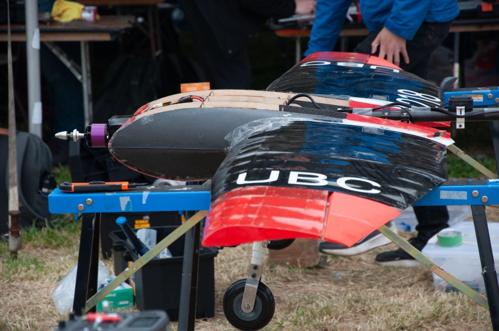

## Pulling the puzzle apart

The job is to distribute power for a 750 W aircraft. It splits into two systems:

| | Propulsion (high power) | Avionics (low power) |
|---|---|---|
| What it covers | Motor and ESC selection, the required arming plug and 750 W hardware power limiter, a 6-cell (22.2 V) LiPo of at least 3000 mAh, 25C | Power requirements, the hierarchy of connected devices, connectivity and interfaces, safety and redundancy, telemetry and monitoring |
| Constraints | Mostly fixed by the rules and the mechanical team's requirements | An open-ended problem, with full design freedom |

This project is the avionics side. The parts that needed to connect together: an on/off kill switch, two 16.8 V batteries, a 2.4 GHz ELRS receiver, ESC PWM, a 900 MHz telemetry radio, a cellular video stream and MAVLink.

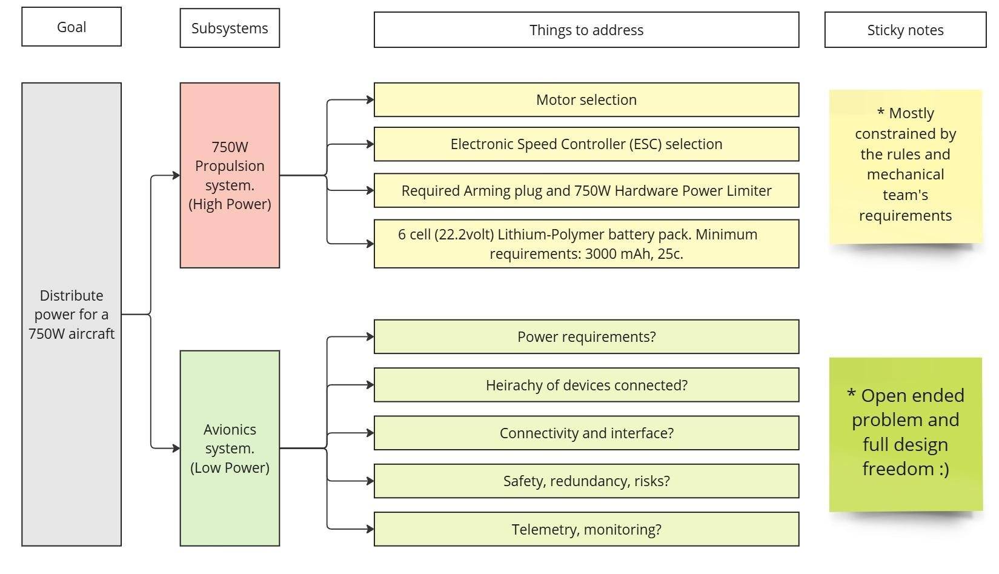

### Power budget

Worst case, each of the two power modules is sized for 15 A from a 4-cell LiPo.

| Load | Current | Module |
|---|---|---|
| Cube Orange flight controller | `3.050 A` | Main |
| Cellular communication system | `4.000 A` | Main |
| Optical system | `0.660 A` | Main |
| Sensor system | `0.434 A` | Main |
| Left and right aileron servos | `2.500 A` each | Main |
| Left and right elevator servos | `2.500 A` each | Tail |
| **Total** | **`18.144 A`** of `30 A`, leaving `11.856 A` margin | |

## Power architecture

- **Propulsion**, isolated from the avionics: a 22 V battery, a high-side arming switch, current and voltage sensing, the 750 W PWM power limiter, the ESC and the motor.
- **Wiring hub:** two 16 V batteries, each through reverse-polarity protection, into an ideal-diode OR controller. After current and voltage sensing, the bus feeds the DC/DC controller, whose 5 V supplies the Cube Orange, the ailerons, the radio receiver, the payload drop, the data collection system and the RFD900 telemetry radio.
- **16 V pass-through:** the battery bus also goes straight through to the camera system and to the tail module.
- **Tail module:** its own DC/DC controller makes 5 V for the left and right elevators, the rudders and the landing gear. The Cube sends it 4 PWM signals.

## Wiring hub | Overview

 and the tail power module (right), joined by the six-wire tail harness.")

The wiring hub is the carrier board for the flight controller. Every connection in the plane goes through it:

- **Flight controller interface:** the Cube Orange plugs into the hub.
- **B2B headers:** the sensor board's interface.
- **LiPo battery in**, through a **2-second fuse**.
- **Servo connections**, and **4 PWM signals plus power to the tail power module**.
- **LED and buzzer** for flight controller status.
- **The main power module**, soldered to the bottom side.

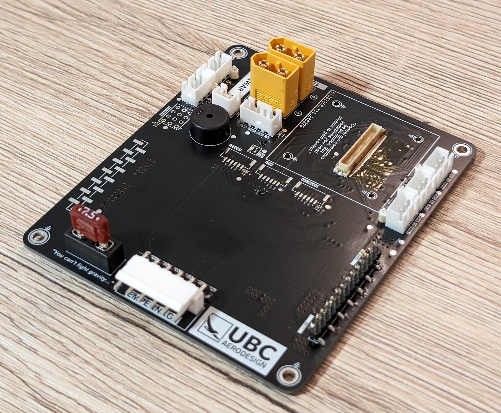

### What the Cube Orange needs

| Interface | Priority |
|---|---|
| 14 PWM channels · ELRS radio receiver | Mission critical |
| USB for configuration and monitoring · 900 MHz radio for wireless configuration and monitoring | Required, but won't cause a failure |
| Status LED and buzzer · battery monitoring | Good to have |

### PCB layout

Four layers. The top layer carries vertical signals, test points, connectors, indicator LEDs and indicator silkscreen. The bottom layer carries horizontal signals, the high-power traces and spare GPIO.

## I/O protection | Filtering, TVS and the fuse

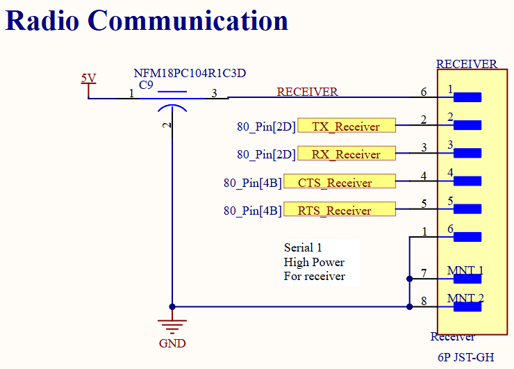

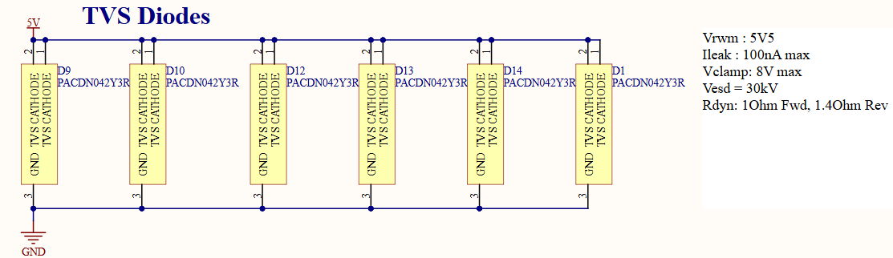

- **0.1 µF filtering capacitors at every connector's supply:** low-ESL parts, to mitigate EMI. Their effect could not be validated, and is expected to be small.
- **TVS diodes on every connector:** ESD was likely during winter.
- Both were also on the flight controller manufacturer's own carrier board.

**Fuse (Littelfuse 0297005).** The trip time was chosen, somewhat arbitrarily, to be under 2 seconds. It was derated for temperature: hot weather, an airframe with low albedo, and heat from the other electronics. In the review afterwards: the fuse should not have been used at all, because it is a single point of failure.

## Power modules | Overview

There are two power modules: the **main power module**, soldered to the wiring hub, and the **tail power module**, which supports 4 servos. Each has:

1. **Dual battery input:** reverse-polarity protection and an ideal-diode OR.
2. **Battery pass-through**, so units can be daisy-chained.
3. **Voltage and current sensing.**
4. **DC/DC controller:** 5 V out, 15 A maximum.

## Buck converter | ISL8117A, 5 V, 15 A

The controller is a Renesas ISL8117A synchronous buck controller, chosen partly on price: `$0.96` per unit at JLCPCB.

| Design input | Value |
|---|---|
| Input voltage, minimum | `7.4 V` (2S LiPo) |
| Input voltage, maximum | `20 V` (4S LiPo, with margin) |
| Output voltage | `5 V` |
| Output current, maximum | `15 A`, from the power budget |

| Result | Value | Note |
|---|---|---|
| Inductor | `3.3 µH` | The same as the ISL8117A evaluation board; ripple-current ratio is usually 30–70 % |
| Inductor ripple current | `1.9326 A` | |
| Switching frequency | `600 kHz` | `RT` tied to `VCC5V` |
| Maximum duty cycle | `0.2551` | |
| Maximum output current of the IC | `24.0337 A` | Must be above the required 15 A, or the frequency has to rise |
| Peak switch current | `15.9663 A` | What the inductor and the FETs have to withstand |
| Output capacitor | `330 µF` aluminium electrolytic (EEE-FK1V331P) | Datasheet recommends 100–680 µF |
| Output deviation on a load step | `±10.5932 mV` | For a `5 A` step: two servos stalling |

**MOSFETs:** Infineon BSC0702LS for both the high and low side. RDS(on) `2.7 mΩ` at VGS 4.5 V, total gate charge `30 nC`, threshold `1.7 V`, `$0.546` each.

**Controller features used:**

| Feature | Setting |
|---|---|
| Adaptive dead time | `16 ns`, no resistor between `UGATE` and `LGATE` |
| Internal bootstrap diode | CBOOT = `220 nF` |
| Undervoltage lockout | `3.9 V` rising, `3.5 V` falling |
| Overcurrent protection | `190 %` of nominal current |
| Overvoltage protection | `121 %` of nominal output |
| Power-good indicator | Used |
| Enable and soft-start | Unused |

**Layout:** two layers, following JLCPCB's standard capabilities with no special stackup. The power stage follows TI's layout guides SNVA803 and SNVSBV0A.

## Monitoring | Voltage, current and input protection

### Battery voltage

A 16.9 kΩ / 4 kΩ divider scales the battery down for the flight controller's ADC, through an OP07 buffer:

| Battery | Sense output |
|---|---|
| Fully charged 4S, `16.8 V` | `3.2153 V` |
| Discharged 4S, `12.8 V` | `2.4498 V` |

The OP07 is not rail-to-rail, and its measured minimum output was `1.27 V`. The options considered:

- [ ] Replace the buffer with a rail-to-rail MCP6001
- [ ] Change the divider ratio
- [ ] Map the output to use the full ADC range
- [x] Do nothing, it's good enough

With the 12-bit ADC, the resolution is `0.879 mV` per bit, which leaves `871` ADC counts between a fully charged and a dead battery.

### Current

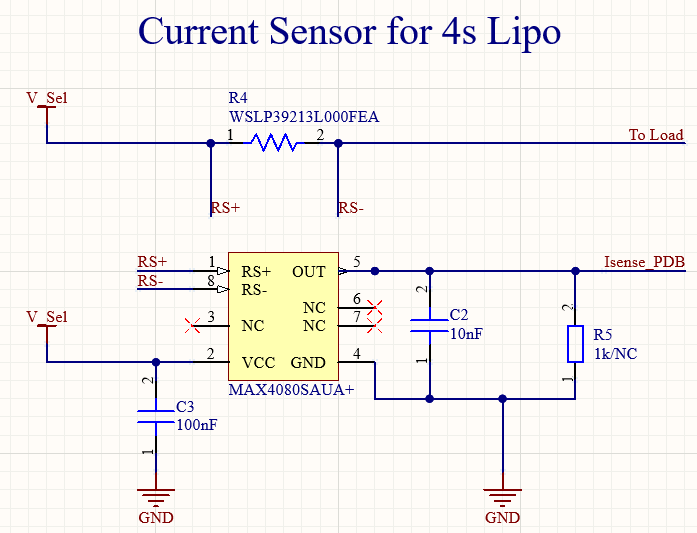

| | |
|---|---|
| Current-sense amplifier | MAX4080SAUA+, gain `60 V/V`, `4.5–75 V` |
| Shunt | `3 mΩ`, `3 W` |
| Maximum load | `15 A` |
| Sense voltage at 15 A | `45 mV` (the amplifier's full scale is 100 mV) |
| Output at 15 A | `2.7 V` |
| Shunt dissipation at 15 A | `0.675 W` |

### Reverse polarity and OR-ing

- **Reverse polarity:** a P-channel FET on each battery input (Q6, Q7).
- **OR-ing:** an LTC4359 ideal-diode controller per battery, with Q4 and Q5 the same FETs as the buck stage. The circuit follows the LTC4359 application examples.

What to change, from the review afterwards: a cheaper OR controller; Zener diodes for D2 and D3; using the controller's built-in reverse-polarity protection; adding overvoltage and overcurrent protection; or redesigning the protection circuits completely.

## Nobody said it was easy

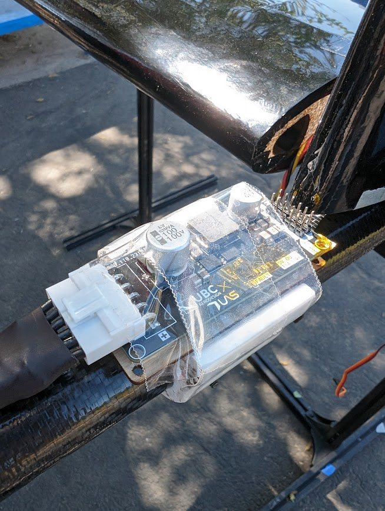
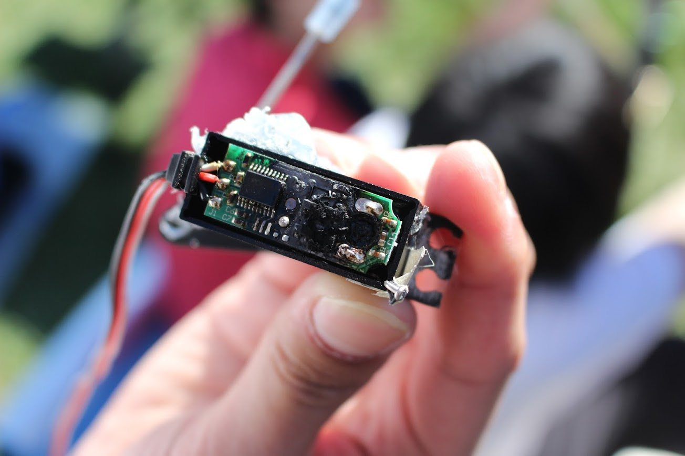

Other issues:

- The buck controller IC was running low on stock.
- No output protection.
- Built-in features of the ICs were underused.
- No datalog for troubleshooting, and no test points.
- Better test equipment was needed to validate the design.

## Things worked | SAE Aero Design West 2024

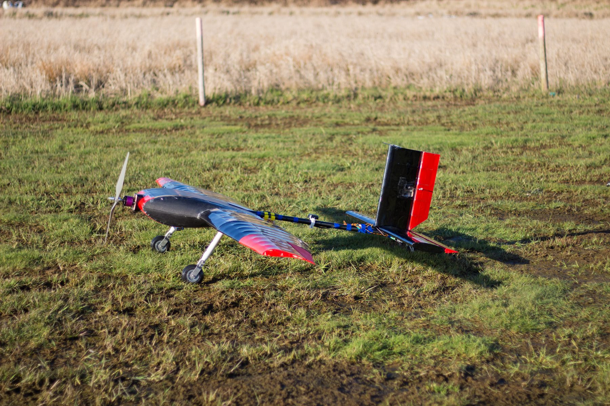

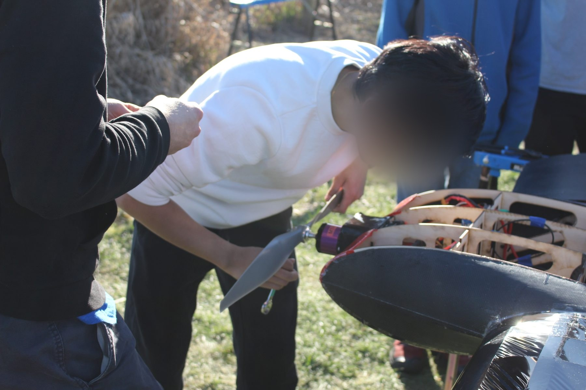

Official overall results, SAE Aero Design West 2024, Advanced Class:

| | |
|---|---|
| Place | 7th of 14 ranked teams |
| Design report | `37.3505` |
| Presentation | `37.8500` |
| Mission | `0.0000` |
| Total | `75.2005` |

Source: [SAE Aero Design West 2024, Overall Results, Advanced Class (PDF)](https://www.saeaerodesign.com/content/2024_AeroDesignWest_Overall_Advanced.pdf), generated 14 April 2024.

The evaluation afterwards:

<b>The good</b><ul><li>Student competition, not a business</li><li>Only team that pursued custom electronics</li><li>Challenged, and things worked technically</li></ul>

<b>The bad</b><ul><li>Placed 7th overall</li><li>Expensive; cost optimization</li><li>High risk</li><li>Unpopular amongst other subteams</li></ul>

<b>The ugly</b><ul><li>Risk mitigation</li><li>FMEA</li><li>Comprehensive system test plan</li><li>Hardware design</li><li>Mechanical integration</li><li>Validate and verify</li></ul>

The next season's power system started over from these lessons: [the 2025 power board](../power-board/index.html).
