In 2021, before I'd ever laid out a circuit board, I made a slide deck of everything I'd built in high school, for UBC's design teams. The last slide said this:

> I will continue what I do despite several unsuccessful attempts, I know I have a lot more to learn. I hope UBC design team can give me an opportunity to learn from all the seniors, and do hands on projects under the proper guidance.
> — “My Projects,” 2021. The last slide.

The unsuccessful attempts were mostly flight computers. Four of them, on protoboard, for a water rocket that never flew. Gen 1 was a servo timer and my first time soldering anything. Gen 3 had an SD card reader that *“won't communicate with the arduino no matter what, I troubleshooted the code, replaced the board, replaced the arduino, added capacitors. Nothing worked.”* Gen 4 ended with a line I wrote at eighteen that aged better than most things I wrote at eighteen:

> In the future, I would like to further refine the code and also learn how to design printed circuit board.
> — Flight computer, Gen 4, July 2021

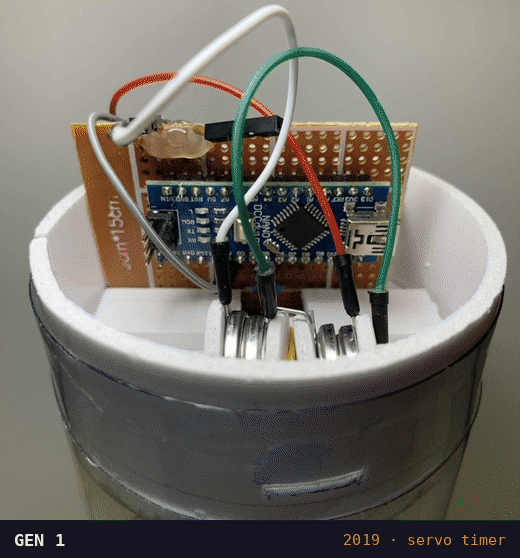

The design team said yes. This is what I did with it.

## The brief | “Money is no issue.”

By 2023 I'd spent two seasons on the mechanical side — wing ribs, carbon layups, airfoils — and was about to become Power & Controls Lead for *Shadow*, the team's SAE Aero Design Advanced Class entry. The brief arrived the way all good briefs arrive.

Avionics Director
<i></i><i></i><i></i>

Custom Electronics, Hand Assembly, Money is no issue, Figure it out

Seen <b>✓✓</b> 02:10 AM

For the record, at the January design review that season, the Power & Controls budget had `$433.61` left of `$1,500.00`. About 28%. Money was, in a sense, no longer an issue.

### Pulling the puzzle apart

The plane needed a kill switch, two 16.8 V batteries, a 2.4 GHz ELRS control link, ESC PWM, 900 MHz telemetry, a cellular video stream, and MAVLink to the flight controller. My slide for this had one label on it, in red, pointing at the whole pile: *“These need to connect nicely together.”*

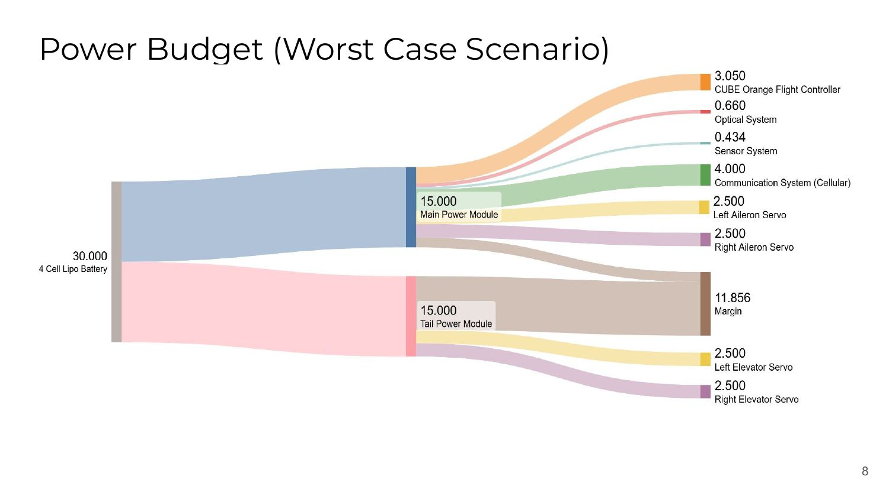

## The rat's nest | Bet you didn't see this.

In PCB design, the *rat's nest* is the tangle of thin lines the software draws before you've routed anything — every connection that still needs to be made, going straight through everything else. It is a to-do list shaped like a mess.

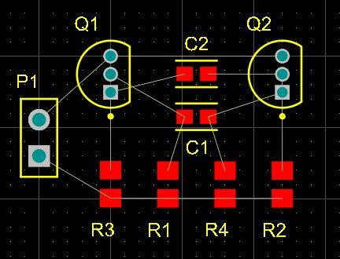

On the plane before *Shadow*, the rat's nest was the plane. My slide for it was titled **“Flight Electronics — Old — The Rats Nest,”** had a large red X over the photo, and said, in its entirety, *“Bet You didnt see this.”*

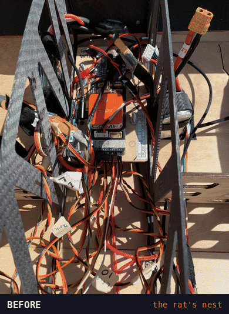

So the job wasn't really “design some boards.” It was: route the rat's nest. Every connection in the plane, made once, on purpose, on copper.

## The brain | The motherboard of the plane.

I split the electrical system the way you'd split a body, which is also how the slides were titled that year: a **central nervous system**, a **brain**, a **heart**, and some **muscle**. It started as a joke and turned out to be a pretty good architecture.

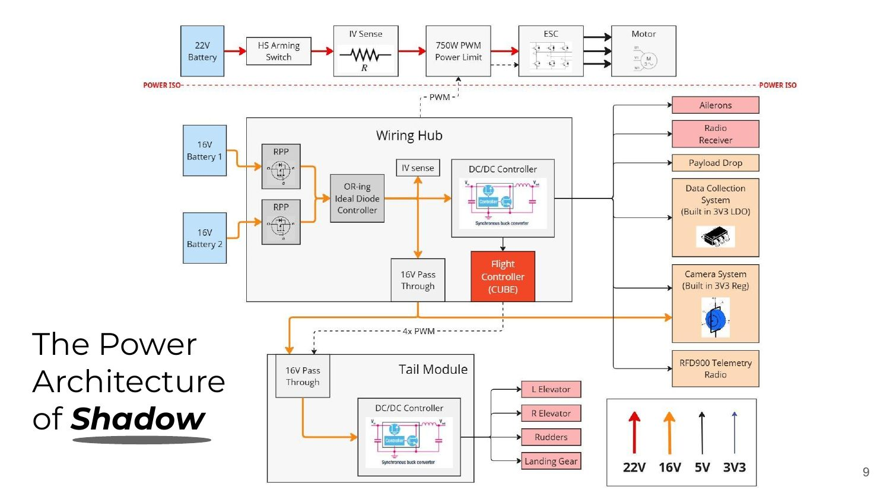

> “Motherboard” of the plane.
>
> Everything connects through the wiring hub.
>
> Centralized piece of hardware for all power distribution and connections.
>
> Simplifies previous architecture; consists of only what we need.
> — Wiring Hub: The Brain. Avionics design review, Jan 2024

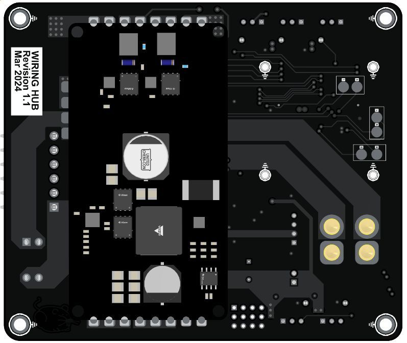

Four layers. Top carries vertical signals, test points, connectors and indicator LEDs. Bottom carries horizontal signals, the high-power traces, and spare GPIO. Vertical on one side, horizontal on the other, so nothing has to fight for a lane.

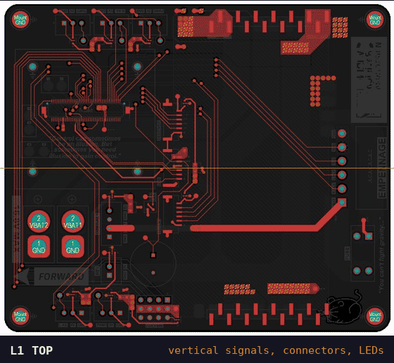

### The decisions, in my own slide notes

- **0.1 µF caps at every connector's supply** — low-ESL, to fight EMI. My note: *“Unable to validate, minimal impact.”*
- **TVS diodes on every connector**, because *“ESD was likely during winter.”*
- **A 2-second fuse.** *“Trip time was arbitrarily selected to be < 2s.”* I did derate it for temperature — Texas weather, an airframe with low albedo, other electronics throwing off heat. Then, underneath, the review I wrote later: *“Shouldn't have considered Fuse, single point failure.”*

The hub bolts into the fuselage on the camera gimbal mount, with room for vibration-damping feet so it doesn't shake noise into the sensor board. The tail got its own small board — the **empennage hub**, “the muscle” — which feeds the elevator, rudder and tail gear, and unplugs cleanly for travel.

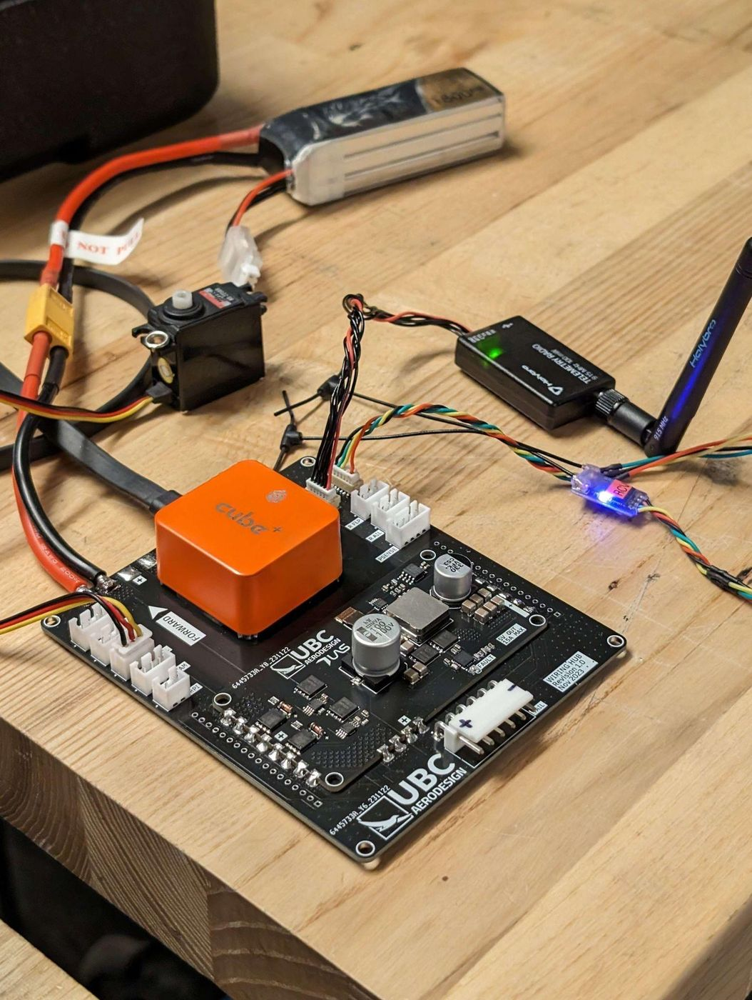

## The heart | Juicy 5 V, 15 A.

The power module turns a 4-cell LiPo into a clean 5 V rail for everything on the plane. The goal on the slide was two words: *Powers Shadow*. It took more than one try.

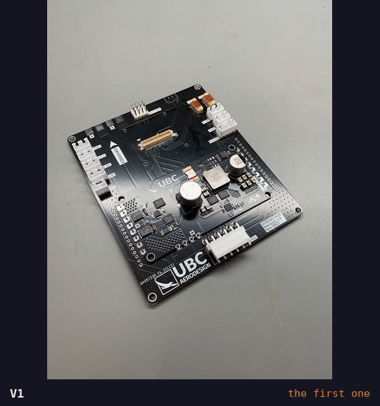

The controller is an ISL8117A, a synchronous buck controller I picked for a reason I wrote down with total honesty: *“Cheap on JLCPCB: $0.96 / unit.”* Everything else came out of the datasheet and a spreadsheet:

- Input `7.4 V` (2S) to `20 V` (4S, with margin), output `5 V`, max `15 A` — from the power budget.
- Inductor `3.3 µH`, same as the eval board, at `600 kHz`. Peak switch current `15.97 A` — the number the inductor and FETs have to survive.
- Output cap `330 µF` aluminium electrolytic, sized for the transient where two servos stall at once and pull 5 A: `±10.6 mV` of deviation.
- Two batteries in through an ideal-diode OR controller with reverse-polarity protection, so either pack can die and the plane keeps flying.
- Current sensed across a `3 mΩ` shunt at a gain of 60 — `2.7 V` out at full load, and the shunt burns `0.675 W` doing it.

The battery voltage monitor went through an OP07 buffer, which turned out not to be rail-to-rail: its output bottomed out at `1.27 V`. I listed my options on the slide like a responsible engineer:

- [ ] Replace the buffer with a rail-to-rail MCP6001
- [ ] Change the resistor divider ratio
- [ ] Map Vout to use the full ADC range
- [x] Do nothing, it's good enough

And it was — 871 ADC counts between a full pack and a dead one is plenty to land a plane on.

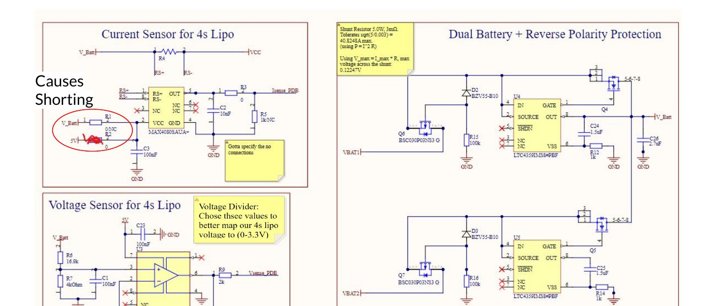

## The ECG | Little to no ripple.

If the board is the heart, the oscilloscope is the ECG. Three tests: stall a servo on purpose and watch the rail, scope the output, and run both batteries at once to check the OR-ing hands over cleanly.

<svg preserveAspectRatio="none" viewBox="0 0 600 120">
<g class="grid">
<line x1="0" x2="600" y1="20" y2="20"></line><line x1="0" x2="600" y1="60" y2="60"></line><line x1="0" x2="600" y1="100" y2="100"></line>
<line x1="100" x2="100" y1="0" y2="120"></line><line x1="200" x2="200" y1="0" y2="120"></line><line x1="300" x2="300" y1="0" y2="120"></line><line x1="400" x2="400" y1="0" y2="120"></line><line x1="500" x2="500" y1="0" y2="120"></line>
</g>
<path class="trace" d="M0 60 L90 60 L100 60 L106 52 L112 60 L130 60 L138 18 L146 98 L154 60 L180 60 L192 50 L204 60 L290 60 L300 60 L306 52 L312 60 L330 60 L338 18 L346 98 L354 60 L380 60 L392 50 L404 60 L490 60 L500 60 L506 52 L512 60 L530 60 L538 18 L546 98 L554 60 L580 60 L600 60"></path>
</svg>

Heart rate: normalRail <b>5.00 V</b>

↑ An illustration for the joke. The real measurements are below.

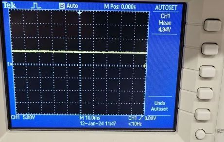
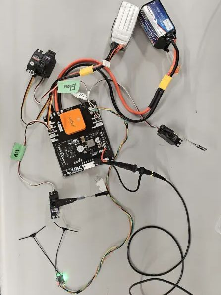

The patient was stable. The patient was about to go to Texas.

## Nobody said it was easy | Seen, 05:23 AM.

Here is the other text message from that season.

A team member
<i></i><i></i><i></i>

Weymen I think we have a problem …

Seen <b>✓✓</b> 05:23 AM

When I reviewed the season afterwards, I put this under a heading I'd recommend to anyone: **“What made me a bad engineer at the time?”** The second bullet is the one I think about:

> Dismissed a member's concern about a critical failure … causing a critical failure;
> — Technical Show and Tell, self-review

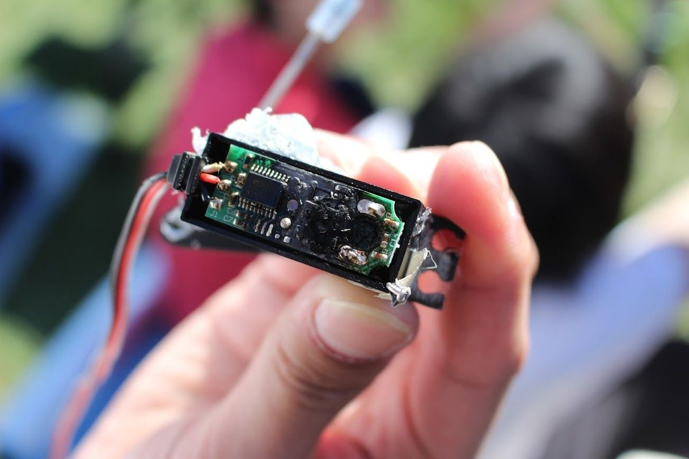
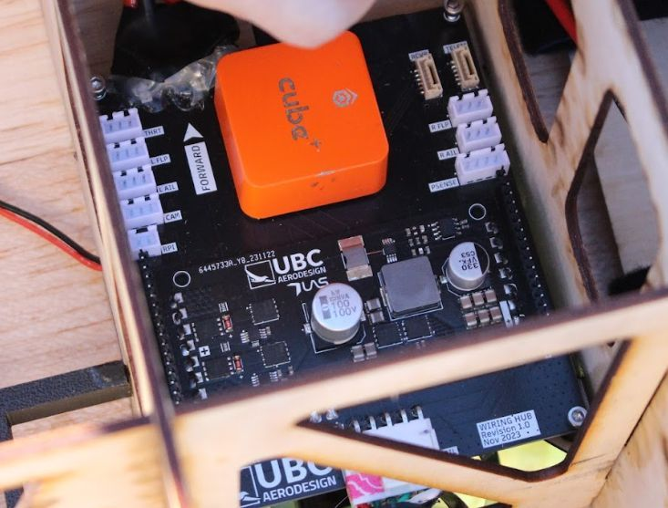

A shoot-through is when both switches in a buck converter's half-bridge are on at the same moment, so the input is shorted straight to ground through them. It is exactly as good for four servos as it sounds. The rest of the list, from the same slide:

- Buck controller IC running low on stock
- Lack of output protection
- Underutilized built-in features in the ICs
- No datalog for troubleshooting, no test points
- Get better test equipment to better validate

Hold onto that list. It comes back.

## Things worked | It flew anyway.

In my show-and-tell deck, after the failures, there's a slide titled *“Things Worked.”* It's one photo, no bullet points. You have to look for the plane.

*Shadow* placed **5th overall** in the Advanced Class. My evaluation of whether I'd actually met the brief was three columns, which I stole from a western:

<b>The good</b><ul><li>Student competition, not a business</li><li>Only team that pursued custom electronics</li><li>Challenged, and things worked technically</li></ul>

<b>The bad</b><ul><li>Placed 5th overall</li><li>Expensive; cost optimization</li><li>High risk</li><li>Unpopular amongst other subteams</li></ul>

<b>The ugly</b><ul><li>Risk mitigation</li><li>FMEA</li><li>Comprehensive system test plan</li><li>Hardware design</li><li>Mechanical integration</li><li>Validate and verify</li></ul>

“Fixated on technicals, not the systems,” the review says. *“A poorly optimized design would've worked anyway.”* Which is humbling to read about your own heart surgery.

## The transplant | Rev 2.

The next season I became Avionics Lead — about thirty people across three subteams, flying an autonomous payload-delivery mission. The power board got redesigned from scratch with B. Liu, and the design brief was, more or less, that list from the autopsy.

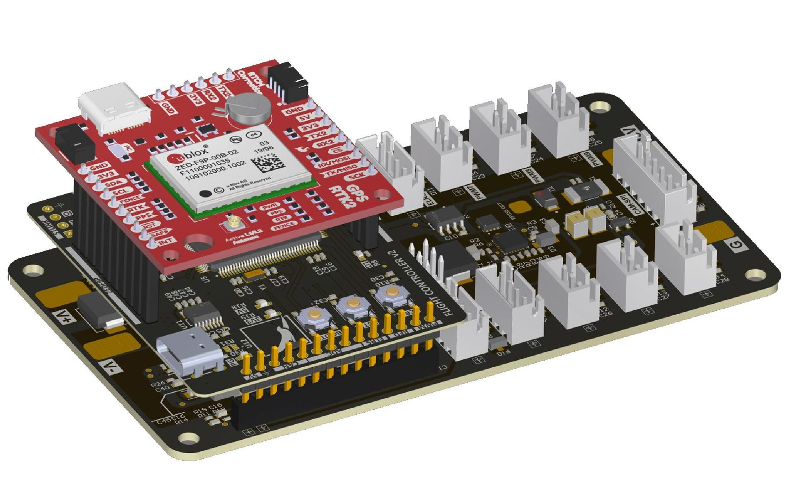

| 2024, what broke |  | 2025, what changed |
|---|---|---|
| Lack of output protection; a shoot-through took out four servos | → | TPS25983 e-fuse on the input *and* the output |
| Cheap out on connectors | → | IO connectors with mechanical lock features |
| No datalog for troubleshooting | → | Voltage and current sense, sent over telemetry |
| Buck controller running low on stock | → | A new buck, the LM5146, still designed for 5 V at 15 A |
| Two-layer power modules | → | Six-layer stackup: one power, three ground, two signal |

Input range is 7 V to 25 V — 4-cell LiPo or smaller, as the competition rules define — powering the servos, camera, remote airspeed sensors, GNSS, radios and flight controller. The big black part in the middle is the LM5146's 3.3 µH inductor.

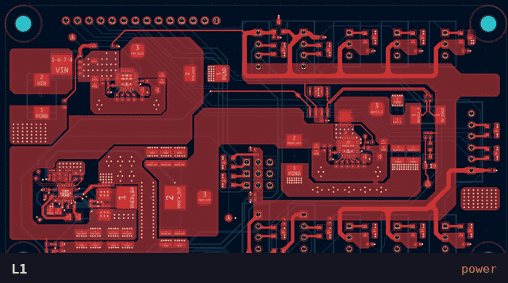

And because this whole site is a cassette, the board has a side A and a side B. Every connector's pinout is printed on the back, where the person plugging it in at 5 AM can actually read it.

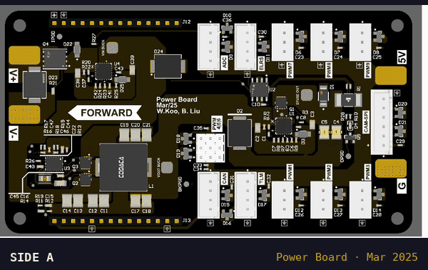

### Rendered, 2026

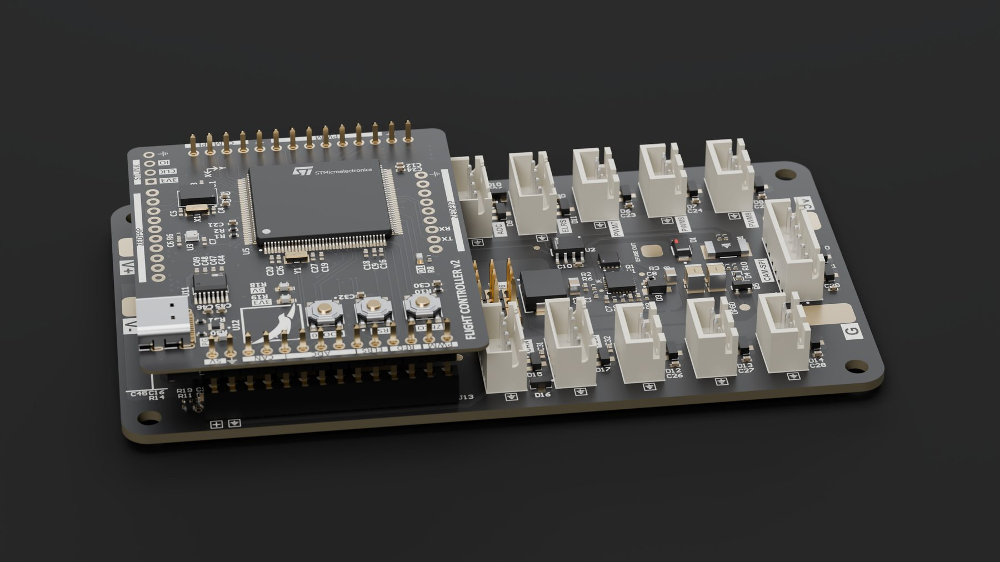

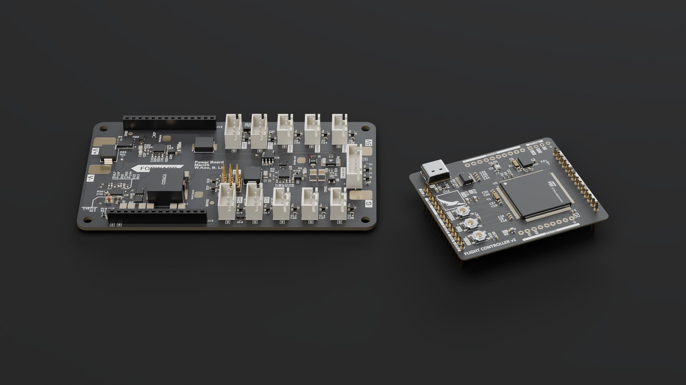
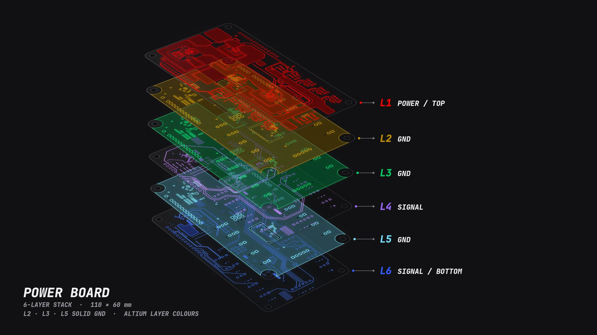

Rendered in Blender (Cycles) from the Altium STEP models and Gerbers.

### The honest part

I don't have waveforms for this one. From my own portfolio, verbatim: *“No waveforms or data to show due to lack of proper equipment.”* I wrote out the test plan anyway, and the gear I'd need to run it — starting with an electronic load of at least 200 W.

So the next thing I built was an electronic load.

## Teaching the rat's nest | How to ~~make~~ steal a component.

In January 2025, Anna and I ran the team's PCB design workshop. A few years earlier I was the one asking the seniors to teach me. This is roughly what I told the room.

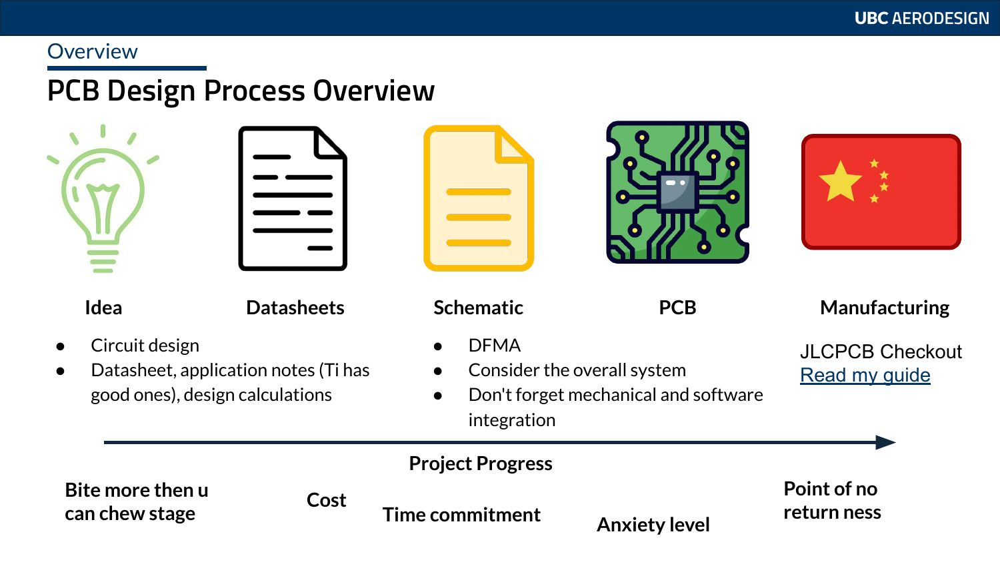

> Copy the Eval Board schematic, but make sure u understand how it works!
>
> Make sure to solder it with 63/37 Eutectic leaded solder with ample flux so it doesn't start running away
>
> Get Good
> — PCB Design workshop, Jan 2025

The schematic section of that workshop had a slide titled *“How Do I Properly Make A Schematic Without F\*\*\*ing Up and Bringing Great Shame.”* The answer on the slide was two arrows: *read the datasheets*, and *copy the eval board, but understand it.* I've never found a better one.

And the routing slide, which is the whole story of this page in two sentences:

> At first, all footprints will be scattered on a grid, with a Rats Nest showing what connections need to be made.
>
> Job of the engineer is to route them all.
> — PCB Design workshop, Jan 2025

## Lights off | They did give me the opportunity.

The things I'd do differently are the same things I wrote down in 2024, and they're mostly not about circuits: manage time, money and people; know my limits; hold design reviews; do the failure-mode analysis; run the integration tests. And when someone texts at 5 AM that they think there's a problem — believe them.

### Specs

| | |
|---|---|
| Aircraft | Shadow, 2023–24 · SAE Aero Design Advanced Class · 5th overall |
| Wiring hub | 4-layer carrier for the Cube Orange · TVS + filtering on every connector · empennage hub in the tail |
| Power, 2024 | ISL8117A synchronous buck · 7.4–20 V in → 5 V, 15 A · 3.3 µH, 600 kHz, 330 µF · ideal-diode OR dual battery · 3 mΩ current sense |
| Power, 2025 | LM5146 buck, 5 V 15 A · TPS25983 e-fuse in and out · 6 layers · locking IO · V/I telemetry · co-designed with B. Liu |
| Roles | Power & Controls Lead, 2023–24 · Avionics Lead, 2024–25 |
| Tools | Altium Designer · LTspice · JLCPCB |
