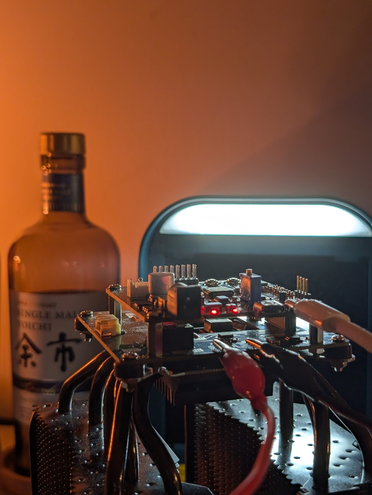
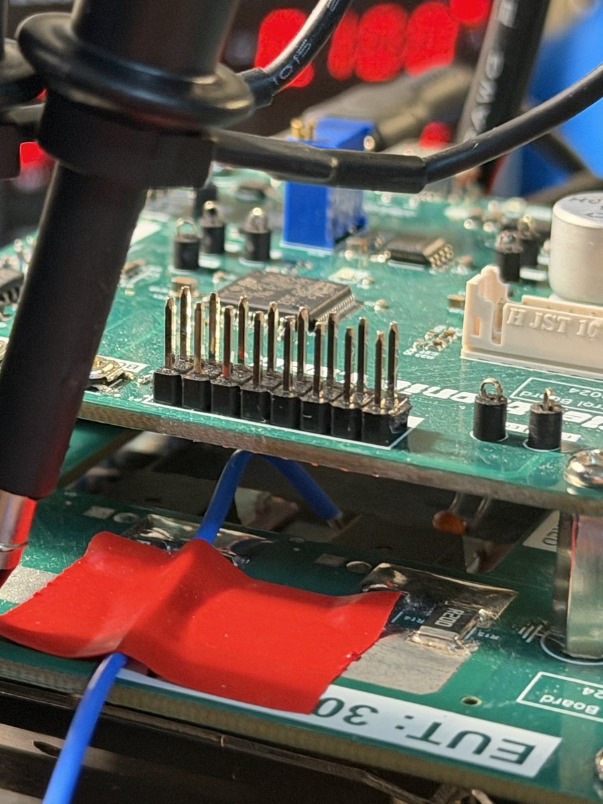
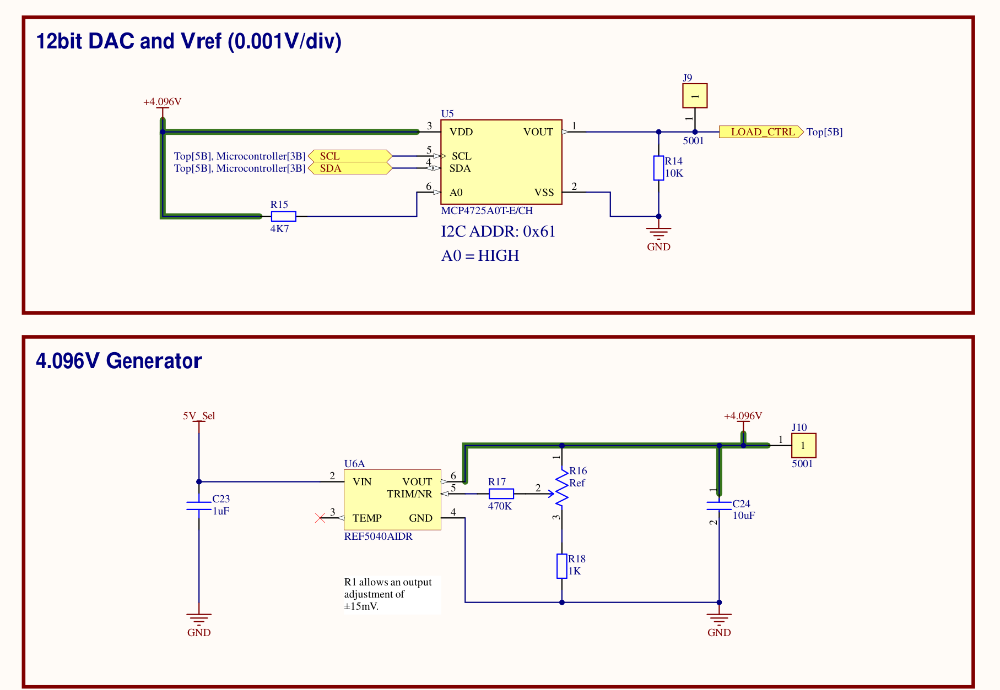
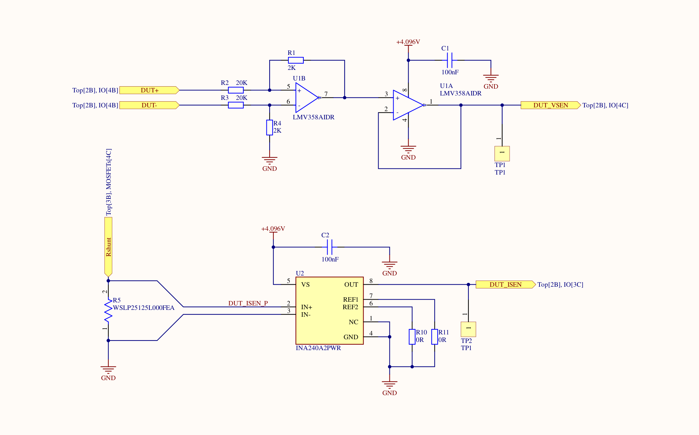

An electronic load pulls a set current from whatever you plug into it, so you can see how a power supply holds up. I built Rev A in late 2024 and finally measured it properly in November 2026.

**Does it work?** Yes, up to 1.93 A and about 36 W. The silkscreen says 10 A. The bench found why it stops short, and Rev B is designed around that.

## Rev A | The board

Two boards. The control board has a microcontroller, a DAC to set the current, and USB-C to a GUI on the laptop. The power board has two MOSFETs, each with its own op-amp loop that holds its current to the setpoint, and the heatsink burns the power off.

## Nov 2026 | Bench test

Almost two years later, a proper day on the bench: a scope, a bench supply as the thing being tested, a meter and a thermocouple, all run from Python scripts with a safety monitor.

<b>1.93 A</b>the most it will pull

<b>36 W</b>continuous, no fan

<b>12 µs</b>load steps, no ringing

<b>10 mA</b>current readback error, worst case

It's been a working tool since: it was the load for the [AeroDesign power board's bench tests](../power-board/index.html).

## Findings | What failed, and what I learned

<table class="ar-fix">
<thead><tr><th>What broke</th><th></th><th>Why, and the fix</th></tr></thead>
<tbody>
<tr><td>It stops at 1.93 A, not 10 A.</td><td>→</td><td>The op-amps run from a 4.096 V reference, so they can't drive the MOSFET gates any higher. Rev B gives them a 12 V rail.</td></tr>
<tr><td>Voltage readback is stuck at 3.98 V, whatever's connected.</td><td>→</td><td>Two resistors swapped in the schematic turned the amplifier into a latch. Swap them back.</td></tr>
<tr><td>Every setpoint reads 8 % low.</td><td>→</td><td>6.6 mΩ of copper in the return path counts as sense resistance. Found with a meter, one trace segment at a time.</td></tr>
<tr><td>At power-up, it asked for 5.6 A before the microcontroller even started.</td><td>→</td><td>The DAC remembers its last value. Zeroed, and the firmware checks it at every boot.</td></tr>
</tbody>
</table>

What I took from it:

- **Check what drives a part, not just the part.** The MOSFETs were fine; the rail feeding their gates wasn't.
- **Copper is a resistor.** When you're sensing in milliohms, the trace back to the connector matters as much as the shunt.
- **Know what every part does at power-up,** before any code runs.

## Design | Layout and schematic

## Rev B | The next board

Every one of those is fixed in the design: full gate drive, four bigger MOSFETs with a blower, a voltage sense that works, and protection in hardware instead of firmware. The target is 10 A and 150 W. The schematic is done and simulated, every part is placed, and routing comes next.

The hardware, firmware, GUI, test scripts and the full bench report are in the [repository](https://github.com/WeymenKoo/DC-Electronic-Load).
