A DC electronic load sinks a set current from whatever is connected to it, so a power supply or battery can be tested at a known load. Rev A was built in November 2024 and bench-tested in November 2026. Rev B, the next board, is designed and not yet built.

**Status:** Rev A built, characterised, and in use as a 1.9 A, 36 W load. Rev B schematic complete and simulated; every part is placed on the PCB and routing has not started.

The repository calls the built board Rev A and the next one Rev B. Earlier versions of this page called them Rev B and Rev E.

## Rev A | The board that was built

Rev A is two boards stacked through a 16-pin header.

| | |
|---|---|
| Control board | STM32F103RET6 · MCP4725 12-bit DAC with a REF5040 4.096 V reference · TPS5430 buck and AMS1117 3.3 V · USB-UART on USB-C · fan thermostat (LM311) |
| Power board | 2 × IRF530 MOSFETs, each with its own op-amp current loop (LMV358) · 2 × 0.2 Ω source resistors per FET · 5 mΩ shunt with an INA240 · fuse |
| Silkscreen rating | EUT: 30 V, 10 A |
| Control | USB-C, with a Windows / macOS GUI |
| Tools | Altium Designer |

, control board (bottom).")

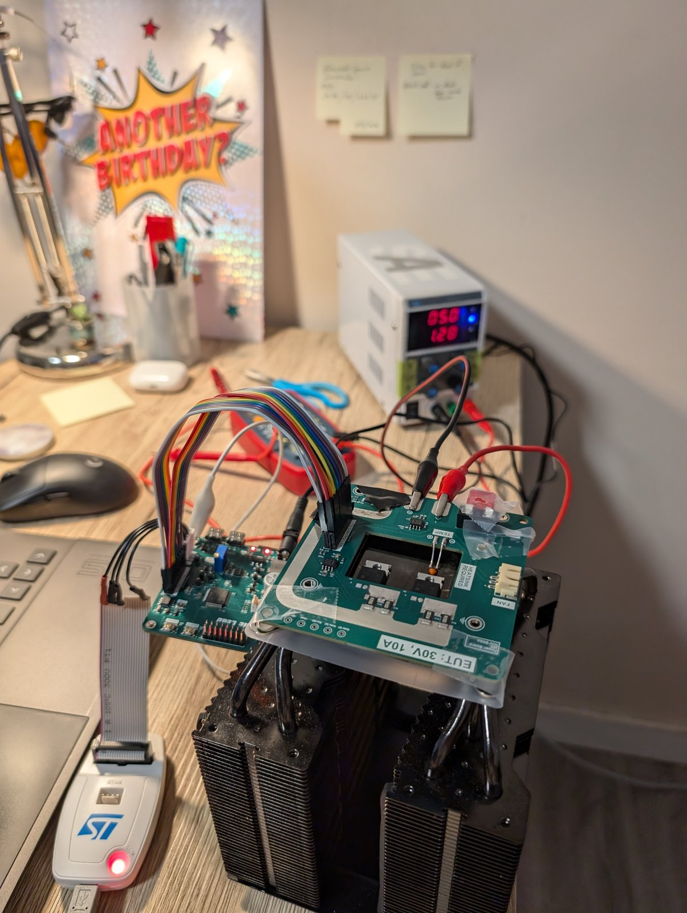

Each MOSFET has its own loop, which forces the voltage on its source resistors to follow the DAC. The op-amps and the DAC both run from the 4.096 V reference, so the gate can never go above about 4.1 V. That turned out to be the main limit.

## Bench tests | What Rev A can do

A schematic review had predicted most of Rev A's faults before it was powered: netlists rebuilt from the Altium files, and the two power-board errors reproduced in LTspice. In November 2026 I measured them.

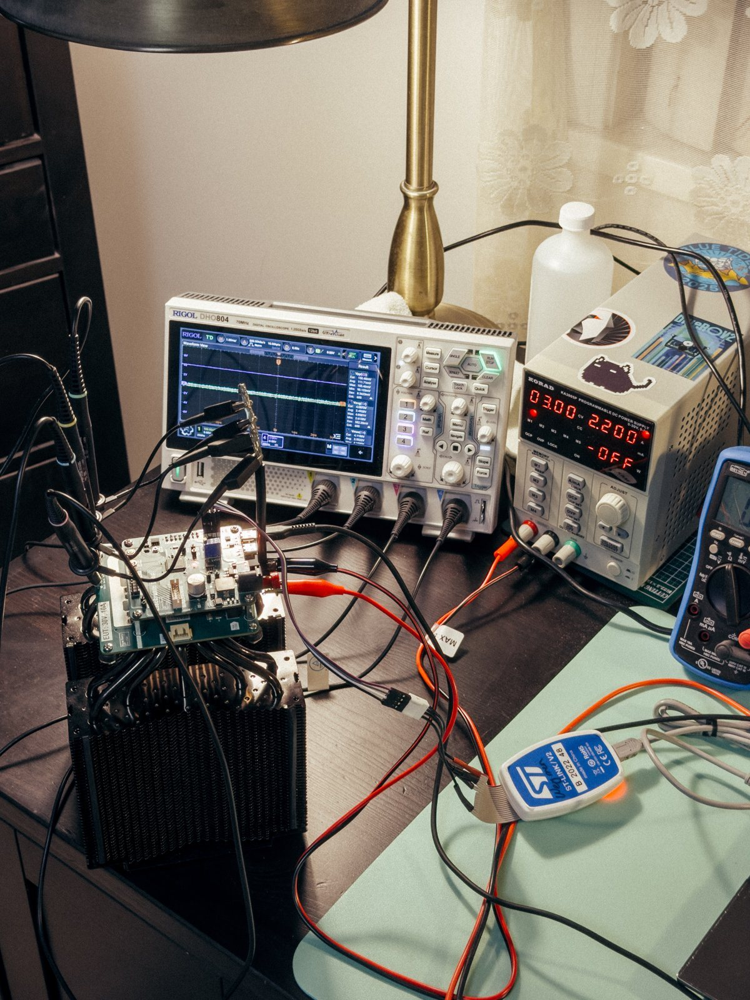
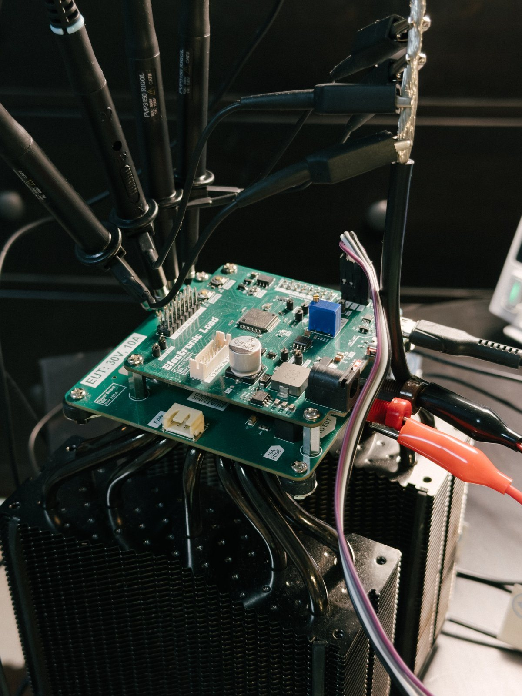

The board ran locked-down test firmware: the DAC starts at 0, it needs an arm command, and it switches off after 2 s without one, on over-current, or on a watchdog reset. Every test was a Python script that set the supply's current limit before switching on, ran a safety monitor, and logged the data and scope captures.

| Parameter | Rev A, measured |
|---|---|
| Current | `0 to 1.93 A` (`2.04 A` when hot) |
| Setpoint | `2.5 mA` steps, no dead zone; 8 % low uncalibrated, `±7 mA` calibrated |
| Current readback | within `±10 mA` to 1.9 A |
| Voltage readback | does not work |
| Minimum input voltage | `0.25 V` at 0.5 A, `0.55 V` at 1 A, `1.7 V` at 1.9 A |
| Continuous power, no fan | about `36 W` for a 125 °C junction |
| Load steps | `11–16 µs` edges, at most 1.5 % overshoot, no ringing |
| Current sharing | 0.1 % between the two MOSFETs |

### Findings

| | Finding |
|---|---|
| Confirmed | **Gate drive is capped at the 4.096 V reference**, so the load stops at `1.93 A` of the 10 A on the silkscreen. |
| Confirmed | **The voltage-sense amplifier has positive feedback** and latches at 3.98 V, whatever is connected. It also holds an MCU pin above its absolute maximum. |
| Measured | **About 36 W continuous without a fan**: heatsink 0.99 K/W, die to heatsink about 3.9 K/W per MOSFET. |
| Confirmed | The loops are stable: no ringing at any step tested. |
| Confirmed | The DAC's EEPROM held half scale, asking for about 5.6 A at power-up before the MCU runs. Zeroed; the firmware now checks it at boot. |
| New | **The setpoint reads 8 % low.** `6.6 mΩ` of copper in the shared return counts as sense resistance. Found by measuring each segment of the path with a meter at 1 A. |
| New | 5 mA flows at a setpoint of zero, from the op-amp offsets. |
| New | The 5 V rail is back-fed from USB. |

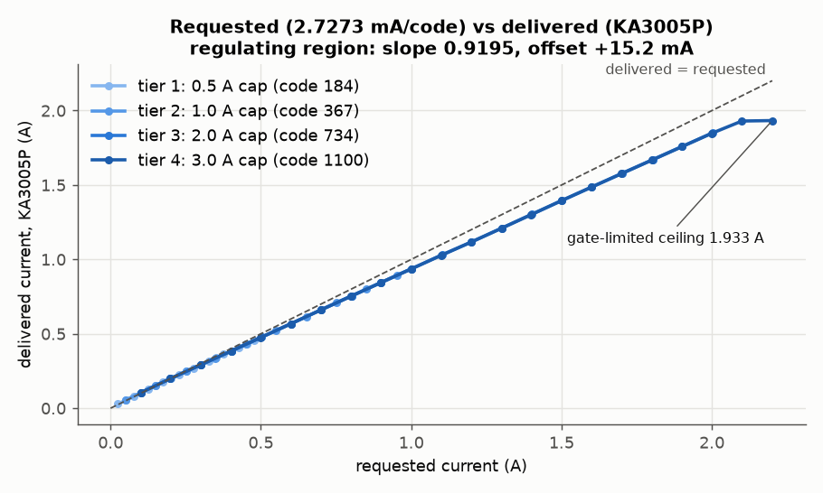
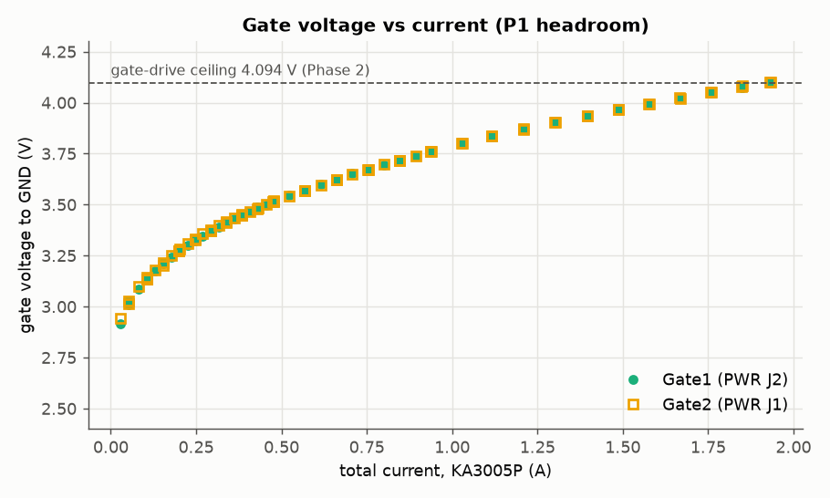
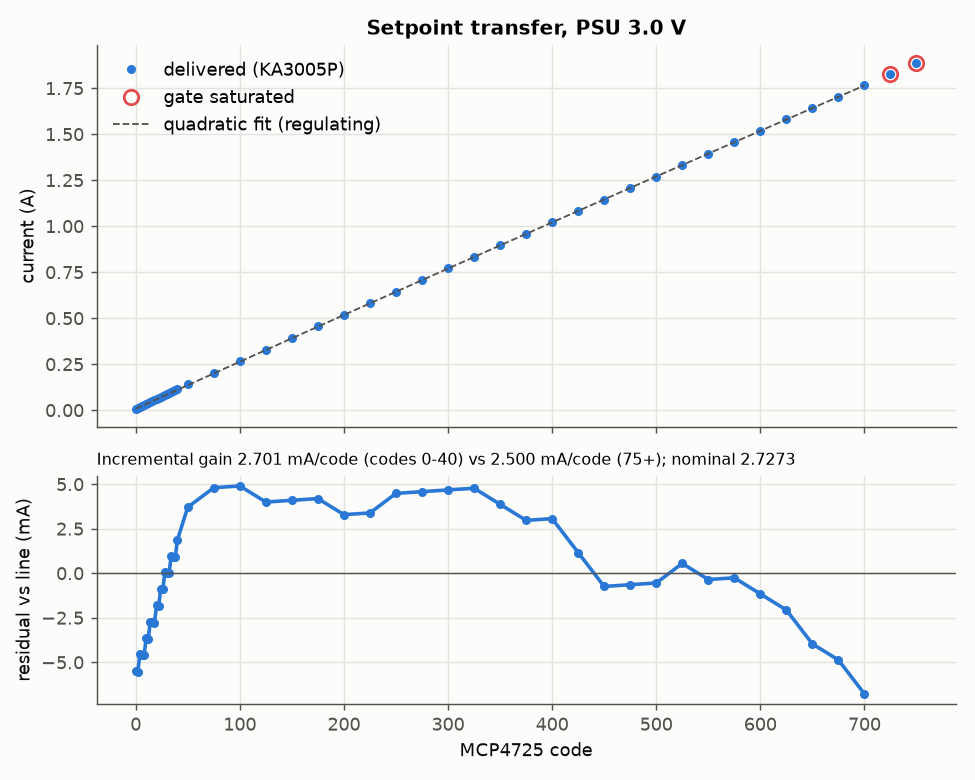
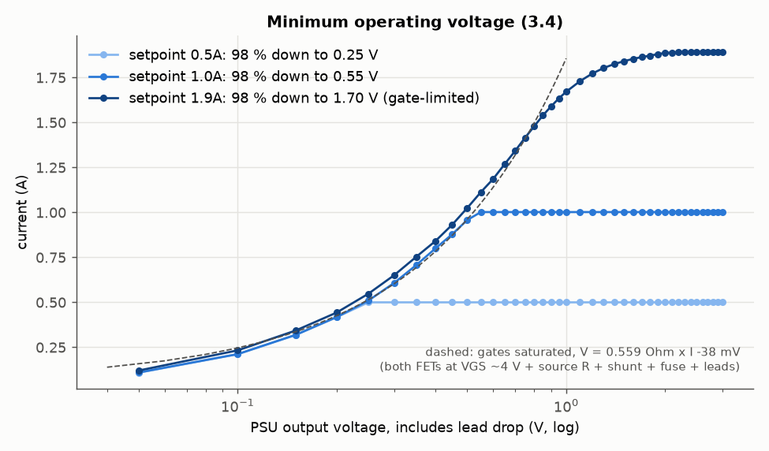

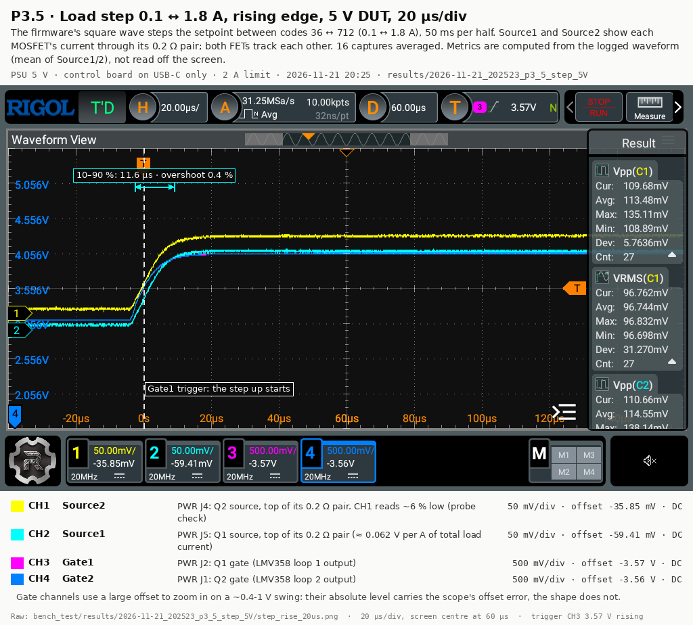
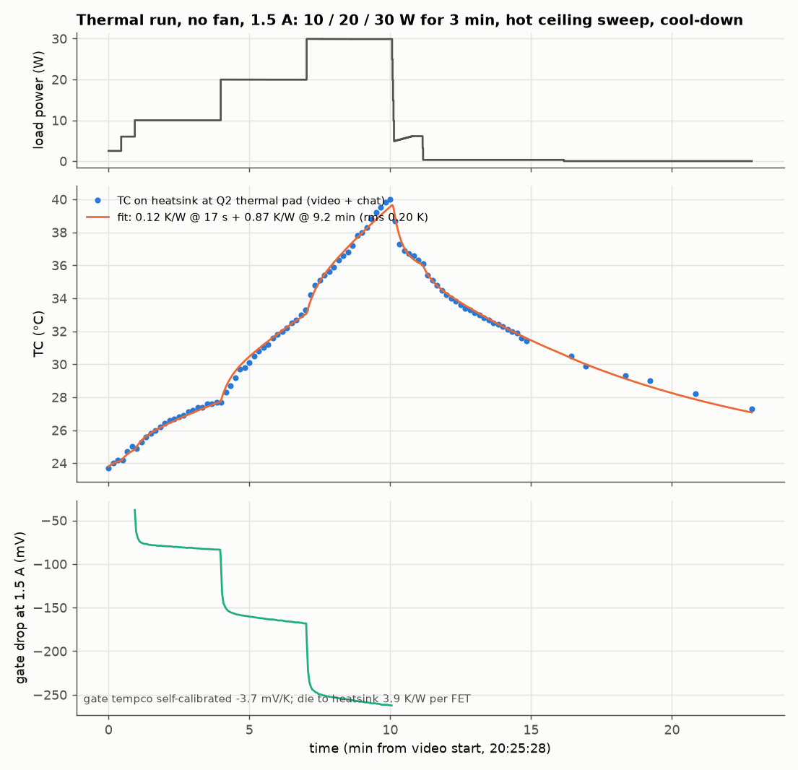
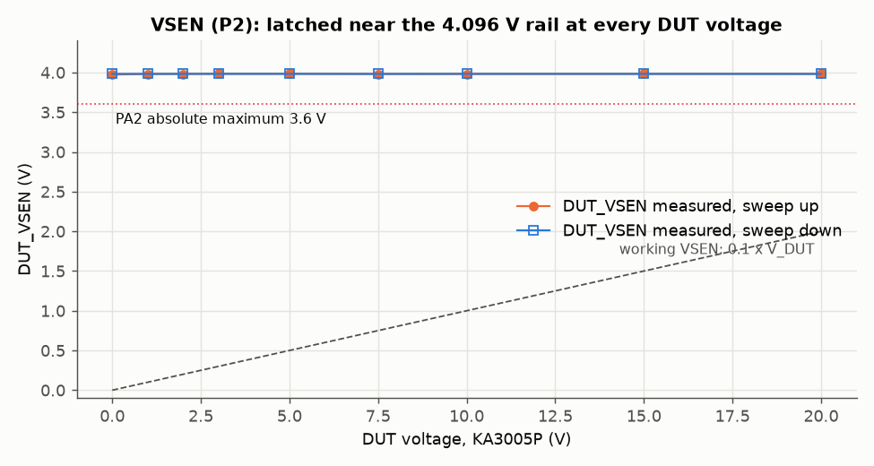
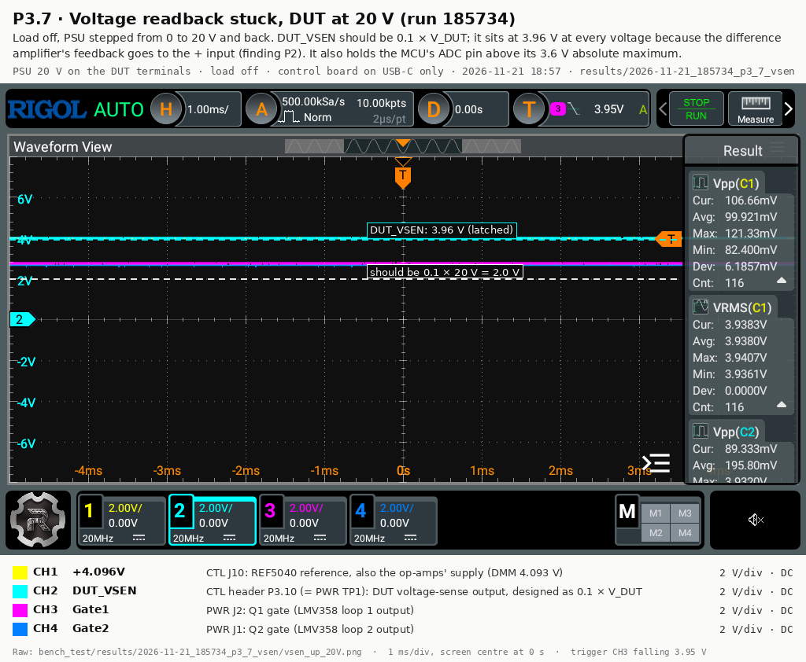

Rev A is now a working tool within those limits: the firmware and GUI enforce 1.90 A, 30 V and 35 W. It was the load for the [AeroDesign power board's bench tests](../power-board/index.html).

## Rev B | The next board

Rev B answers each finding: op-amps on a 12 V rail for full gate drive, four TO-247 MOSFETs with a blower, no shared shunt, a correct 4-wire voltage sense into an external ADC, and protection in hardware. Nothing here is built yet.

| | Rev A, measured | Rev B, target |
|---|---|---|
| Current | `1.93 A` | `10 A` |
| Power | about `36 W`, no fan | `150 W` with a fan |
| Input voltage | tested to `20 V` | `0.6 to 58 V` |
| Setpoint accuracy | 8 % low uncalibrated | `±1 %` after a 2-point calibration |
| Voltage readback | not working | 4-wire, `±0.5 %` |
| Protection | firmware only | hardware over-temperature, over-voltage, dropout, OFF |

The design:

| | |
|---|---|
| Rating | 150 W continuous (with the blower), 0.6 to 58 V, 0 to 10.1 A |
| Power stage | 4 × IRFP250N (TO-247), one TLV9154 current loop per MOSFET, 2 × 0.2 Ω Kelvin source resistors each |
| Modes | CC and CV in hardware; CR, CP and battery discharge planned in firmware |
| Set / readback | MCP4822 12-bit DAC (2.44 mA per step) · ADS1118 16-bit ADC, true 4-wire voltage sense |
| Protection | 15 A fuse, TVS, over-temperature 85 °C, over-voltage 62 V, NTC-open, dropout KILL, hardware OFF (LM339) |
| MCU | STM32G0B1RBT6 |
| Power and UI | One USB-C port (power, SCPI over CDC, DFU) · OLED, encoder, three buttons |
| Board | Control board 170 × 40 mm and power board 170 × 60 mm on one 2-layer, 2 oz panel |
| Cost | About US$25 of catalogue parts per unit, plus the OLED, blower and PCB |
| Tools | KiCad 10 (schematic generated by a Python script), LTspice |

Simulated in LTspice with TI's TLV915x model: phase margin at least 87° and gain margin at least 22 dB for the IRFP250N from 50 mA to 2.5 A per channel; a 20 to 30 µs step response with no overshoot.

### Next

1. Route the PCB.
2. Order the boards and parts.
3. Bring-up, then firmware.
4. Test hot-plug from a battery, which Rev A's bench supply could not show.

Hardware, firmware, GUI, test scripts, raw data and the full report: [github.com/WeymenKoo/DC-Electronic-Load](https://github.com/WeymenKoo/DC-Electronic-Load).
