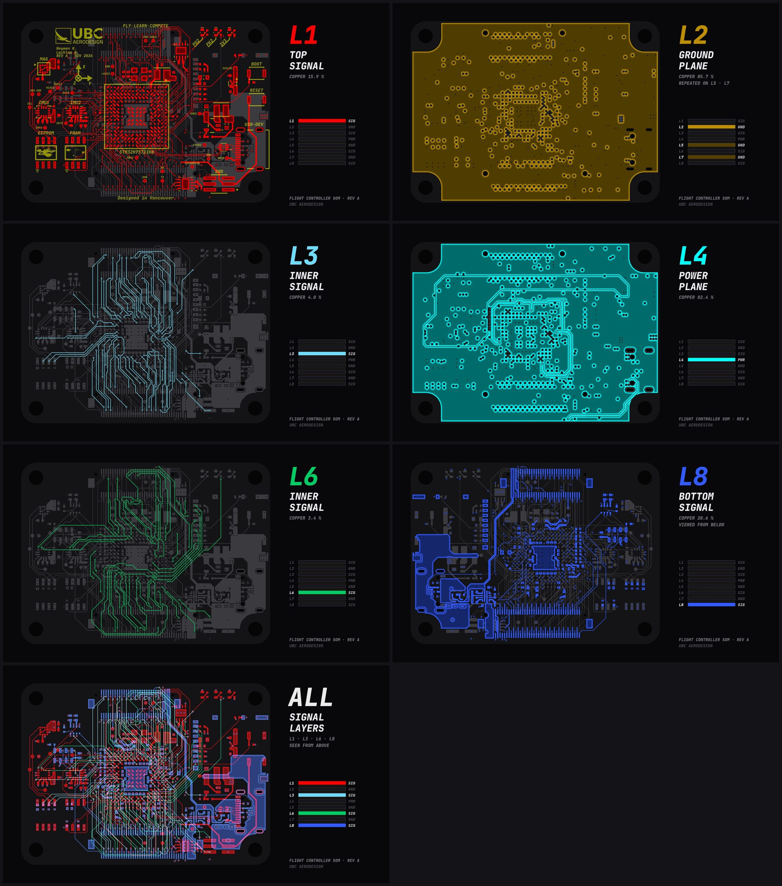

The 55 × 40 mm, 8-layer module carries the MCU, two IMUs, two barometers, a magnetometer, FRAM, microSD and the power path. It plugs into a carrier board and a payload board through two Hirose DF17 board-to-board connectors.

**My role:** I led the design: the architecture, the schematic, the layout and the manufacturing release. I brought Lachlan Biersteker, a newer member, onto the board to train him. He selected the eFuse, the buck and the LDO under my review and did early routing, which I took over and finished.

**Status:** Rev A. Design complete. Altium DRC clean (0 violations, 14 Nov 2026). Manufacturing files exported 15 Nov 2026. Not yet fabricated or tested.

| | |
|---|---|
| Revision | Rev A |
| Board | 55 × 40 mm, 8 layers, ENIG, black mask, white silkscreen |
| Processor | STM32H757XIH6, Cortex-M7 at 400 MHz, 2 MB flash |
| Firmware | ArduPilot (ChibiOS) |
| Sensors | 2 IMUs, 2 barometers, magnetometer |
| Storage | 32 KB FRAM (parameters), microSD (logs), 8 KB EEPROM (board ID) |
| Power | 5 V from the carrier or USB-C, eFuse with a 1.1 A limit |
| I/O | 16 PWM, 8 UARTs + USB, 4 I2C, 2 CAN, 5 ADC |
| Assembly | 150 parts (59 top, 91 bottom), 22 test pads |
| Designers | Weymen Koo (lead) · Lachlan Biersteker (trained on this board) |
| Files | [Repository](https://github.com/WeymenKoo/UBCAeroDesign-2026-Flight-Controller) · [Schematic (PDF)](https://github.com/WeymenKoo/UBCAeroDesign-2026-Flight-Controller/blob/main/FC_SoM_RevA_Schematic.pdf) · [STEP model](https://github.com/WeymenKoo/UBCAeroDesign-2026-Flight-Controller/blob/main/mechanical/FC_SoM_RevA.step) |

## Board views

 from the Altium STEP model and the fabrication Gerbers.")

## Hardware

### Processor

- STM32H757XIH6 (not the `A` suffix), TFBGA-265.
- Core supply from the internal SMPS in direct mode, so the maximum clock is 400 MHz.
- 25 MHz HSE crystal. The Cortex-M4 core is unused.

### Sensors

| Function | Part | Bus |
|---|---|---|
| IMU 1 | ST LSM6DSV32X | SPI1 |
| IMU 2 | TDK ICM-42688-P | SPI5 |
| Barometer 1 | Infineon DPS368 | SPI1 |
| Barometer 2 | TE MS5611 | SPI5 |
| Magnetometer | ST LIS2MDL (optional) | I2C4, 0x1E |

Each SPI bus carries one IMU and one barometer, so a single bus failure leaves a complete IMU and barometer pair.

### Storage

- Parameters: Infineon FM25V02A, 32 KB FRAM on SPI2.
- Logs: microSD (Hirose DM3), 4-bit SDMMC1.
- Board ID: ST M24C64 EEPROM on I2C4, 0x50, write-protected by default. ArduPilot has no driver for it.

### Power

- Two 5 V inputs, carrier (J4) and USB-C VBUS, through a TI TPS2116 priority mux. The carrier has priority.
- TI TPS259474A eFuse with a 1.1 A current limit. The carrier input is accepted from 4.19 V (rising, drops out at 3.81 V) up to 5.46 V.
- TI TLV62569 buck for the 3.3 V main rail, TI TPS7A20 LDO for a separate 3.3 V sensor rail.

### Interfaces

| Ref | Connector | Side | Function |
|---|---|---|---|
| J4 | Hirose DF17, 80-pin | Bottom | Carrier: power, PWM, serial, I2C, CAN, ADC, GPIO |
| J5 | Hirose DF17, 60-pin | Bottom | Payload: SPI6, UART, I2C, CAN2, GPIO, power |
| J2 | USB-C (USB 2.0 FS) | Top | MAVLink, DFU, power |
| J3 | 2 × 3, 1.27 mm header | Top | SWD (custom pinout) |
| J1 | microSD | Bottom | Logging |

Mounting: 4 × M3 holes (3.2 mm, non-plated) on a 48.4 × 33.4 mm pattern.

I/O available through J4 and J5:

- 16 PWM outputs on TIM4, TIM1, TIM8 and TIM5. CH1–4 support DShot; bidirectional DShot on CH1 and CH3.
- 8 UARTs plus USB: telemetry (with RTS/CTS), companion, GPS 1, GPS 2, ELRS/CRSF, ESC telemetry (RX only), payload, debug.
- 4 I2C buses: internal (magnetometer, EEPROM), GNSS, airspeed/power monitor, payload. Pull-ups are on the module.
- 2 CAN buses with TI TCAN3414 transceivers on the module. Termination is on the carrier.
- 5 ADC inputs with RC filters on the module. Voltage dividers are on the carrier.
- SBUS input, safety switch and LED, buzzer, arming output, 6 GPIO.

### Test points

22 pads (0.8 mm, top side): VBUS, +VCARRIER, +5V_EFUSE, +VMUX, +3V3LDO, +A3V3, 6 × GND, debug UART, SPI1, internal I2C, both IMU interrupts, DBG2 and PAY_IO17.

## PCB layout

| Layer | Use | Copper |
|---|---|---|
| L1 | Top signal | 15.9 % |
| L2 | Ground plane | 85.7 % |
| L3 | Inner signal | 4.0 % |
| L4 | Power plane | 82.4 % |
| L5 | Ground plane (same as L2) | |
| L6 | Inner signal | 3.4 % |
| L7 | Ground plane (same as L2) | |
| L8 | Bottom signal | 20.6 % |

, seen from above.")

About 200 vias sit in pads. They are epoxy filled and capped. No impedance control is needed (USB full speed only).

## Firmware

ArduPilot board definition files (`hwdef.dat`, `hwdef-bl.dat`) are drafted and pass `chibios_hwdef.py`. They have not been compiled or run on hardware.

- `define SMPS_PWR` is required. A build without it misconfigures the core supply.
- Board ID `AP_HW_UBC_FCSOM` is a placeholder until allocated in ArduPilot's `board_types.txt`.
- Board forward is the top edge (J5 side), marked by the X arrow on the top silkscreen.
- IMU rotation from the datasheets and footprints: `ROTATION_ROLL_180_YAW_90` for both IMUs. To be confirmed with a motion test.
- The LSM6DSV32X must have I2C disabled (`IF_CFG`) before any other traffic on SPI1.

## Manufacturing

Built for JLCPCB. The Gerbers, BOM and pick-and-place file were exported on 15 Nov 2026 and checked against the PCB file: every pad, track and via is in the Gerbers, and the BOM and CPL list the same 150 parts.

| Order setting | Value |
|---|---|
| Layers | 8 |
| Thickness | 1.6 mm |
| Surface finish | ENIG |
| Via covering | Epoxy filled and capped |
| Mask / silkscreen | Black / white |
| Assembly | Standard PCBA, both sides |
| Inspection | X-ray for the BGA |

The upload set is in the repository under [`jlcpcb/`](https://github.com/WeymenKoo/UBCAeroDesign-2026-Flight-Controller/tree/main/jlcpcb).

## Status

Rev A. Design complete, not yet fabricated or tested. The carrier board is in development; the plan is to order the module and the carrier together.

Bring-up plan, in order; results go here as they come in:

- [ ] Bare-board checks: rail-to-ground resistance, BGA X-ray
- [ ] Current-limited first power on USB-C: 3.3 V and sensor rail levels, eFuse limit
- [ ] SWD connect, clock and SMPS configuration
- [ ] ArduPilot build boots; both IMUs, both barometers, the magnetometer, FRAM and microSD detected
- [ ] IMU orientation confirmed with a motion test
- [ ] On the carrier: CAN, PWM outputs, UARTs and the ADC dividers
