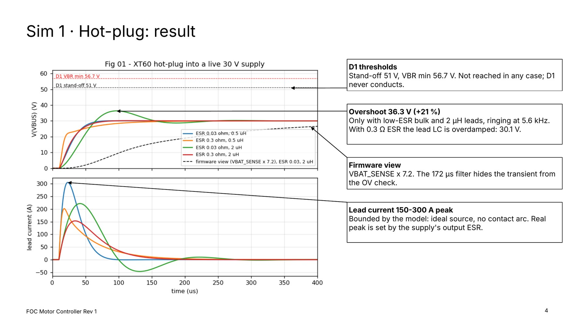
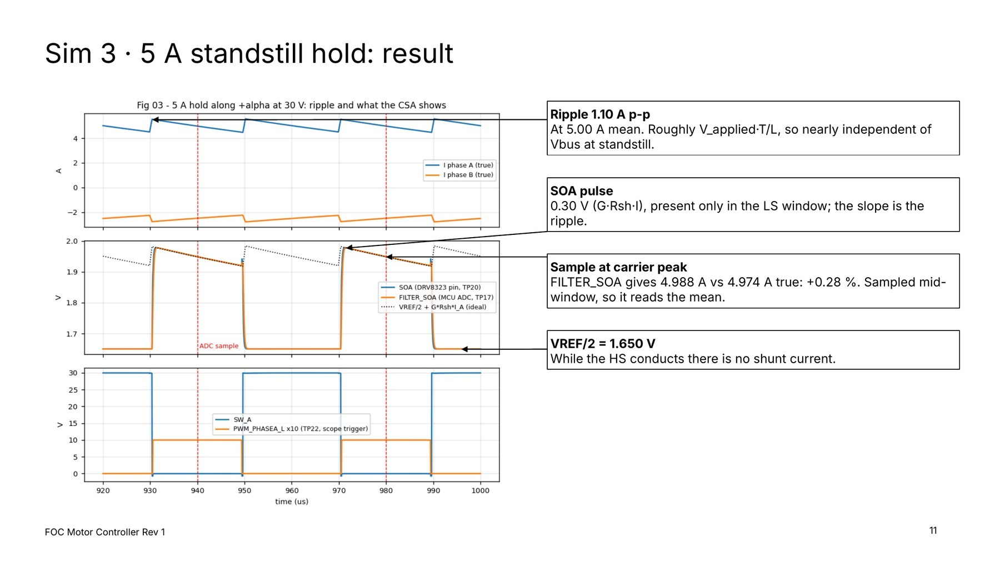
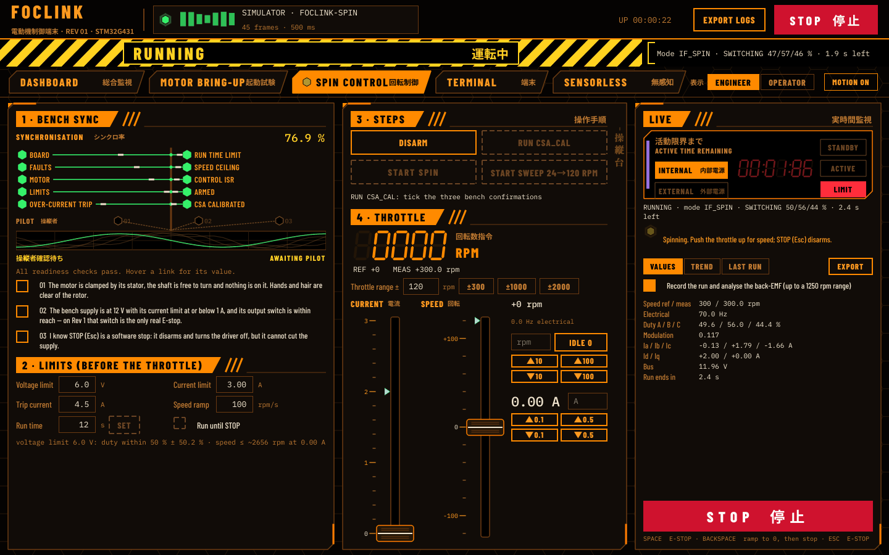

70 × 70 mm, 6 layers, built for a 12S bus. Six boards (one per joint) are planned, sharing the bus and talking over CAN-FD.

**Status:** Rev 1 is design-frozen, fabricated and partly bench-validated on a 12 V supply. The MCU, gate driver (SPI), current sensing and PWM are verified, and a T-Motor MN601-S has been identified (R, L, back-EMF) and spun open-loop up to 1000 rpm. Not yet tested on the 12S bus, under load, or in closed-loop FOC.

| | |
|---|---|
| Bus | 12S LiPo: 44.4 V nominal, 50.4 V full, 56 V max |
| Phase current | 10 A RMS continuous (design target) |
| MCU | STM32G431RB, 170 MHz Cortex-M4F |
| Gate driver | TI DRV8323S (SPI, 3 integrated current-sense amplifiers) |
| Power stage | 6 × Infineon ISC030N10NM6, 100 V, TDSON-8 |
| Current sensing | 3 × 3 mΩ low-side shunts, Kelvin-connected |
| Position | AS5047P 14-bit magnetic encoder, on the back of the board under the motor shaft |
| Comms | CAN-FD (TCAN1044), UART to the bench GUI, SWD |
| Power tree | SMCJ51CA TVS → LMR36520 buck to 5 V → LDO to 3.3 V |
| Board | 70 × 70 mm, 6 layers, KiCad 10, fabricated and assembled by JLCPCB |
| Files | [Repository](https://github.com/WeymenKoo/FOC-Motor-Controller) · [Schematic (PDF)](https://github.com/WeymenKoo/FOC-Motor-Controller/blob/main/Documentation/FoC_Motor_Controller_Schematic.pdf) · [Bench session](https://github.com/WeymenKoo/FOC-Motor-Controller#bench-session-22-november-2026) |

## Renders

Rendered in Blender (Cycles) from the KiCad board and the fabrication Gerbers.

## On the motor

Rendered with the ODrive M8325s (100 KV, 20 pole pairs), the reference motor for the leg joint, on the 3D-printed test upright.

## PCB layout

Stackup: L1 signal + power, L2 ground, L3 / L4 signal + power, L5 ground (identical to L2), L6 signal + power. Phase and bus current run in outer-layer pours; the DRV8323S sits next to the bridge to keep the gate loops short.

## Bench test

## Simulation vs scope

Three LTspice decks built from the Rev 1 netlist, each predicting what a bench measurement on a Rigol DHO804 should show, then checked against the scope captures. Bench results are on a 12 V supply; hot-plug is at 30 V.

### 1 · Hot-plug (XT60 into a live supply)

30.15 V peak, no overshoot. The bench supply limits the charge rate, so the 36.3 V overshoot the ideal-source sim predicts doesn't occur on this supply.

### 2 · Half-bridge switching (one leg, hard edges)

8.8 ns rise and 13.87 V peak at 12 V, against 7.0 ns in the sim. The difference is mostly the 70 MHz probe.

### 3 · Current sense (standstill hold, I/f spin)

The I/f spin at 2 A / 300 rpm gives a 2.04 A envelope, and the 112 mV pulse matches the sim's 120 mV.

Full slides: [Sim and bench results (PDF)](https://github.com/WeymenKoo/FOC-Motor-Controller/blob/main/Documentation/FOC_Motor_Controller_Sim_and_Bench_Results.pdf). Decks, results and raw captures: [`Testing/Simulation/`](https://github.com/WeymenKoo/FOC-Motor-Controller/tree/main/Testing/Simulation).

## Bench GUI: FOCLINK

FOCLINK is the bench console: a PySide6 app styled as a NERV operations terminal, talking to the firmware over UART. The GUI holds no safety logic; it only requests, and the firmware decides what is allowed. The firmware and GUI live in a separate repository.

Screenshots are from the GUI's built-in board simulator, not a live board.

## Documents

| File | What it is |
|---|---|
| [Schematic](https://github.com/WeymenKoo/FOC-Motor-Controller/blob/main/Documentation/FoC_Motor_Controller_Schematic.pdf) | Full schematic, 14 pages |
| [PCB artwork](https://github.com/WeymenKoo/FOC-Motor-Controller/blob/main/Documentation/FoC_Motor_Controller_PCB_Artwork.pdf) | Board drawing |
| [Sim and bench results](https://github.com/WeymenKoo/FOC-Motor-Controller/blob/main/Documentation/FOC_Motor_Controller_Sim_and_Bench_Results.pdf) | Simulation and bench-correlation slides |
| [Bench session](https://github.com/WeymenKoo/FOC-Motor-Controller#bench-session-22-november-2026) | Rev 1 characterization: switching, protection, current sensing, dead time, braking, heat, motor constants, Rev 2 list |

## Validation | What's proven, what's next

Each step runs on a current-limited supply before the next. Ticked items are done; the rest get a scope capture and conditions here as they're run.

- [x] MCU, gate driver over SPI, current-sense amplifiers and PWM verified on a 12 V supply
- [x] Motor identified: T-Motor MN601-S resistance, inductance and back-EMF
- [x] Open-loop (I/f) spin to 1000 rpm on 12 V
- [ ] Switch node on each phase at 12S: rise and fall, overshoot, ringing
- [ ] Dead time measured at the gate pins
- [ ] Closed-loop current (torque) control, step response
- [ ] Closed-loop speed control on the encoder
- [ ] Phase current at the 10 A RMS target, with board temperature over time
- [ ] DC bus sag and ripple during throttle steps

## Rev 2, top items

1. Thermal vias in the low-side drain pads, or a bottom-side switch-node pour
2. Board NTC moved into the FET zone
3. Separate analog 3.3 V rail (ferrite + local caps) for VDDA / VREF+
4. More bulk capacitance, or a lower-ESR part
5. Hardware CAN node addressing

The full list, with reasons, is in the [repository README](https://github.com/WeymenKoo/FOC-Motor-Controller#rev-2).
