70 × 70 mm, 6 layers, built for a 12S bus. Six boards (one per joint) are planned, sharing the bus and talking over CAN-FD.

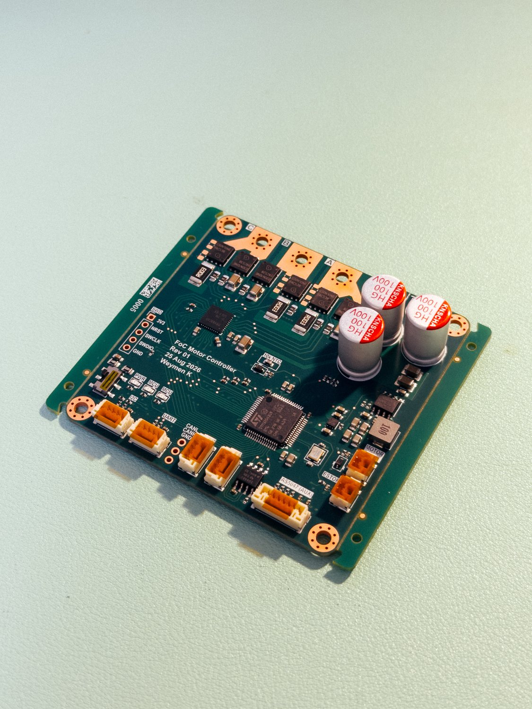

**Status:** Rev 1 is fabricated, brought up and bench-characterised at up to 30 V and 10 A DC per phase (22 November 2026). It switches cleanly, measures its own current to within 1–2 % and protects itself, but only after three of the gate driver's power-on settings were changed. Not yet tested on the 12S bus, at the 10 A RMS design point, under shaft load, with the encoder, or over CAN-FD.

**Who did what.** The electrical design, the bench setup and probing, and the Rev 2 decisions are mine. The firmware and the bench GUI were written by Claude (Anthropic's AI model). In the 22 November session Claude also ran the scripted measurements and implemented the firmware limits, which I reviewed; the operating limits saved to the board were set by me.

| | |
|---|---|
| Bus | 12S LiPo: 44.4 V nominal, 50.4 V full; continuous limit 51 V (TVS stand-off) |
| Phase current | 10 A RMS continuous, 14 A peak (design target, not yet reached) |
| MCU | STM32G431RB, 170 MHz Cortex-M4F |
| Gate driver | TI DRV8323S (SPI, 3 integrated current-sense amplifiers) |
| Power stage | 6 × Infineon ISC030N10NM6, 100 V, TDSON-8 |
| Current sensing | 3 × 3 mΩ low-side shunts, Kelvin-connected |
| Position | AS5047P 14-bit magnetic encoder, on the back of the board under the motor shaft |
| Comms | CAN-FD (TCAN1044), UART to the bench GUI, SWD |
| Power tree | SMCJ51CA TVS → LMR36520 buck to 5 V → LDO to 3.3 V |
| Board | 70 × 70 mm, 6 layers, KiCad 10, fabricated and assembled by JLCPCB |
| Files | [Repository](https://github.com/WeymenKoo/FOC-Motor-Controller) · [Schematic (PDF)](https://github.com/WeymenKoo/FOC-Motor-Controller/blob/main/Documentation/FoC_Motor_Controller_Schematic.pdf) · [Bench session](https://github.com/WeymenKoo/FOC-Motor-Controller#bench-session-22-november-2026) |

## Renders

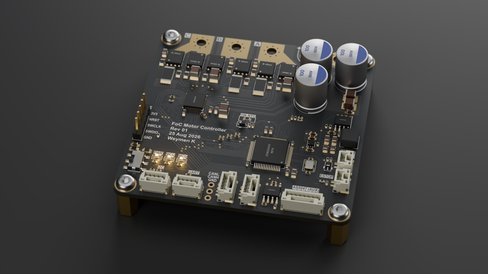
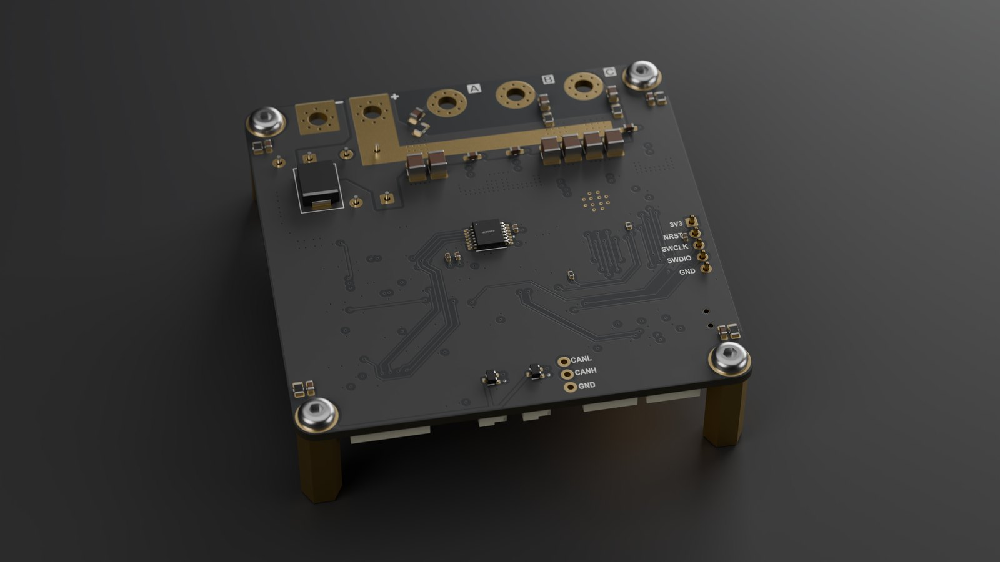

Rendered in Blender (Cycles) from the KiCad board and the fabrication Gerbers.

## On the motor

Rendered with the ODrive M8325s (100 KV, 20 pole pairs), the reference motor for the leg joint, on the 3D-printed test upright.

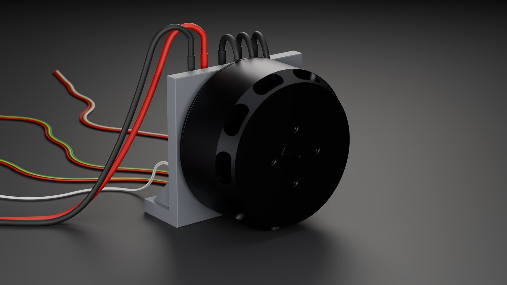
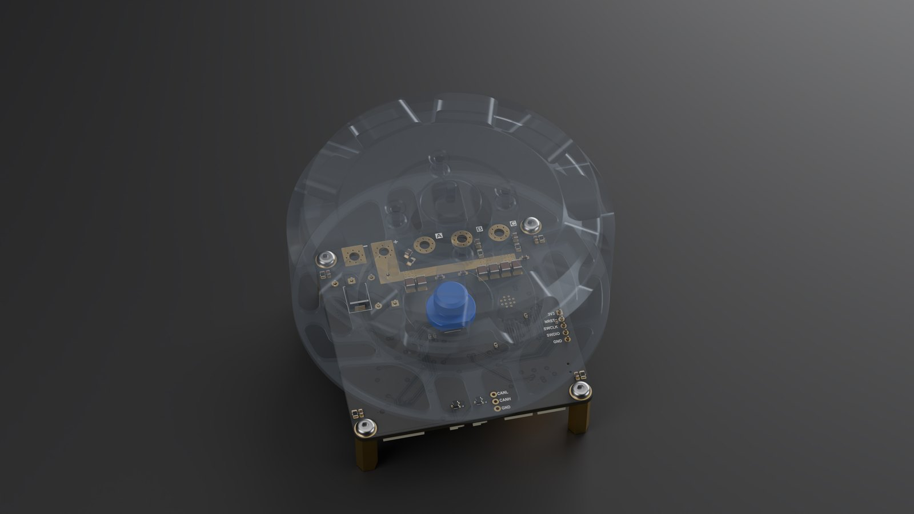

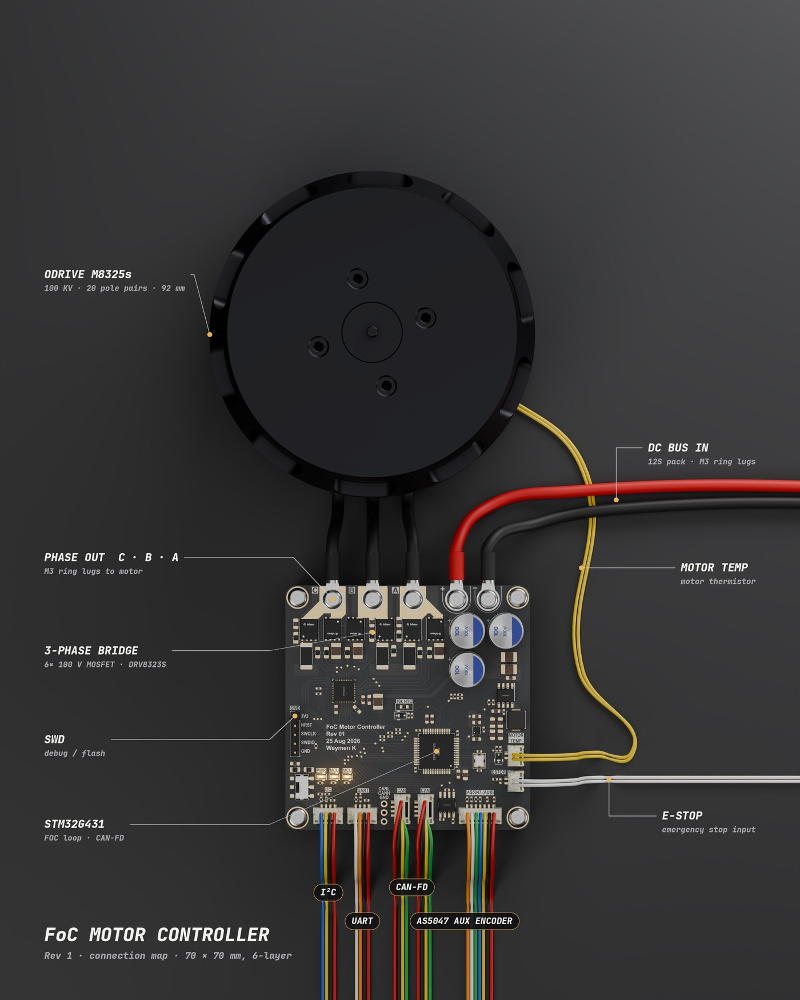

## PCB layout

Stackup: L1 signal + power, L2 ground, L3 / L4 signal + power, L5 ground (identical to L2), L6 signal + power. Phase and bus current run in outer-layer pours; the DRV8323S sits next to the bridge to keep the gate loops short.

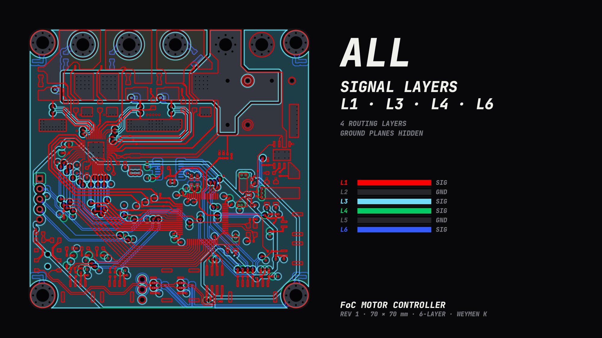

## Nov 2026 | Bench session

One day of power-stage characterisation on a 30 V / 5 A bench supply, with a 70 MHz scope and hand-held ×10 probes, a meter and a thermocouple. There was no encoder magnet mount and no dynamometer, so a T-Motor MN601-S served as an inductive load: parked by a DC current vector, or spinning unloaded without the encoder. The aim was to find what the firmware must respect and what Rev 2 has to change.

Phase current isn't supply current. A parked rotor needs only the winding's I·R drop, so a 10 A DC hold in one phase draws well under 1 A from the 30 V supply, while the bridge still hard-switches 30 V at 10 A every PWM period. Every "10 A" below is 10 A DC in one phase: the peak of the design point, not 10 A RMS.

### Switching: the edge that broke the rating

With current flowing out of a phase, the high-side FET makes the hard edge, and it looked clean. Reversing the current moves the hard edge to the low-side FET. At the gate driver's default gate current, the switch node rang to −10 V against the DRV8323's −7 V absolute maximum, and the shunt pins saw −4.6 V against ±3 V. Every earlier run had done this whenever a phase sank current.

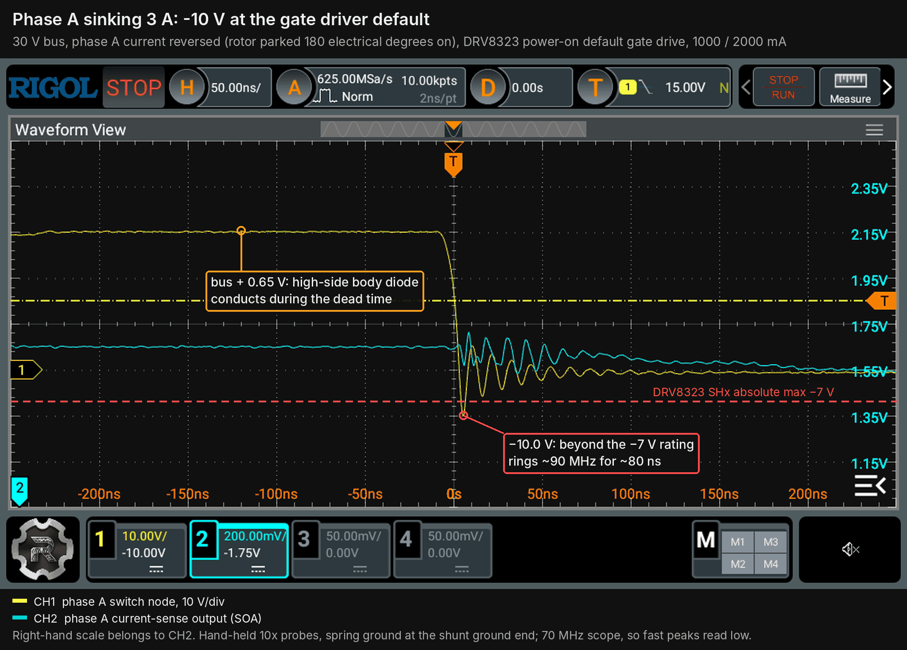
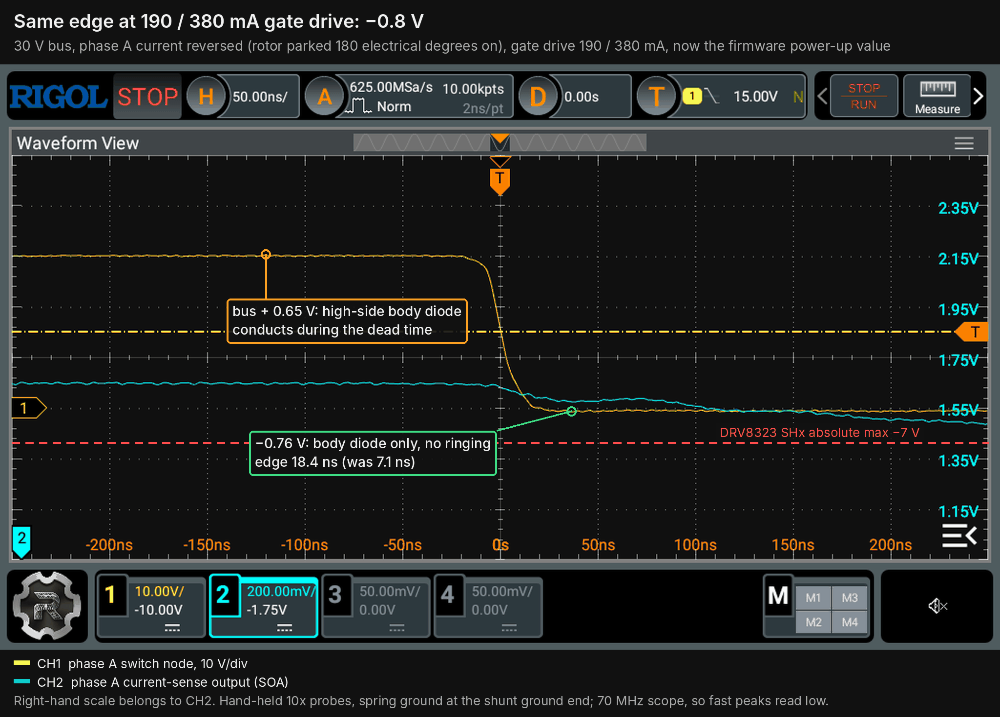

| Gate current (source / sink) | Edge time | Switch-node minimum | Across the shunt |
|---|---|---|---|
| 1000 / 2000 mA (default) | `7.1 ns` | **`−10.0 V`** | **`−4.6 V`** |
| 440 / 880 mA | `8.9 ns` | `−2.7 V` | `−2.4 V` |
| 190 / 380 mA (now the default) | `18.4 ns` | `−0.8 V` | – |

- **Bus voltage doesn't matter:** −2.7 V at 12, 24 and 30 V. The ringing is set by the edge and the layout, which is good news for the 50 V bus (still unproven above 30 V).
- **Current barely matters:** about −0.1 V per amp at 440 / 880 mA.
- **Phase C is worse than A and B** in five of five probe placements: its commutation loop is larger. At 10 A the worst case is about −3.6 V against the −7 V rating.
- **The cost of the slow setting** is about 10 ns of edge time, about 10 mW per phase at 3 A, 30 V and 25 kHz. It grows with current and voltage.

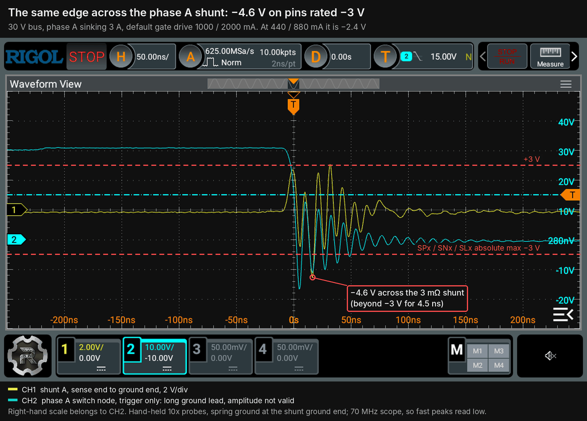
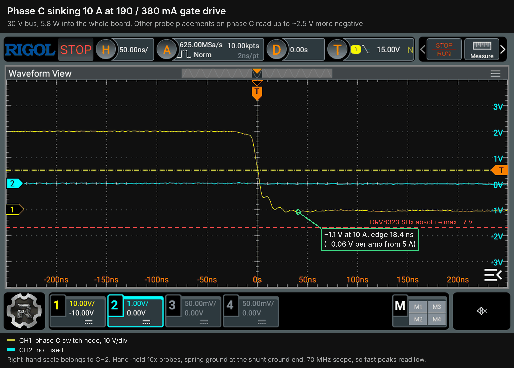

### Protection: two trips, one of them at 280 A

**Firmware over-current trip.** The outputs go off 9.5 µs after the ADC sample that sees the over-current, four times out of four. With one sample per 40 µs period, the worst case is about 50 µs: fine for overload, far too slow for a short circuit.

**Gate-driver short-circuit trip.** With the DRV8323's VDS threshold at its lowest (0.06 V), phase A's current was ramped in steps, with the firmware trip as a ceiling. At 22 A the gate driver tripped first, three times out of three. 0.06 V across the FET's 2.7 mΩ is 22 A, so **the power-on setting of 0.75 V means a trip at about 280 A**: no usable short-circuit protection. It's now 0.13 V, about 48 A cold and 30 A hot.

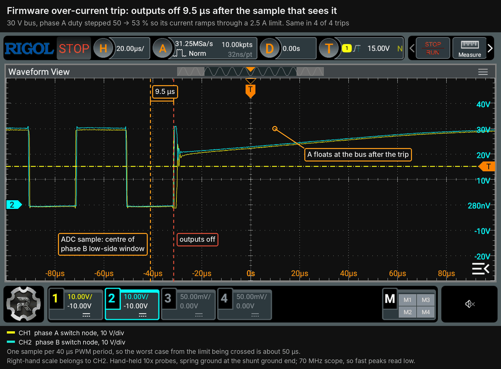
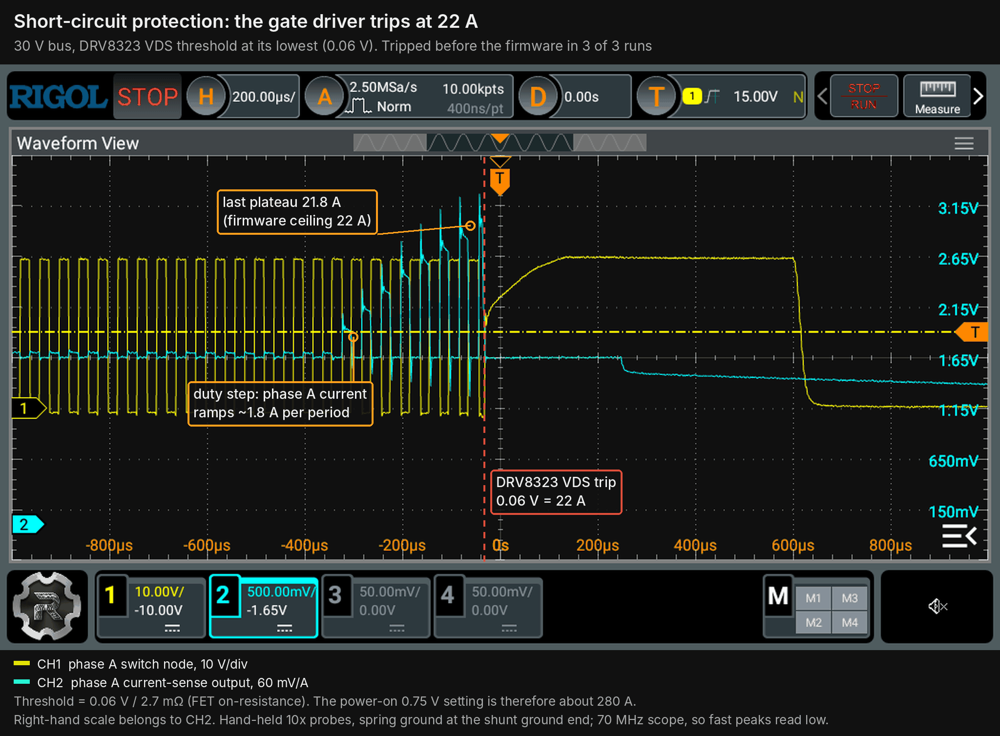

| Layer | Threshold | Response | Covers |
|---|---|---|---|
| Firmware over-current | Per mode (12 A for holds); can't exceed 22 A | `9.5 µs` after the sample, about `50 µs` worst case | Overload |
| DRV8323 VDS monitor | `0.13 V`: about 48 A cold, 30 A hot | Datasheet: 4 µs deglitch plus turn-off (not measured) | Short circuit |
| Firmware bus limits | 36 V / 22 V on the 30 V bench | Every control period | Supply faults, braking |
| Heartbeat watchdog | `500 ms` | `501 ms` measured, 5 of 5 | Lost control link |
| SMCJ51CA TVS | Breaks down at ≥ 56.7 V, clamps up to 82.4 V | Nanoseconds | Transients, **but it clamps above the 65 V rating of the DRV8323 and the buck** |
| E-stop | None on Rev 1 | – | The supply switch was the E-stop |

### Current sense, dead time, braking, heat

| Check | Result |
|---|---|
| Current-sense scale, 3 A and 5 A holds | Correct within `1–2 %` |
| Current-sense offsets, 12 to 30 V | Move less than `7 mA` |
| Current-sense noise | `20–27 mA` rms per sample |
| High duty | Phases A and B read down to a `1.2 µs` window; phase C fails at about `3 µs`, because it's second in its ADC sequence. The firmware rebuilds it from the other two |
| Dead time | Set by the gate driver, not the MCU: halving the MCU's 200 ns changes nothing. Driver now at 50 ns; no shoot-through at any setting |
| Braking, 3 A from 1000 rpm on a 12 V bus | Bus pumped to `23 V`; the bench supply can't sink current. A firmware clamp at 90 % of the limit now holds it within `0.1 V` |
| Low-side FET case, 10 min hold | `+7.5 °C` at 3 A, `+10.2 °C` at 5 A (10 A not yet run) |
| Supply ramped 30 → 4 → 30 V | Runs down to 5 V, clean restart between 5 and 6 V |
| 50 sensorless starts | 50 of 50 reached closed loop, `2.45 s ± 40 ms` |
| Bus ripple, 1000–3000 rpm | `58–79 mV` p-p at 6–21 W |

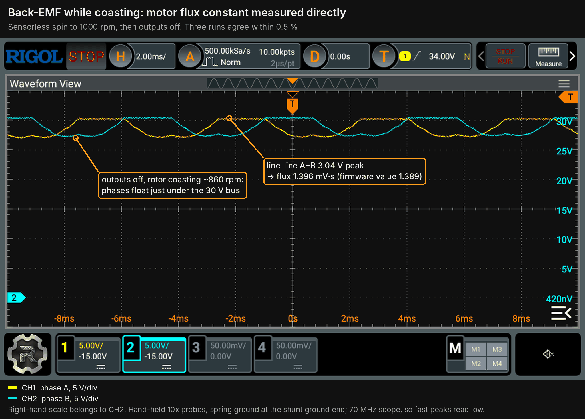
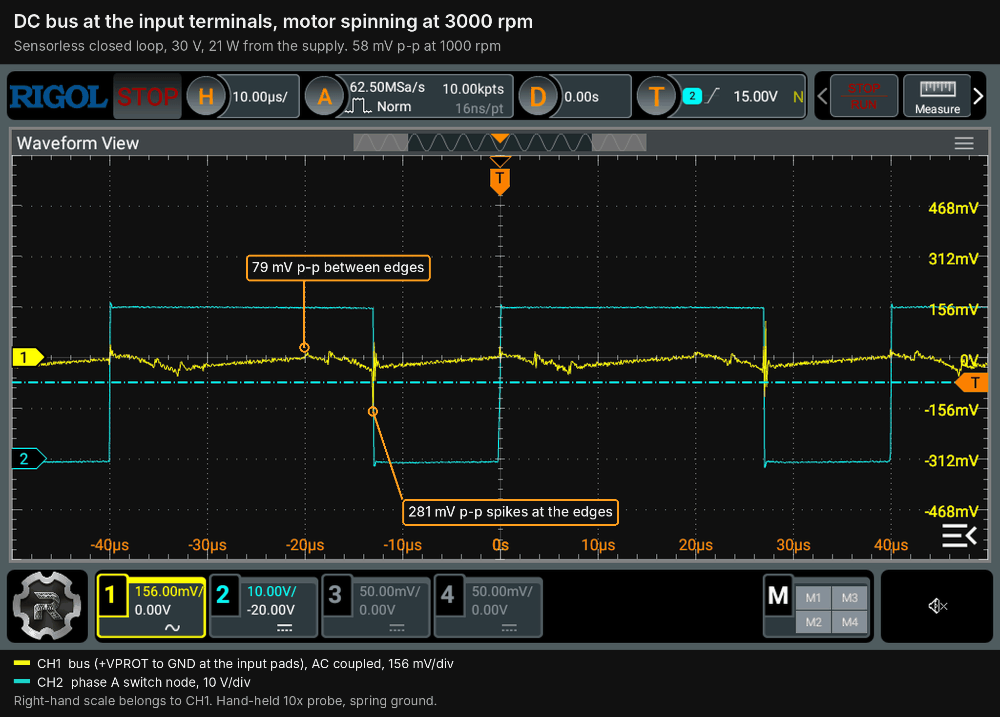

**Motor constants.** From the coasting back-EMF, the flux linkage is 1.396 mWb (KV ≈ 282 rpm/V), within 0.5 % of the firmware's value. Four-wire with the motor unplugged, the phase resistance is 17.97 mΩ. The 98 mΩ the firmware identified in September was the bridge's dead-time voltage error read as resistance at 1 A.

**Without an encoder.** Sensorless modes were added for this session: open-loop start handing over to a flux observer, and a position mode that parks the rotor with a current vector. Closed-loop speed reached 3000 rpm unloaded.

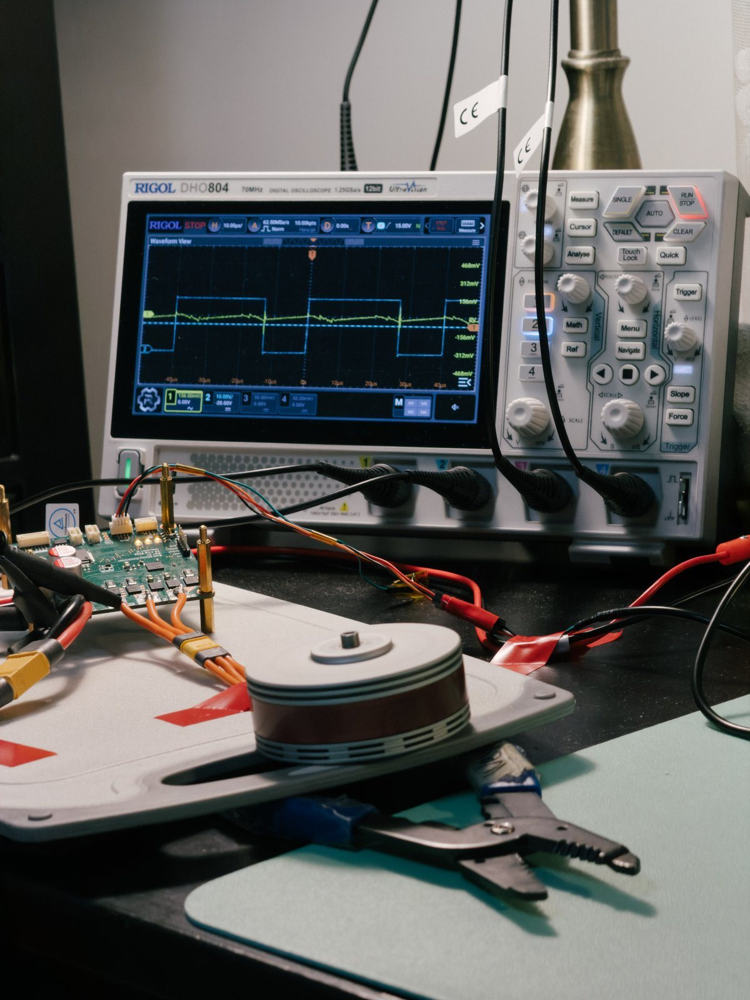

### Limits of these numbers

- Not tested: above 30 V and 10 A DC, FET temperature at 10 A, the gate driver's short-circuit reaction time, efficiency under load, bulk-capacitor ripple at full power, EMC, CAN-FD, the encoder.
- A 70 MHz scope and hand-held probes under-read 7–9 ns edges: real peaks are higher than stated.
- Switch-node voltages are measured against the shunt's ground end, not the gate driver's ground pin.

## Simulation vs scope

October 2026, before the full characterisation: three LTspice decks built from the Rev 1 netlist, each predicting what a bench measurement on a Rigol DHO804 should show, then checked against the scope captures. Bench results are on a 12 V supply; hot-plug is at 30 V.

### 1 · Hot-plug (XT60 into a live supply)

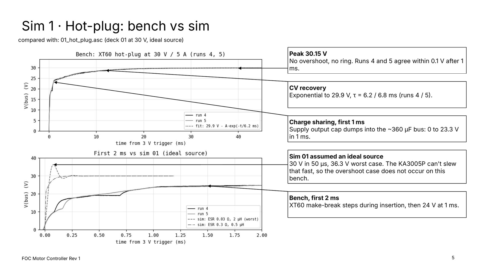

30.15 V peak, no overshoot. The bench supply limits the charge rate, so the 36.3 V overshoot the ideal-source sim predicts doesn't occur on this supply.

### 2 · Half-bridge switching (one leg, hard edges)

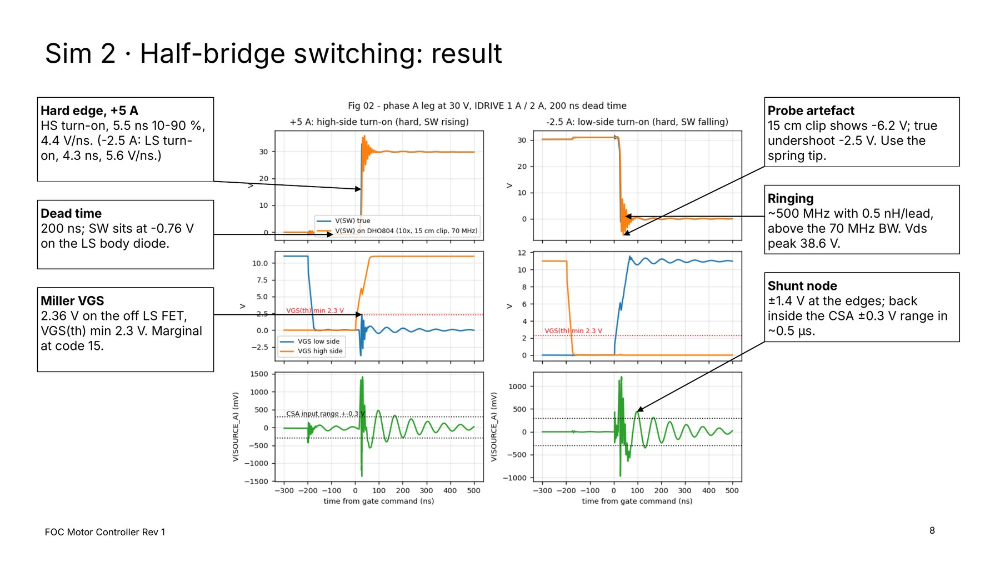

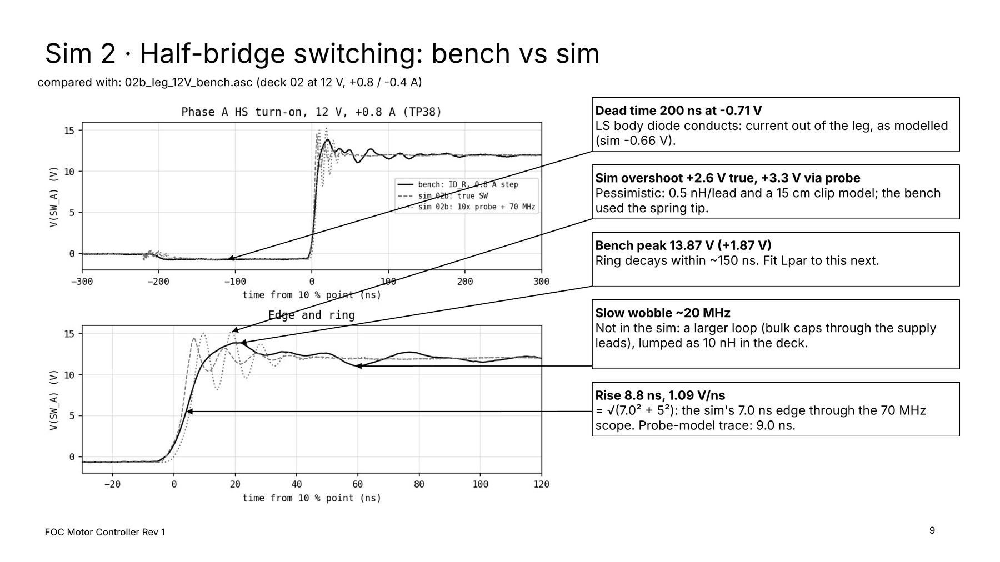

8.8 ns rise and 13.87 V peak at 12 V, against 7.0 ns in the sim. The difference is mostly the 70 MHz probe.

### 3 · Current sense (standstill hold, I/f spin)

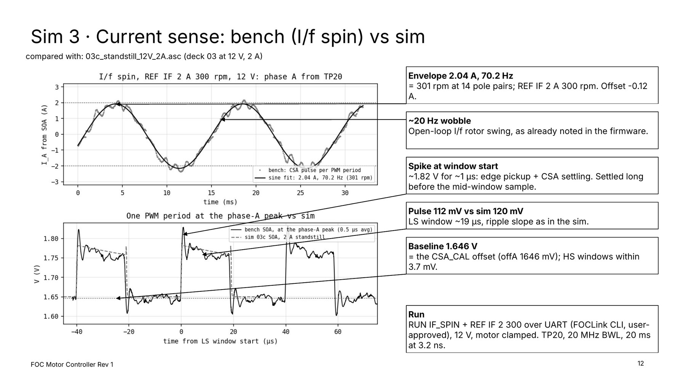

The I/f spin at 2 A / 300 rpm gives a 2.04 A envelope, and the 112 mV pulse matches the sim's 120 mV.

Full slides: [Sim and bench results (PDF)](https://github.com/WeymenKoo/FOC-Motor-Controller/blob/main/Documentation/FOC_Motor_Controller_Sim_and_Bench_Results.pdf). Decks, results and raw captures: [`Testing/Simulation/`](https://github.com/WeymenKoo/FOC-Motor-Controller/tree/main/Testing/Simulation).

## Bench GUI: FOCLINK

FOCLINK is the bench console: a PySide6 app that talks to the firmware over UART. It holds no safety logic; it only requests, and the firmware decides what is allowed.

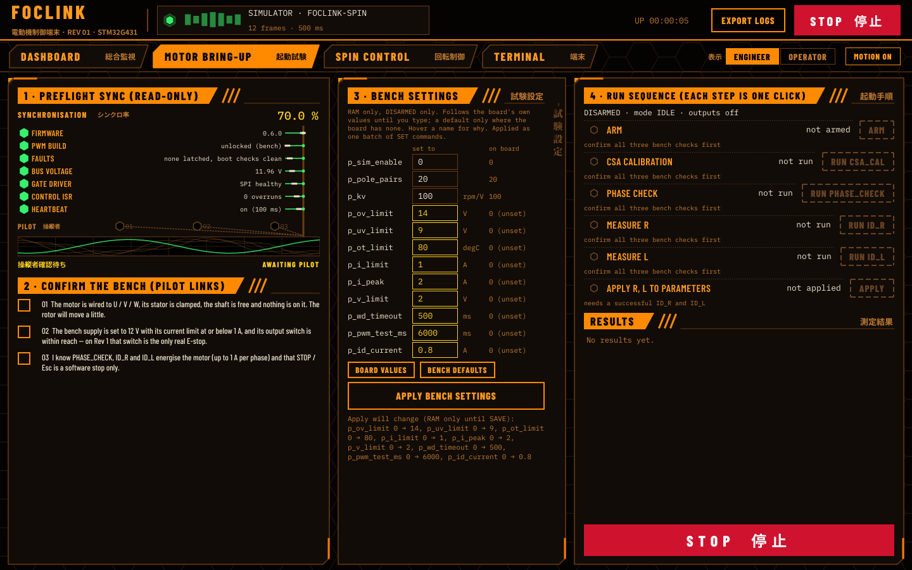
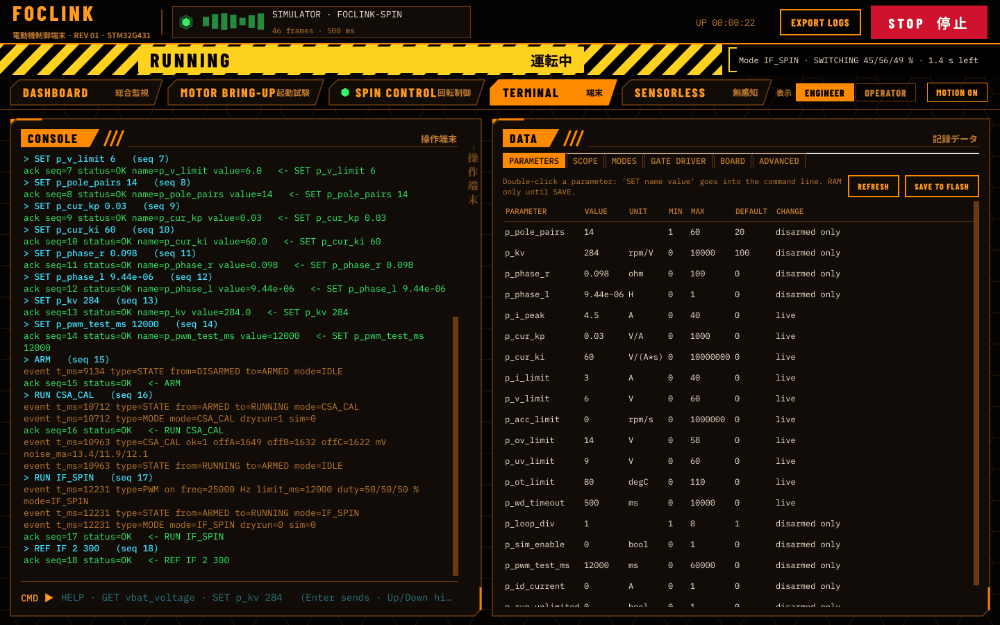

These come from the GUI's built-in board simulator, spinning a simulated motor at 300 rpm and 2 A with the limits saved on the real board. They show the GUI, not bench data.

## Documents

| File | What it is |
|---|---|
| [Schematic](https://github.com/WeymenKoo/FOC-Motor-Controller/blob/main/Documentation/FoC_Motor_Controller_Schematic.pdf) | Full schematic, 14 pages |
| [PCB artwork](https://github.com/WeymenKoo/FOC-Motor-Controller/blob/main/Documentation/FoC_Motor_Controller_PCB_Artwork.pdf) | Board drawing |
| [Sim and bench results](https://github.com/WeymenKoo/FOC-Motor-Controller/blob/main/Documentation/FOC_Motor_Controller_Sim_and_Bench_Results.pdf) | Simulation and bench-correlation slides |
| [Bench session](https://github.com/WeymenKoo/FOC-Motor-Controller#bench-session-22-november-2026) | Rev 1 characterization: switching, protection, current sensing, dead time, braking, heat, motor constants, Rev 2 list |

## Validation | What's proven, what's next

- [x] MCU, gate driver over SPI, current-sense amplifiers and PWM verified
- [x] Switch node on every phase at 12, 24 and 30 V, up to 10 A; gate drive fixed
- [x] Dead time measured, and set at the gate driver
- [x] Firmware over-current trip timed; gate-driver short-circuit trip found at 280 A and fixed
- [x] Current sense checked against a meter; phase C's high-duty gap found and worked around
- [x] Motor constants measured: flux linkage from back-EMF, four-wire resistance
- [x] Closed-loop sensorless speed to 3000 rpm unloaded; 50 of 50 starts
- [ ] The 12S bus, above 30 V
- [ ] 10 A RMS, with FET temperature over time
- [ ] Closed-loop current and speed control on the encoder (needs the magnet mount)
- [ ] Shaft load, and braking into a real joint's energy
- [ ] CAN-FD with more than one board

## Rev 2 | What changes

| Priority | Change | Why |
|---|---|---|
| High | Bus protection that clamps below 65 V | The TVS clamps at up to 82 V, above the DRV8323 and buck ratings |
| High | Braking resistor or active bus clamp | Braking pumped a 12 V bus to 23 V with a bare rotor |
| High | Current-sense outputs routed so both ADCs sample together | Phase C is unreadable at high duty |
| High | Hardware E-stop independent of the gate driver's enable | Rev 1 has none |
| High | Bulk capacitors with a verified ripple rating, about 8 A RMS | Not checked on Rev 1 |
| Medium | Gate resistors, so edge rate doesn't depend on a register that powers up at its fastest | −10 V at the default |
| Medium | Test points with a ground pad beside each | Hand-held readings varied by up to 2.5 V |
| Medium | Thermal vias under the low-side FETs, temperature sensor by the bridge | Neither on Rev 1 |
| Medium | MCU with more headroom | Flash 95.5 % and RAM 96.7 % full |

The full list, with the low-priority items, is in the [repository README](https://github.com/WeymenKoo/FOC-Motor-Controller#rev-2).
