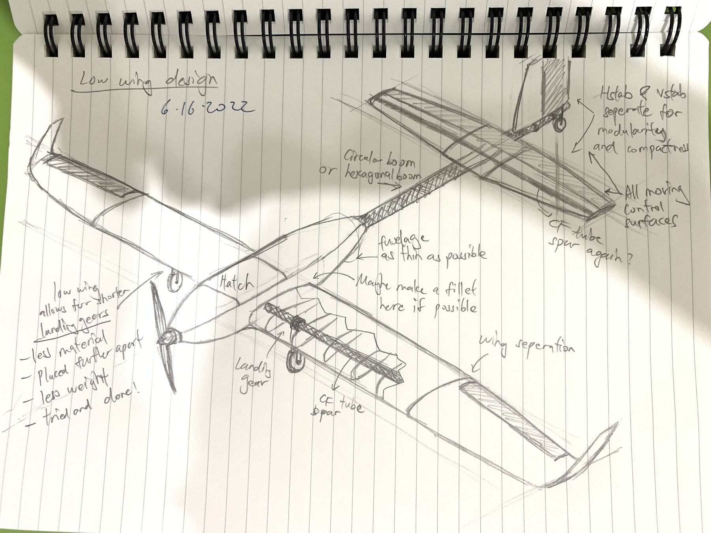
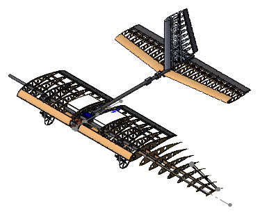
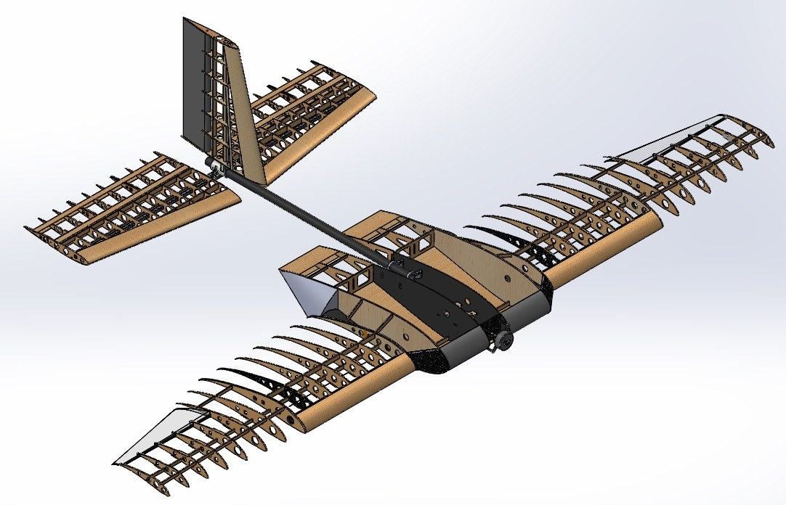

Before I moved to the electrical side of UBC AeroDesign, I spent two seasons as mechanical lead for lifting surfaces and aerodynamics: the wings, the flaps and the tail. *Kyogre*, the blue one, was the 2021–22 plane. *Spirit*, the 2022–23 plane, was built twice.

| | |
|---|---|
| Kyogre | 2021–22 · blended wing and fuselage · `119 in` span · aspect ratio `6.37` · E591 root, S1223 RTL tip, S8035 tail |
| Spirit | 2022–23 · blended wing body · `120 in` span · S808 fuselage, S1223 inner, S1223 RTL outer, NACA 0012 tail |
| Structure | Laser-cut balsa and plywood ribs · carbon fibre spar and tail boom · MonoKote |
| Tools | XFLR5 · MATLAB · SolidWorks · AutoCAD |

## Drafting | Paper first

Neither sketch is the plane that got built: after the trade study, Spirit became a blended wing body. The single carbon tail boom and the wing that splits into sections carried over.

## Analysis | XFLR5, then the design report

More than 30 low-Reynolds-number airfoils went through XFLR5. The wing and tail were then modelled in it as a whole, and those runs fed the figures in the design report.

## CAD | SolidWorks, reviewed

Every rib, strap and piece of sheeting was modelled in SolidWorks, flattened to DXF and nested in AutoCAD for the laser cutter. On Spirit the wing was split between several of us, so the CAD went through marked-up reviews.

## Build | Ribs, carbon and MonoKote

## Fate | One crash, one flight

**Kyogre** crashed on a test flight on 9 April 2022. The tail clamp was loose. The analysis covered the boom in a 45° bank; it did not cover a clamp that wasn't tight. It was rebuilt, then UPS lost the shipment to Fort Worth. UBC placed 5th of 18 without a flight.

**Spirit** came out at `22.92 lb` against a `20 lb` target, with the CG too far aft, so it was built again. UPS lost that one too, then delivered it late. We reached the flight line one minute before the cutoff, and UBC placed 7th of 12 without a flight.

It flew once, at dusk on 15 April 2023, outside the competition rounds.

