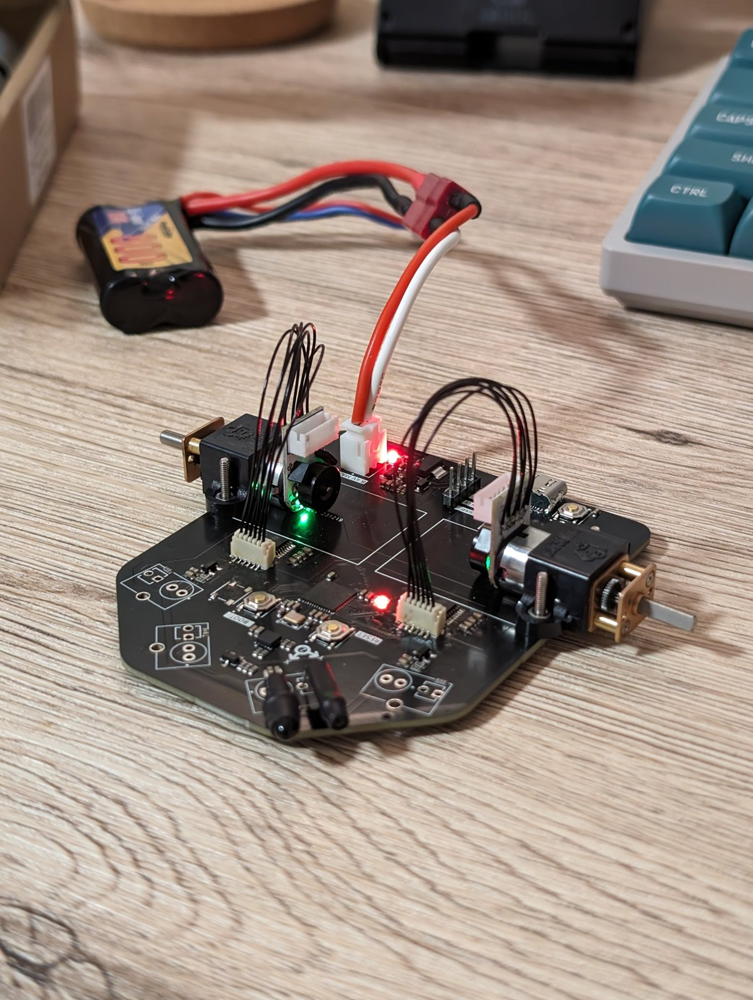
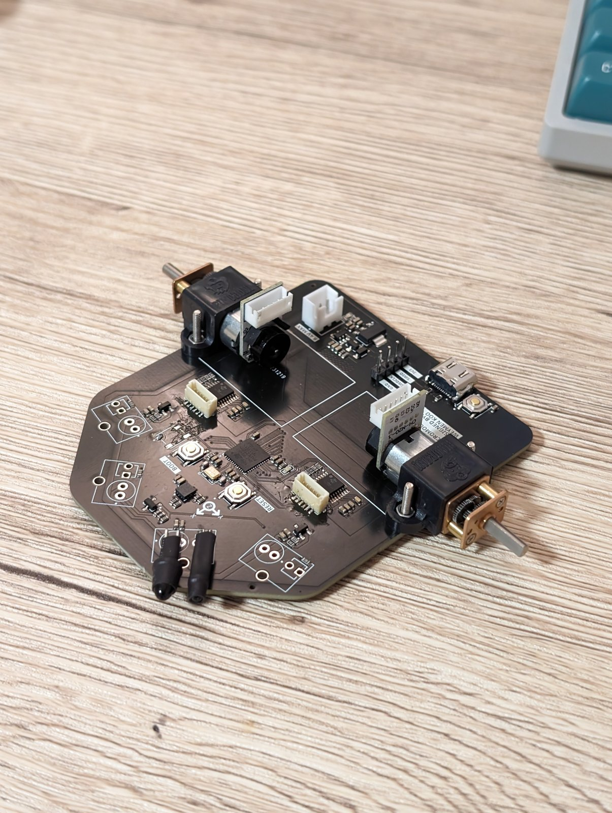
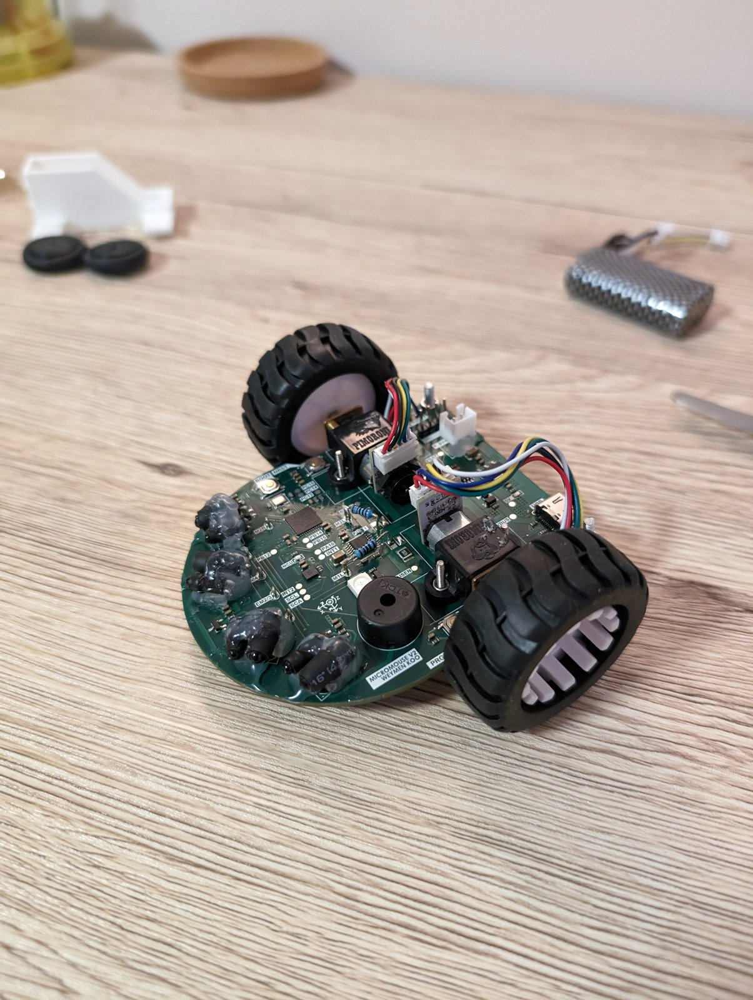

A micromouse is a small autonomous robot that drives through a maze. This one is a single board that carries the electronics and the two motors. V1 failed; V2 fixed it.

**Status:** V2 built.

## V1

| | |
|---|---|
| MCU | STM32F411CEU6, 25 MHz crystal |
| Motor drivers | 2 × DRV8874 (phase / enable) |
| Sensing | LIS3DHTR accelerometer · IR emitters (2N7002 switched) and receivers |
| Power | AMS1117 and AP2112K 3.3 V |
| USB | USB-C |
| Tools | Altium Designer, STM32CubeIDE |

**Why it failed:** bad pinout. I didn't check the STM32 pinout properly and put the motor driver inputs on pins without timer channels, so the motors couldn't be driven with hardware PWM. In the V1 firmware configuration the left driver's enable is on PA4, which has no timer on the STM32F411.

## V2

| | |
|---|---|
| MCU | STM32F411CEU6, 25 MHz crystal |
| Motor driver | DRV8833 (dual H-bridge); all four inputs on TIM2 channels 1 to 4 |
| Encoders | Left on TIM3, right on TIM4 (encoder mode) |
| Wall sensors | 4 × SFH4545 IR emitters, pulsed through 2N7002s from TIM5 · 4 × TEFT4300 phototransistors into the ADC |
| IMU | LSM6DS3TR-C, I2C |
| Power | 2-pin JST-XH battery · AMS1117 5 V · AP2112K 3.3 V |
| Other | USB-C (USB CDC and DFU boot) · buzzer · RGB LED |
| Board | 4 layers |
| Tools | Altium Designer, STM32CubeIDE |

The firmware runs a proportional wall-centring loop at 1 kHz: it reads the left and right IR receivers, steers by their difference, and sets the two motors' PWM.

<figure><video src="v2-wall-test.mp4" poster="v2-wall-test-poster.jpg" controls muted playsinline preload="metadata" style="width:100%;height:auto"></video><figcaption>V2 with its IR sensors running and a metal plate held beside it as a wall, February 2024.</figcaption></figure>

