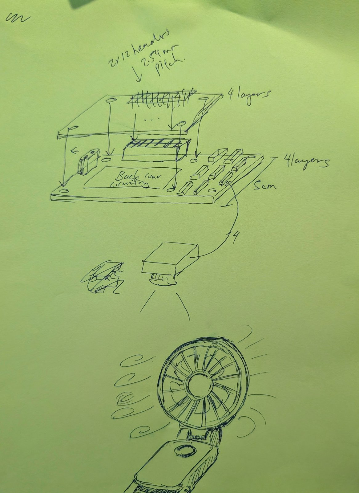
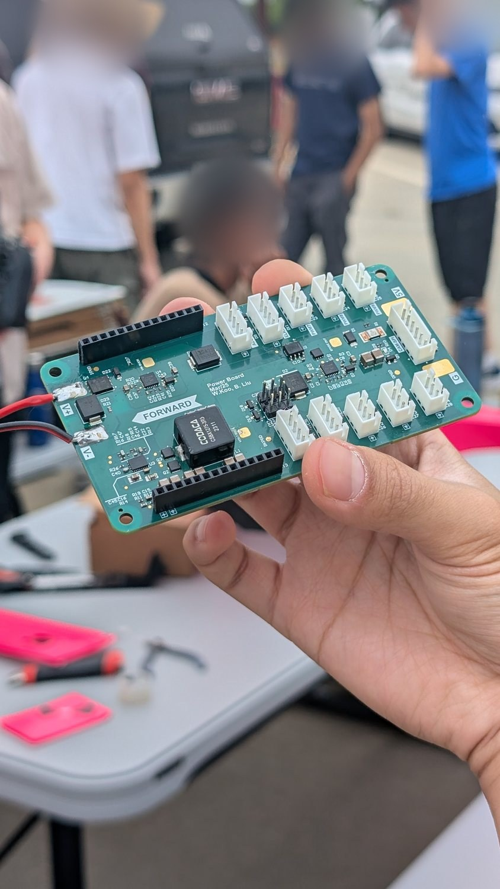
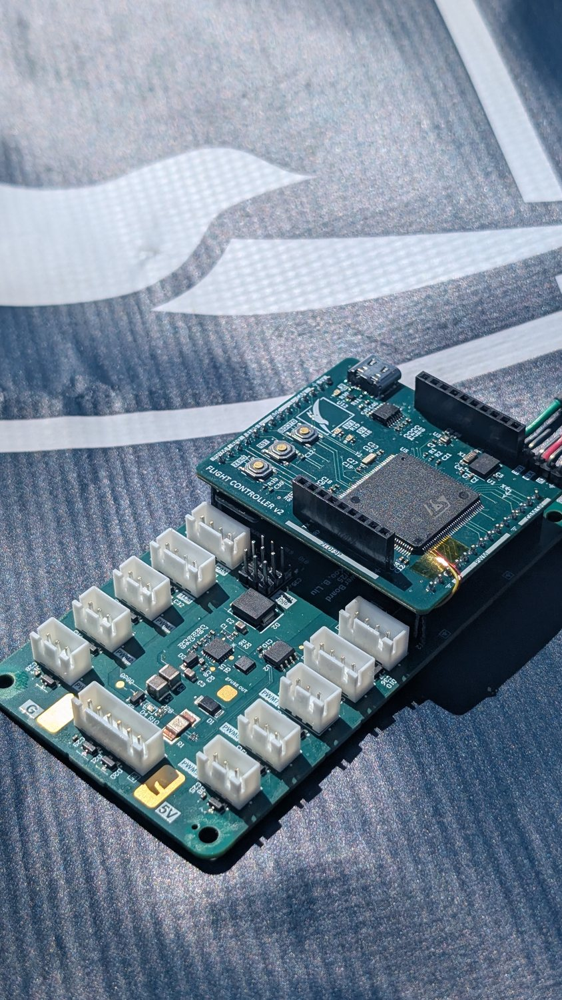
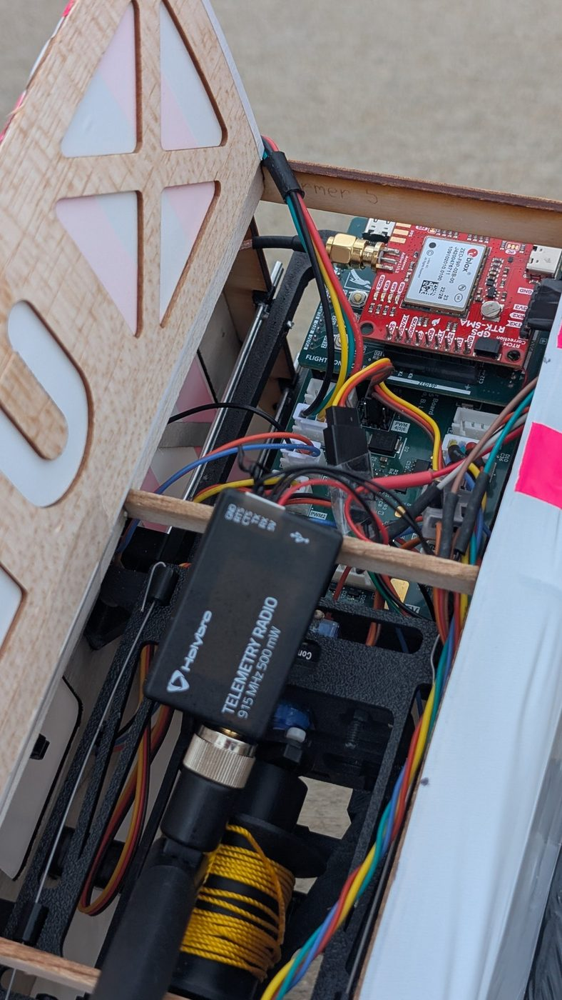
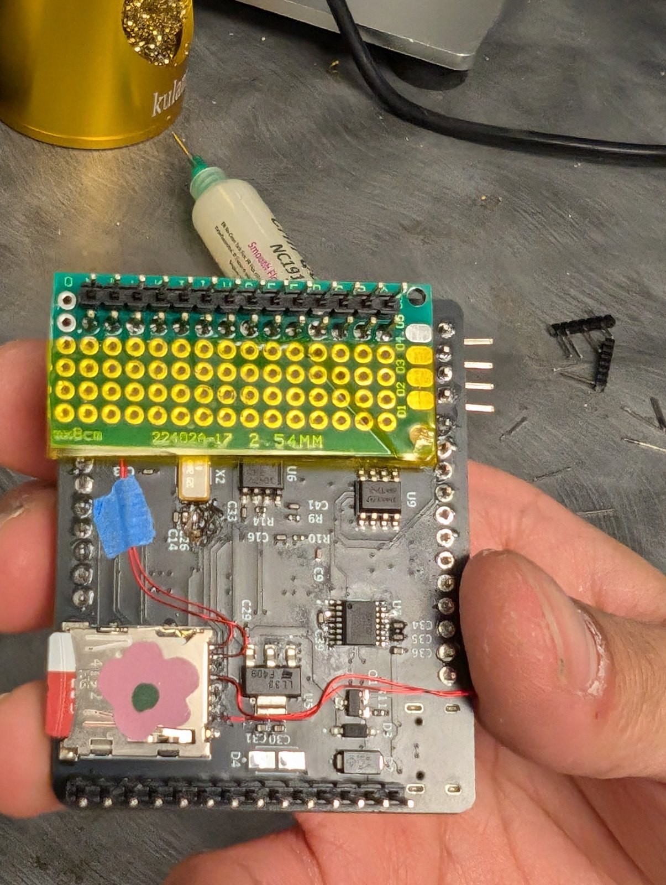
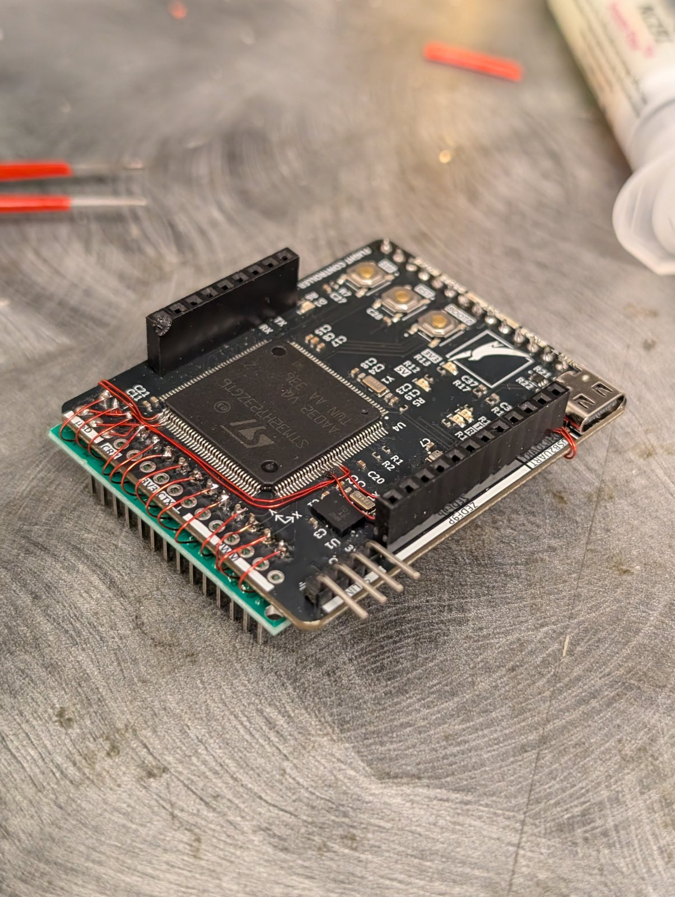
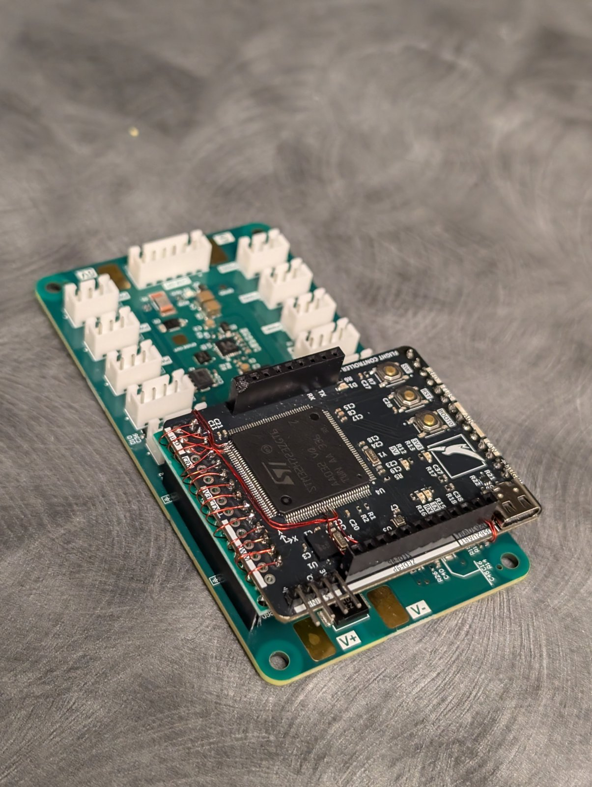

The power board sits between the flight battery and everything else in the aircraft. It takes a 2S–4S LiPo, makes one protected 5 V rail, and distributes it to nine servo outputs, the receiver, the telemetry radio, the camera, the sensors and the flight controller, which plugs into it from above.

I was the lead designer of this board, a clean-sheet redesign after the previous revision did not work. B. Liu is credited on the silkscreen for groundwork from that earlier revision.

**Status:** built and flown in UBC AeroDesign's aircraft in the Advanced Class of SAE Aero Design 2025. Bench validation (ripple, regulation, protection thresholds, temperature) is in progress; see [Validation](#validation) at the end.

| | |
|---|---|
| Input | 2S–4S LiPo; input eFuse window `5.97–24.86 V` |
| Output | 5 V, 15 A maximum (design) |
| Buck | TI LM5146 controller, 2 × AON7534 FETs, 3.3 µH, 300 kHz |
| Protection | TPS25983 eFuse on the input and on the servo output · P-channel reverse-polarity FET · TVS diodes · an ESD array on every connector |
| Sensing | Servo-rail current: INA240A2 across a 5 mΩ shunt, to the flight controller's ADC |
| Outputs | 9 PWM servo channels · ELRS receiver · telemetry radio · CAN · ArduCam (SPI) · external power sensing |
| Flight controller | Plugs in through two 1 × 14, 2.54 mm headers (J12, J13) |
| Board | 110 × 60 mm, 6 layers |
| Tools | Altium Designer |
| Designers | W. Koo (lead) · B. Liu (earlier revision) |

## Planning | From the chalkboard

The avionics for the 2024–25 aircraft were planned on a chalkboard first: the flight controller, the receiver, the radios, the camera and the power budget. The stack itself was sketched on paper: the flight controller sitting on 2 × 17, 2.54 mm headers above the power board.

## Power flow

The board as built has one path:

1. **Input eFuse** (TPS25983) with reverse-polarity protection, from the battery to `VBATT_PROT`.
2. **LM5146 buck**, from `VBATT_PROT` to `VBUCK_OUT`, 5 V.
3. **Servo output eFuse** (a second TPS25983) and a 5 mΩ current shunt, from `VBUCK_OUT` to `5V_PROT`.
4. **Connectors**: every connector on the board, servo or otherwise, is supplied from `5V_PROT`.

Each stage has a power-good signal brought out to a test pad: `IPGD` (input eFuse), `BKPGD` (buck) and `OPGD` (output eFuse). `OPGD` also drives a status LED through a 2N7002.

The crossed-out blocks are what the design started with: a second battery with its own input eFuse, an LM5050 ideal-diode OR between the two packs, current sensing on each battery input, and a second 5 A buck with its own ideal diode.

## Input protection | Input eFuse and reverse polarity

- **Reverse polarity:** a P-channel MOSFET (Infineon BSC030P03NS3, Q4) in the battery path. Its gate is pulled to ground through 100 kΩ and clamped by a 6 V zener.
- **Surge:** a 1.5 kW TVS (38.9 V) across the battery input.
- **eFuse:** TI TPS25983 (U4), set with resistor dividers and capacitors on its pins:

| Setting | Value |
|---|---|
| Undervoltage | on at `5.97 V`, off at `5.48 V` |
| Overvoltage | off at `24.86 V` |
| Current limit | `17.81 A` |
| Transient overcurrent blanking | `2021 µs` |
| Inrush | `0.46 A`, no dV/dt start-up required |
| On a fault | latches off |

- A solder jumper bypasses the eFuse. Pulling `EN/UVLO` below 0.8 V shuts it down.
- A 30 V, 5 A diode (D24) sits between the eFuse output and ground.

## Buck converter | 5 V, 15 A: LM5146

The design targets, as written on the sheet:

| | |
|---|---|
| Input | `7–30 V` (controller on at `6 V`, off at `5.5 V`) |
| Output | `5 V`, `15 A` maximum |
| Switching frequency | `300 kHz` |
| Soft start | `4 ms` |
| Output ripple | `8 mV` peak-to-peak, with output capacitor ESR ≤ `2 mΩ` |
| Inductor ripple current | `3.7 A` peak-to-peak |
| Loop crossover | `50 kHz` |

- **Controller:** TI LM5146 (U3), synchronous, driving two AON7534 N-channel MOSFETs (Q2 high side, Q3 low side).
- **Inductor:** Codaca CSBX1275-3R3M, 3.3 µH, saturating at 37 A. The sheet records the rule it was picked by: saturation current above the eFuse current limit (17.81 A).
- **Output voltage:** 24.9 kΩ over 4.75 kΩ on the 0.8 V feedback pin, which sets `4.994 V`.
- **Capacitors:** 4 × 4.7 µF ceramic on the input, 5 × 4.7 µF ceramic on the output; a 2.2 Ω + 100 nF RC across the input.
- **Compensation:** a type III network (R15, C44, C46 on `COMP`; R16, R17, C47 on `FB`) for the 50 kHz crossover.
- **Light load:** `SYNCIN` is left unconnected, so the controller runs in diode emulation (discontinuous conduction) at light load.
- **Grounds:** analog ground for the IC reference and power ground for the high-current paths, joined at one net tie.

## Servo output | Output eFuse and current sense

A second TPS25983 (U1) sits between the buck and the connectors:

| Setting | Value |
|---|---|
| Undervoltage | on at `2.99 V`, off at `2.74 V` |
| Overvoltage | off at `7.93 V`, back on at `7.27 V` |
| Current limit | `17.81 A` |
| Transient overcurrent blanking | `2021 µs` |
| Inrush | `1.01 A` |
| On a fault | retries 4 times, `94 ms` apart |

- An AON7534 (Q1) is driven from the eFuse's `DVDT/BGATE` pin.
- An SMCJ12A TVS on the buck side, a Schottky (RSX501L) from the output to ground, and 2 × 100 µF on the output.

**Current sense.** A 5 mΩ, 3 W shunt (R1) carries the whole servo rail. A TI INA240A2 reads it with a gain of 20 V/V, referenced to mid-supply (2.5 V at 0 A):

| | |
|---|---|
| Full scale | `15 A` → `75 mV` across the shunt → `1.5 V` swing at the output |
| Shunt loss at 15 A | `1.125 W` |
| Output | `SRV_Isns`, to the flight controller's `ADC1` |

The sheet requires a Kelvin connection from the shunt to the amplifier; it is made with two 0 Ω links (R4, R5).

## Connectors

| Ref | Pins | Use |
|---|---|---|
| J1–J3, J6–J8 | 3 | Servo outputs, PWM 7, 8, 9, 1, 2, 3 |
| P1–P3 | 3 | Header servo outputs, PWM 6, 5, 4 |
| J4 | 4 | External power sensing: 5 V, `ADC_V2`, `ADC_I2`, GND |
| J5 | 4 | ELRS receiver: 5 V, TX, RX, GND |
| J9 | 4 | CAN: 5 V, CAN P, CAN N, GND |
| J10 | 4 | Telemetry radio: 5 V, TX, RX, GND |
| J11 | 6 | ArduCam: 5 V, SPI (MOSI, MISO, SCK, CS), GND |
| J12, J13 | 14 each | Flight controller interface: PWM 1–9, CAN, UARTs, camera SPI, ADC, 5 V |

Every connector has a 100 nF capacitor on its 5 V pin and a PACDN042 ESD array on its signal lines.

## PCB layout

| Layer | Use | Copper |
|---|---|---|
| L1 | Power, top | 52.9 % |
| L2 | Ground | 91.6 % |
| L3 | Ground | 91.6 % |
| L4 | Signal | 6.4 % |
| L5 | Ground | 91.6 % |
| L6 | Signal, bottom | 10.2 % |

L2, L3 and L5 are the same solid ground pour. The battery comes in on the V+ and V− pads on one short edge; the 5 V and ground pads are on the other.

## Flight Controller v2 | The flight controller (not my design)

Flight Controller v2 was designed by another member of the avionics team. It is built around an STM32H723ZG, with a BNO055 IMU, a BMP390 barometer, a TCAN1042 CAN transceiver and a u-blox ZED-F9P GNSS board on top. It plugs into the power board's J12 and J13 and takes its 5 V and every servo, radio and camera signal through them.

## Rework | The flight controller didn't fit

The connector spacing didn't match. Flight Controller v2's header rows came out narrower than the power board's J12 and J13, so the two boards couldn't plug together. Checking that the two designs mated was my job as avionics lead, and I missed it.

The fix was rework, done on 22 March 2025: a strip of 2.54 mm perfboard with a header on it, soldered along one edge of the flight controller, and fine jumper wires.

## SAE Aero Design 2025

The power board and Flight Controller v2 flew in UBC AeroDesign's aircraft, number 221, in the Advanced Class of SAE Aero Design 2025.

Results: [SAE Aero Design Advanced Class results (PDF)](https://www.saeaerodesign.com/content/Advanced-Class-Results.pdf).

## Validation | Bench tests

The design numbers above are targets. These are the bench tests, run on a bench supply and power resistors, with a scope on a short ground spring. Each result goes here with its conditions and scope capture.

- [ ] Smoke test: 16 V in, 0.5 A current limit, no load
- [ ] Input eFuse: undervoltage and overvoltage thresholds, measured against the settings in the table above
- [ ] Line regulation: 8 V to 25 V in, at 1 A
- [ ] Load regulation: 0 to 1 A to 5 A
- [ ] Output ripple at 1 A and 5 A, against the `8 mV` target
- [ ] Load step response
- [ ] Servo current sense: `SRV_Isns` against a meter, 0–5 A
- [ ] Thermal: 5 A for one hour, temperature of the FETs, inductor and shunt
