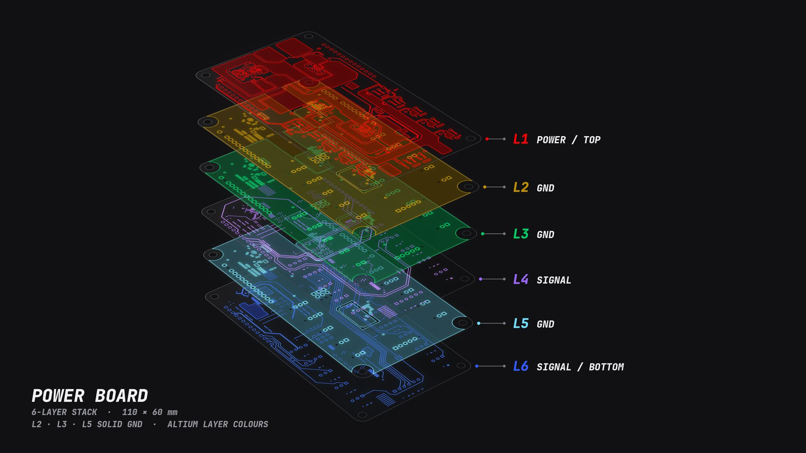
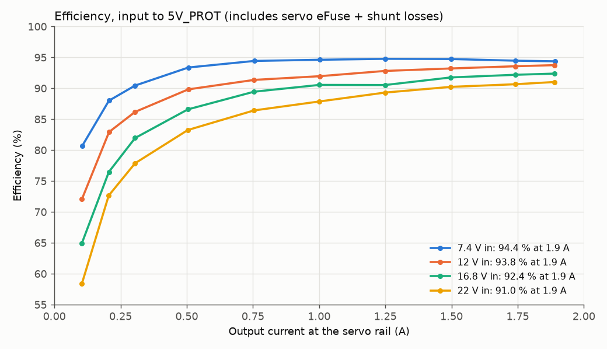
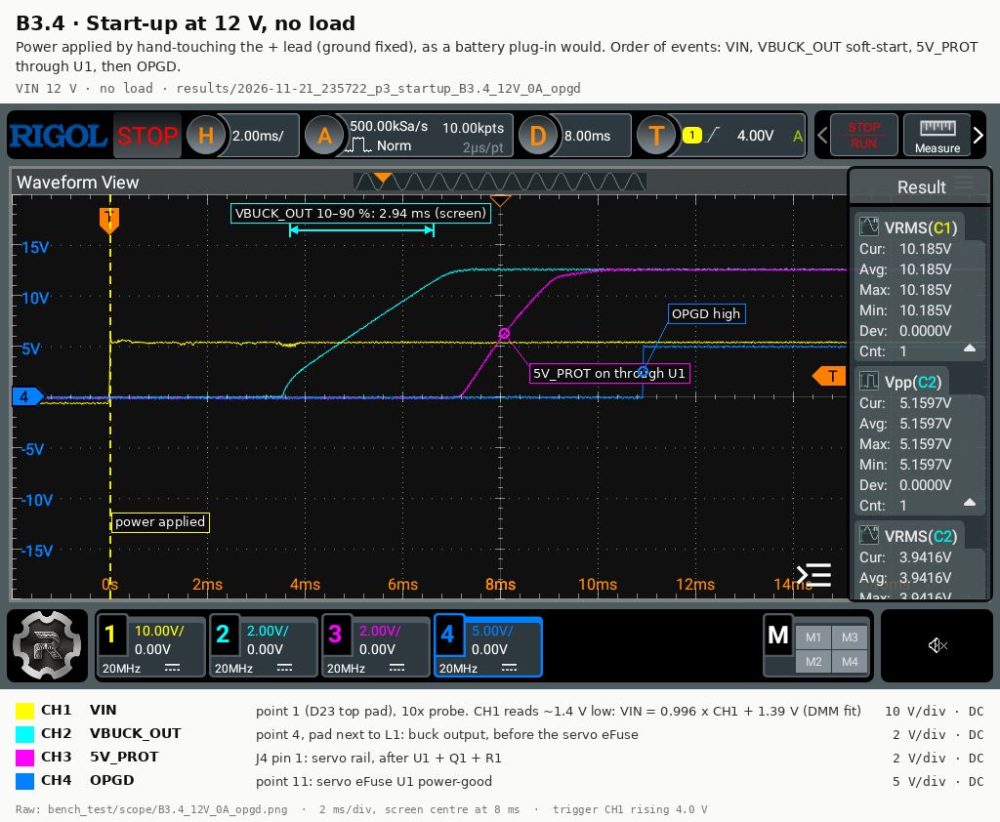
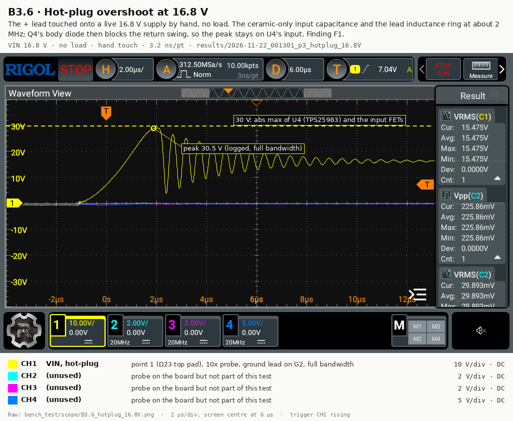
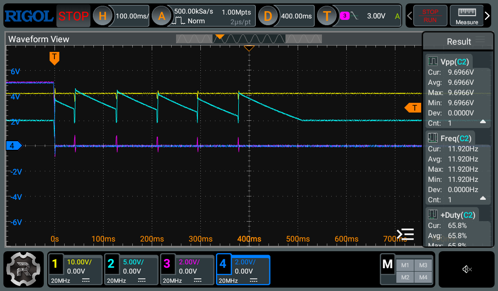

It sits between the flight battery and everything else in the aircraft: every servo, the receiver, the radios, the camera and the flight controller, which plugs in on top.

**Does it work?** It flew the whole 2025 season. A year later I put it on the bench: everything it was designed to do, it does, and three things I didn't design for turned up.

I was the lead designer, a clean-sheet redesign after the previous revision didn't work. B. Liu is credited on the silkscreen for groundwork from that earlier revision.

## What it is

A 2S–4S battery comes in. A protected 5 V rail, rated for 15 A, goes out to nine servos and everything else. There's an electronic fuse on the way in and another on the way out, so a short on the servo side can't take the flight controller down with it.

| | |
|---|---|
| In | 2S–4S LiPo |
| Out | `5 V`, `15 A` |
| Protection | eFuse on the input and on the servo rail, reverse-polarity FET |
| Extras | Servo current sensing, power-good signals and a status light |
| Board | 110 × 60 mm, 6 layers, Altium |

## Rework | The flight controller didn't fit

Flight Controller v2, designed by a teammate, came out with its header rows narrower than mine. The two boards couldn't plug together. Checking that was my job as avionics lead, and I missed it. The fix, on 22 March 2025: a strip of perfboard and fine jumper wires.

## SAE Aero Design 2025

Results: [SAE Aero Design Advanced Class results (PDF)](https://www.saeaerodesign.com/content/Advanced-Class-Results.pdf).

## Nov 2026 | Does it work?

The board flew a season without ever being bench-tested. In November 2026 I fixed that, with my own [DC load](../dc-load/index.html) as the load.

<b>1 %</b>every protection threshold, against the design

<b>91–94 %</b>efficient at 1.9 A

<b>0.1 ms</b>to cut off a dead short on the servo rail

<b>15 mV</b>of ripple on the 5 V rail

My load tops out at 1.9 A, so everything from 2 to 15 A is still untested.

## Findings | What failed, and why

<table class="ar-fix">
<thead><tr><th>What broke</th><th></th><th>Why, and the fix</th></tr></thead>
<tbody>
<tr><td>Plugging in a full 4S pack puts 30.5 V on 30 V parts.</td><td>→</td><td>The battery leads and the input capacitors ring. A bulk capacitor across the input damps it.</td></tr>
<tr><td>Every time the servo fuse trips, 10 V capacitors see up to 11.3 V.</td><td>→</td><td>The buck's inductor dumps its energy with nowhere to go. More capacitance there, and 16 V parts.</td></tr>
<tr><td>Servo current reads 2.5 times too high.</td><td>→</td><td>The amplifier is a 50× part; the schematic assumed 20×. Firmware corrects it; Rev B uses the 20× part.</td></tr>
</tbody>
</table>

The schematic, every scope capture, the test log and the raw data are in the [repository](https://github.com/WeymenKoo/AeroDesign-Power-Board).
