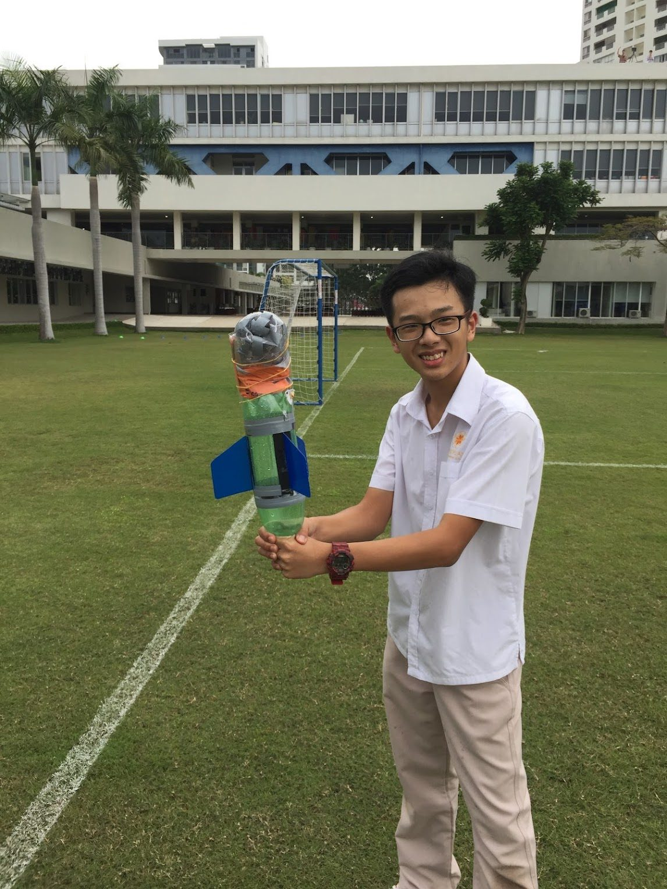
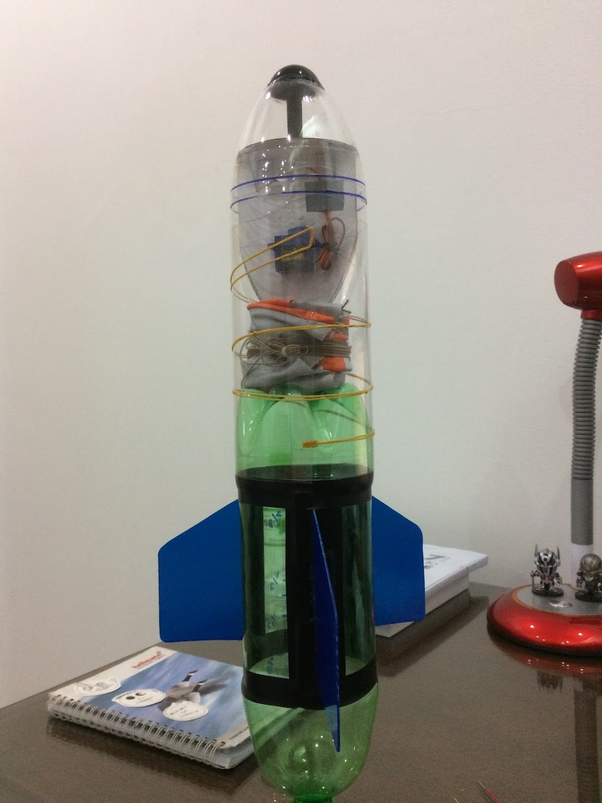
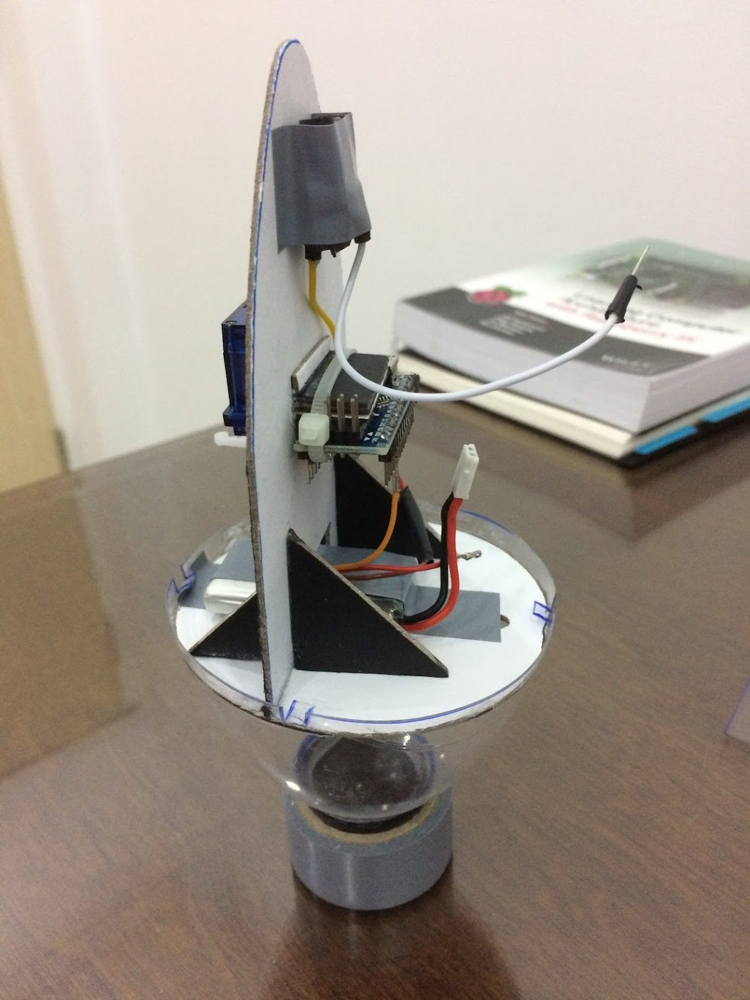
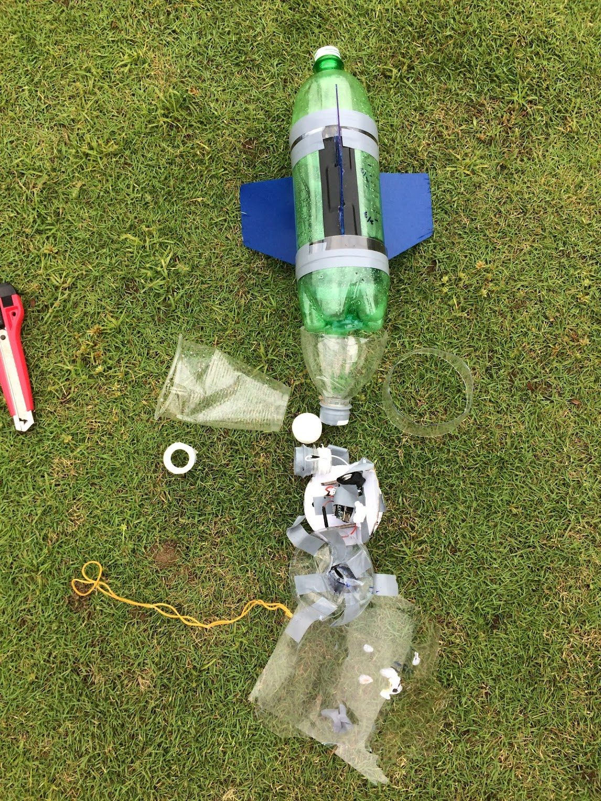
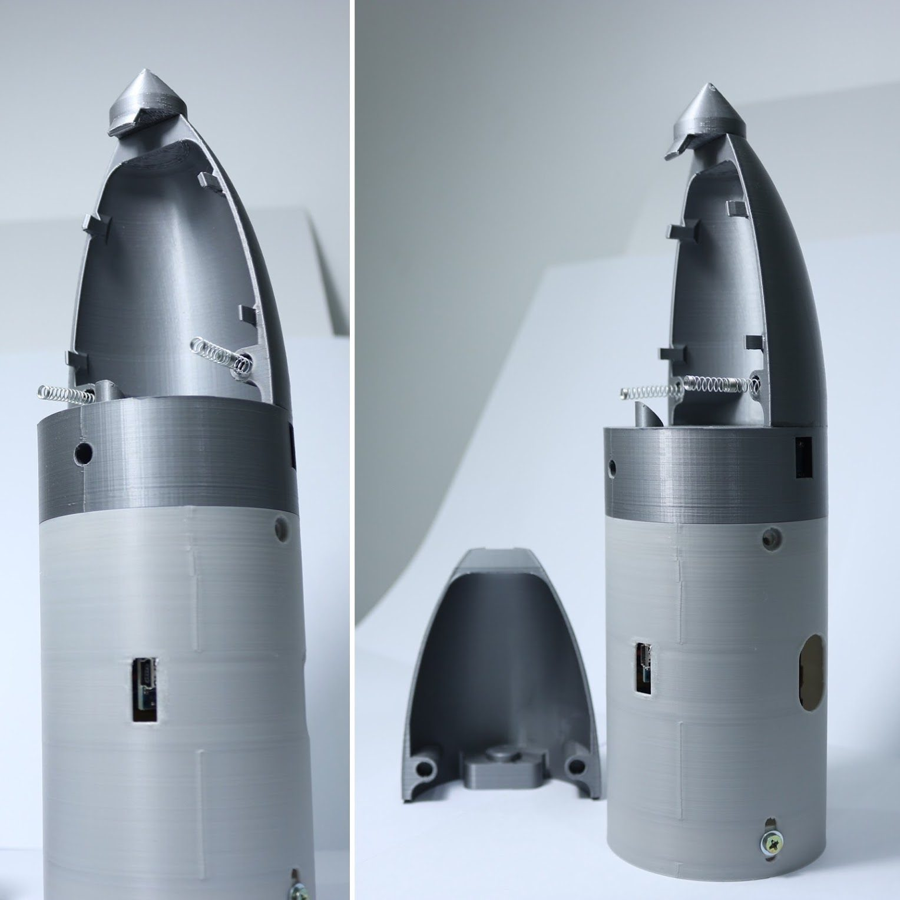
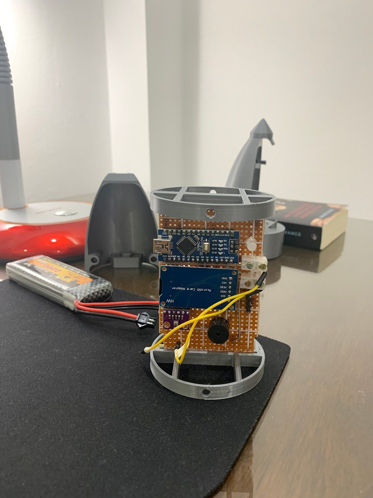
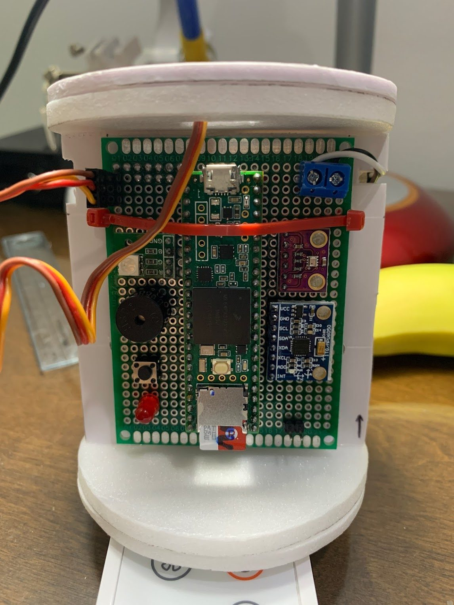

The other half of the flight computer project was designing the mechanism and the housing. The electronics have [their own page](../protoboard-avionics/index.html). This one is mostly pictures of the rocket.

## Science competition | Where it started

This was from a science competition. The servo timer in the first flight computer was built after this one's parachute failed.

## 2019 | A clear bottle body

The Gen 1 flight computer deployed the parachute, on the ground at least. The rocket wasn't airtight.

## 2020 | Printed nose cone

> The final goal is to build a reliable water rocket parachute deployment system.
> — "My Projects," July 2021
